<h1 align="center">
   Orca Lab
</h1>

  
  
  
  
  

  English · <a href="docs/readme/README.es.md">Español</a>

  <strong>Run a team of coding agents, each in its own worktree, on every machine you own, and see who needs you.</strong> 
  Orca Lab is Ab2Web's build of <a href="https://github.com/stablyai/orca">Orca</a>: a desktop IDE for agents, a phone companion, and a lead agent that runs one member per ticket across your machines.

<h3 align="center"><a href="https://github.com/ab2webco/orca-oss/releases/latest"><ins>Download Orca Lab</ins></a></h3>

  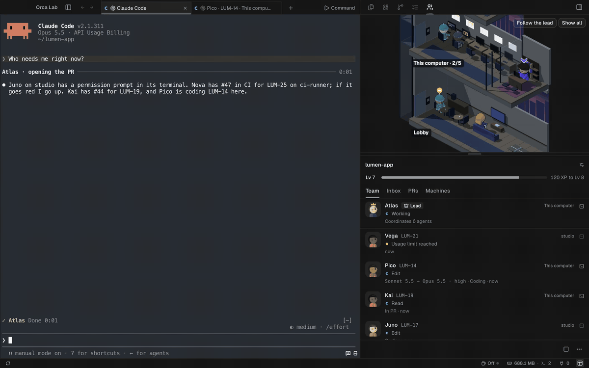

  <a href="#how-it-fits-together">How it fits together</a> ·
  <a href="#desktop">Desktop</a> ·
  <a href="#mobile">Mobile</a> ·
  <a href="#orca-game-a-team-lead-with-engineering-discipline">Orca Game</a> ·
  <a href="#run-members-on-every-machine-you-own">Multi-host</a> ·
  <a href="#install">Install</a>

## How it fits together

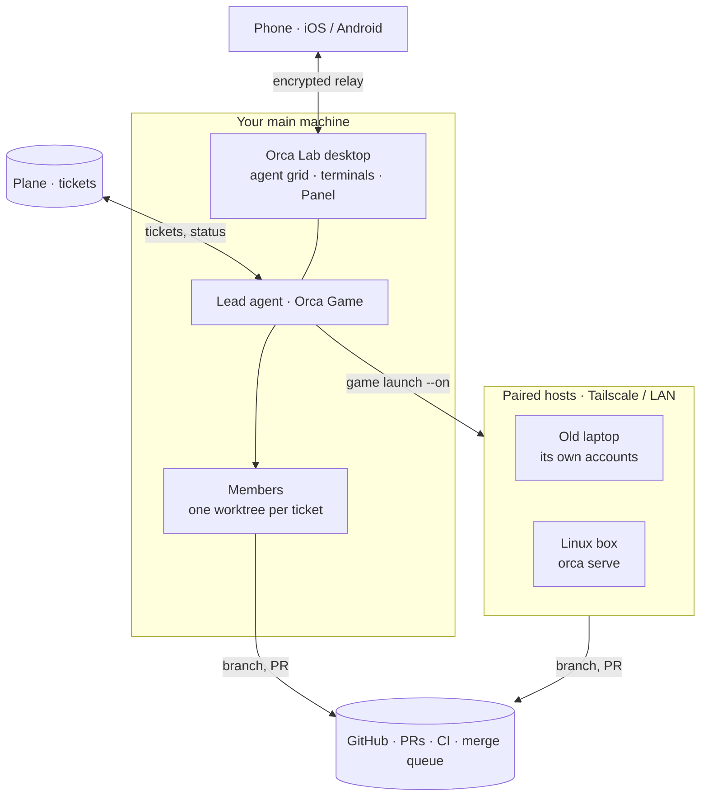

Plane holds the work, GitHub holds the code, and the lead turns one into the other through members that each own a ticket, a worktree and a branch, on this machine or a paired one. CI going green and PRs merging come back to the lead as XP. You watch and answer from the desktop or from your phone.

## Desktop

### See every agent at once

The agent grid puts every live agent of every project on one screen, grouped by what it needs from you: **Needs You**, **Working**, **Done** and **Idle**. Each cell is the agent's own terminal.

  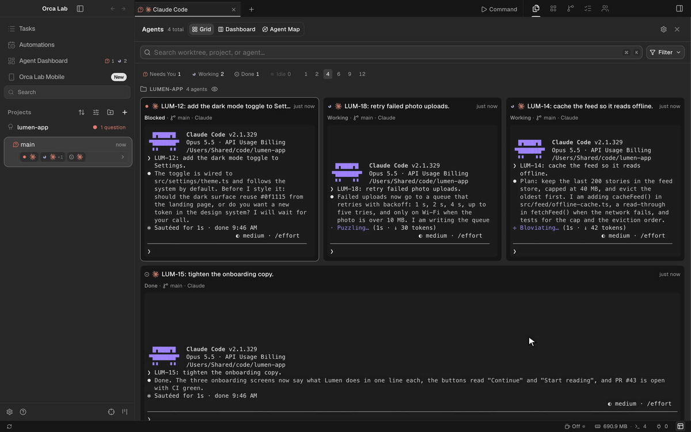

- **A sidebar for every host.** Each host lists its projects and workspaces, with a team's lead and members as agent rows. Group by status, PR or project, and filter out what you do not need. A workspace with one agent is a single row with what that agent is doing now, and its hover card leads with the agent's state, model, account, cache timer, PR and ticket. [Sidebar →](docs/user/model/sidebar.md)
- **One + menu for new tabs.** Terminals, the browser and every detected agent; in a project with a lead, **Go to lead**, **Add member…** from the To Do, or reopen the team. On a phone-width pane the tabs shrink to icons with a **+N** list. [New tabs →](docs/user/model/sidebar.md#the--menu)
- **One worktree per agent.** Every task gets its own git worktree, so agents never edit the same checkout; folders work as workspaces too. [Worktrees →](docs/user/model/worktrees.md)
- **Terminals that outlive the window.** Tabs and split panes run in a background daemon, so a restart reconnects them with their recent output. [Terminal →](docs/user/terminal.md)
- **SSH worktrees and headless hosts.** Run worktrees on a remote machine over SSH, or run the whole runtime without a window with `orca serve`. [SSH →](docs/user/ssh.md) · [Headless Linux →](docs/reference/headless-linux-server.md)
- **Windows and WSL.** Settings → Terminal → Windows Shell picks the default shell and whether projects run on Windows or in a WSL distro; terminals with no project follow it too. [Windows and WSL →](docs/user/terminal.md#windows-and-wsl)
- **Quick open, file explorer and viewers** for code, images and documents. [Quick open →](docs/user/model/quick-open.md) · [Files →](docs/user/editing/file-explorer.md) · [Viewers →](docs/user/editing/viewers.md)

### Switch Claude and Codex accounts without losing the session

Add several Claude and Codex accounts and pick the active one in Settings → AI Provider Accounts, or switch a running terminal with `orca account switch`: Claude relaunches in the same terminal and resumes the conversation. A worktree can be pinned to its own account, and usage and quota resets show next to each agent. To stop logins rotating across hosts, give an account a long-lived `claude setup-token` token per host (**Token** on its row, or `orca account token set`). [Usage tracking →](docs/user/agents/usage-tracking.md)

  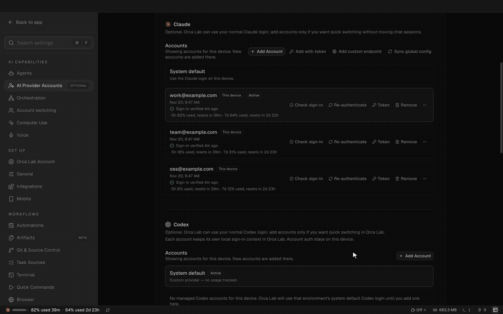

### Work from your Plane board

Connect a Plane workspace and its projects become a task source: a board with one column per state, or a list grouped by state, with priority and assignee on every work item. Agents read and move the same tickets with `orca plane`. Linear works as a task source as well. [Plane and Linear →](docs/user/review/linear.md)

  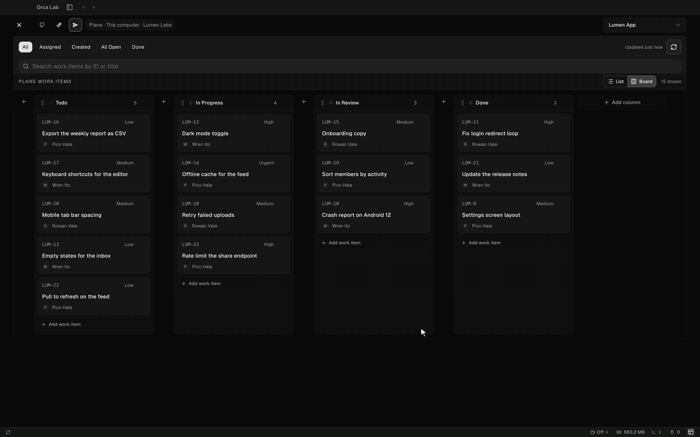

### Review what agents built

- **Annotate an AI diff.** Leave notes in the diff gutter and send them straight to the agent's terminal. [Annotate →](docs/user/review/annotate-ai-diff.md)
- **Built-in browser with design mode.** Preview the page an agent changed, pick an element, and send a question or change request with its selector, styles and HTML. [Design mode →](docs/user/browser/design-mode.md)

  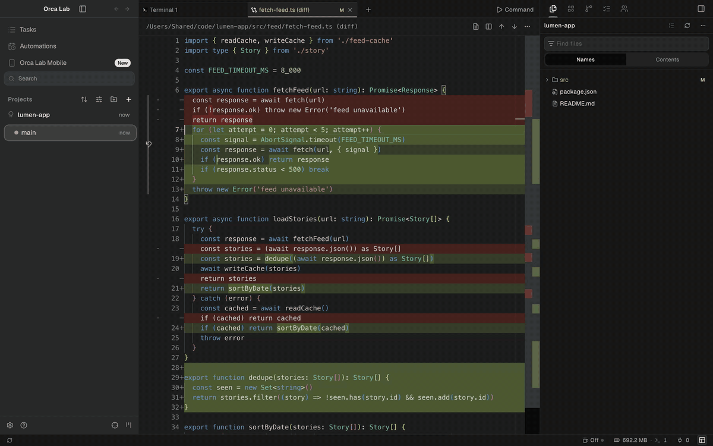

  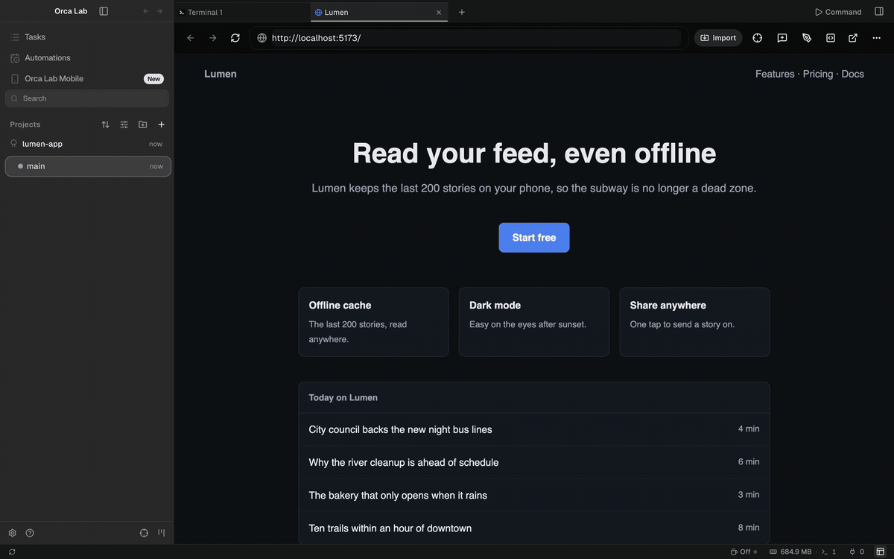

### Extend it with plugins

A plugin is a folder with an `orca-plugin.json`. Nothing runs until you review what it asks for; then its panel, settings and worker go live, sandboxed. [Orca Sonar](docs/reference/orca-sonar.md) is one: `orca sonar find` and `orca sonar symbol` give agents an index of the repo instead of grep. The [worklog example](examples/plugins/worklog) exercises the whole API. [Plugin development →](docs/reference/plugin-development.md)

  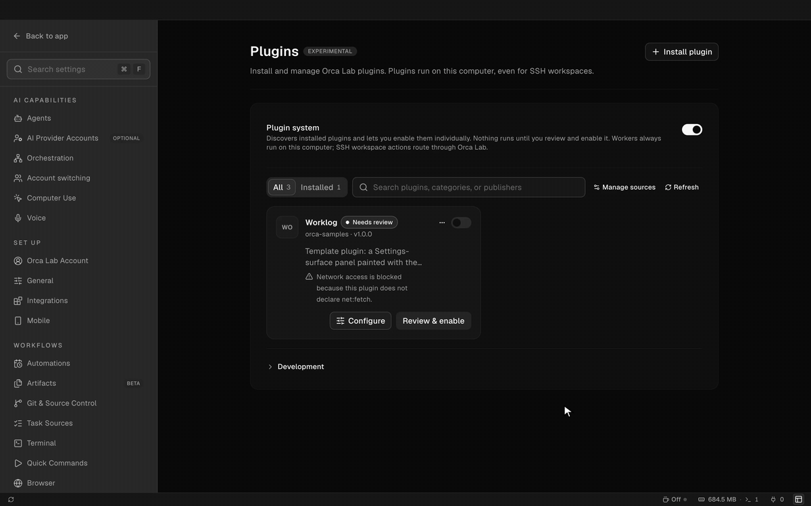

### Safety nets and automation

- **Crash reports** with the process that died, memory by process type and GPU/WebGL state, from a dialog you can review before sending.
- **Low-memory warning** that lists agent terminals first and says what opened it.
- **Automations** that run a scheduled prompt or command, on the Claude or Codex account the automation picks.
- **The `orca` CLI** drives all of it, so agents can too: worktrees, terminals, accounts, Plane, the team and more. Every `orca game` command is listed there. [CLI →](docs/user/cli/overview.md)

## Mobile

The Orca Lab app (0.0.62) pairs with your desktop and puts your agents in your pocket. Pair once from Desktop → Settings → Mobile by scanning a QR code; the phone then reaches the desktop directly or through an end-to-end encrypted relay. [Mobile →](docs/user/mobile.md)

- **Every desktop at a glance.** Each desktop's card shows its team (members, how many are working, who needs you) and the active Claude account's 5-hour use, and keeps the last known team when the desktop drops.
- **Accounts per desktop.** Pick a paired desktop, see each Claude and Codex account's 5-hour and 7-day use and who runs on it, and switch accounts.
- **Live terminals.** Watch any agent's terminal stream and type into it.
- **Owner-question Inbox.** When a lead needs a decision only you can make, the question lands in the phone's Inbox with a notification. Answer it there, and the answer goes back to the lead.
- **Notification tap routing.** A tap opens the right host and screen; a lead's question opens the lead's terminal with the Team drawer.
- **Team drawer over the lead's terminal.** A **Team** tab with a card per member (ticket, host, state, account use, PR and CI) and the team's metrics, an **Inbox** tab for the lead's questions, **PRs** with the merge queue, and **Hosts**: the Machines board, with a summary strip and each host's CPU, memory and disk.
- **Plane board and plugin panels** from the phone, and a button that asks the desktop to install its pending update.

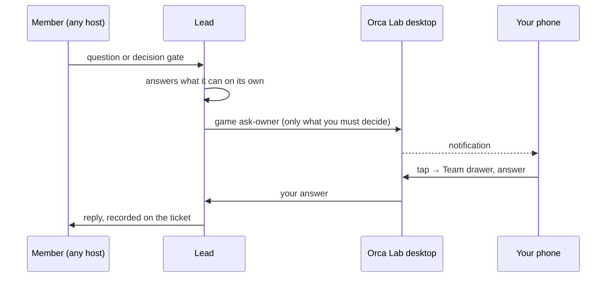

Builds: iOS ships through TestFlight; Android APKs are attached to the [`mobile-android-v*` releases](https://github.com/ab2webco/orca-oss/releases?q=mobile-android).

## Orca Game: a team lead with engineering discipline

Orca Game turns a Claude Code session into the **lead** of a team. The lead does not write the code itself: it launches one **member** per ticket, each in its own worktree and branch, waits for their reports, answers their questions, and asks you only what only you can decide.

It looks like a game, a **Team** panel in the right sidebar with a scene, levels and XP, because watching ten agents in ten terminals is hard. The rules underneath are the ones a good engineering team already keeps. [Agent Teams guide →](docs/user/agents/agent-teams.md)

The idea of running a Claude Code team as a game came from [Jucer Orozco](https://github.com/Jucerweb).

**What keeps it serious**

- **XP only from verified signals.** A member earns nothing for saying it is done. XP comes from CI turning green, the ticket reaching review or Done, and the PR merging. [The lead's XP →](docs/reference/orchestrator-game.md#the-leads-xp)

  | Signal                  | XP  |
  | ----------------------- | --- |
  | Member claims a ticket  | 10  |
  | Its PR's CI turns green | 20  |
  | Ticket moves to review  | 50  |
  | Ticket reaches Done     | 70  |
  | PR merges               | 100 |
  | Merged PR is perfect    | 100 |

- **One agent per ticket, the tracker is the source of truth.** Members are launched from the Plane (or other tracker) To Do, `game wave` fills the free slots in board order, and a ticket a member already holds is skipped.
- **Your rules, not just Orca's.** Orca's standing rules come first; a project appends its own in `orca.yaml` (`orchestrator.rules`): strict TDD, conventional commits, merging only through the merge queue, whatever your team enforces.
- **Typed reports.** A member finishes with a `worker_done` envelope that states each claim it verified and how: live, unit tests only, or not at all. The runtime rejects a malformed report, and a success cannot rest on an unverified claim.
- **Finish before starting.** The lead drives each member to a merge before it launches another ticket, then removes the merged worktree and branch, so half-done work does not pile up.
- **Questions go somewhere real.** Members ask the lead, or stop on a decision gate; the lead answers what it can and records the answer on the ticket. What only you can decide (releases, spending, hard-to-reverse actions, product direction) becomes an owner question with options, kept in an Inbox on desktop and phone, never buried in chat. When the lead relays your answer, the member checks it with `orca game owner-question <id>` instead of asking you again.
- **The Team panel shows the truth.** One card per member with its ticket, branch, PR, CI, phase and account use; click it to open the member's terminal. **Inbox** holds the questions for you, **PRs** your open PRs and the merge queue, **Machines** each host's free memory and agents. A member reads its PR's CI and GitHub's merge state from `orca game state` (`review.ci`, `review.mergeState`), and only a `clean` PR can merge.
- **Members you can follow.** Each member is one character for its whole run, on its card, its terminal and the history. `orca game history` lists the freed members with outcome, PR and character; their outcomes become short project lessons that new members get in their brief, and `orca game adopt-history` carries both over when a repo is added again.
- **Recovery is built in.** `game resume-members` brings back members a restart paused; `game adopt` takes an agent the fleet found running into the team, `game drop` lets one go without stopping it; `game lead --fresh` rotates to a new lead when the old conversation is too long.

A wave fills the free slots from the To Do, one member per ticket, and each verified signal pays the team on the spot: Kai's PR goes green, merges, and the team reaches Lv 8:

  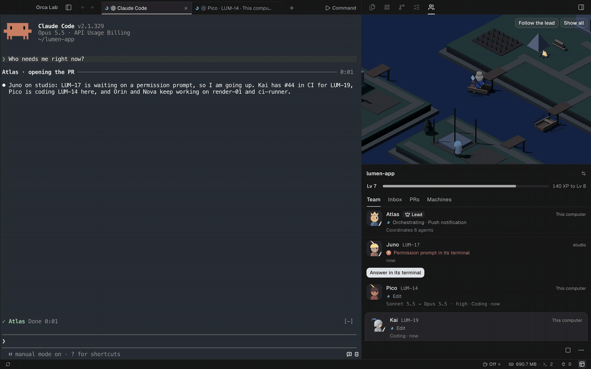

A question only you can answer lands in Orca's Inbox, and your answer goes back to the lead:

  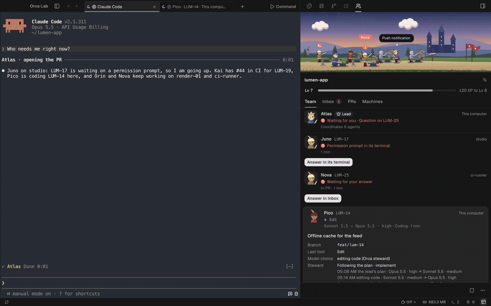

The PRs tab keeps the team's open PRs and the merge queue:

  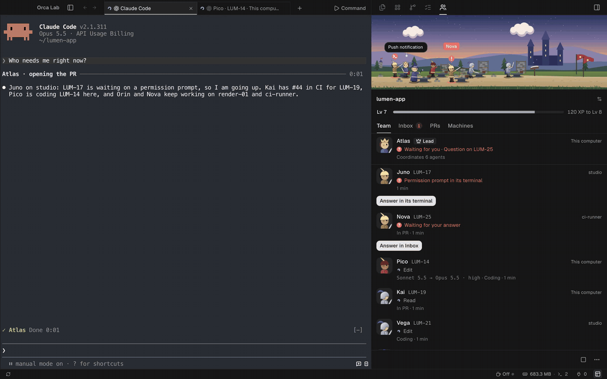

Settings → Agents → Panel picks how the panel looks: **Game** (a scene with levels and XP), **Display** (a carousel of team metrics) or **Plain**. The scene comes in three styles that act out the real state of the work: **Pixel** (a garden, a floor per machine), **Figures** (a 3D island per machine: each member builds its house, the lead walks the roads and rows between islands, and Jev watches from its tower) and **Office** (a 3D building with one floor per machine: developers at their desks, the lead's own office and a glass lift, and each machine's Jev in its control room). In Figures the camera follows the lead. **Scene quality** sets both 3D scenes: Illustrated draws them in 3D, Low resources draws flat figures and the Office in 2D. **Lead's pace** (Normal, Fast or Direct) sets how the lead gets around in either. A project can change any of it in its own settings or in `orca.yaml`, a scene themes Pixel while Figures and Office keep Orca's own art, and Settings previews the chosen style. Settings → Appearance → Status colors sets one color per state for light and dark. The older pixel band inside the lead's pane is off by default; **Show the band** in Settings → Agents → Agent Teams game turns it on with its **Default view** (Off, Flat, Zen, 2D classic, 2D hd). [Agent Teams guide →](docs/user/agents/agent-teams.md) · [Orca Game reference →](docs/reference/orchestrator-game.md)

  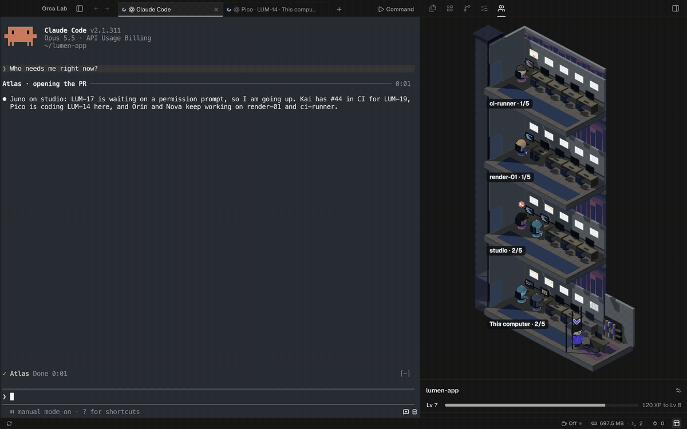
  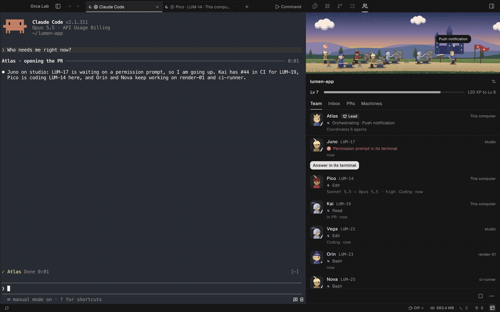
  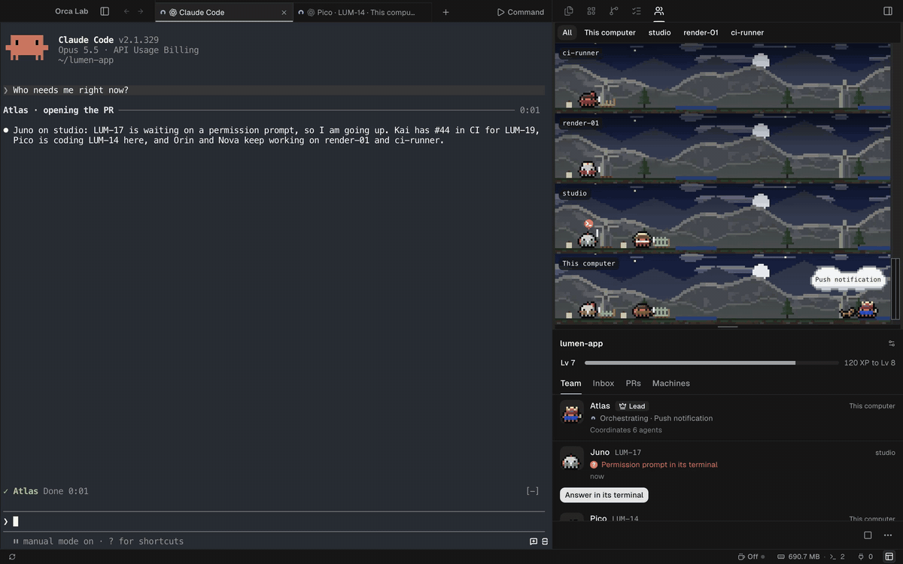

## Run members on every machine you own

A member does not have to run on the machine you are sitting at. Every Orca you pair becomes a host the lead can place members on, with `orca game launch <ticket> --on <host>`.

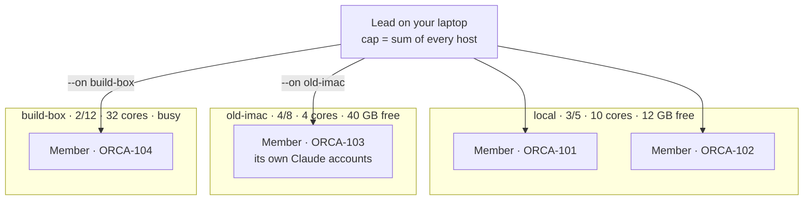

- **Pairing.** Any machine running Orca Lab, the desktop app or `orca serve` on a headless Linux box, prints a pairing link; `orca environment add` saves it on the lead's machine. A Tailscale address keeps it private. [Headless server →](docs/reference/headless-linux-server.md)
- **Caps that add up.** Each host's member cap comes from its own memory and cores, and the lead's cap is the sum over every reachable host. A host's cap counts the members every project's lead started there, so two leads cannot each fill one machine; `game fleet` shows the split per project. A launch past a host's cap is refused and names a host with room.
- **No launch on a struggling host.** `game launch` refuses a host that is busy or low on memory and prints its reading; the lead's own machine refuses at three quarters of its cores, to keep room for its leads. `--past-busy "<why>"` launches anyway and prints why.
- **Every host in plain sight.** `game fleet`, `game state` and the Panel show each host's members against its cap, cores, free memory and load, flagged `low memory` or `busy`.
- **Each host uses its own accounts.** A remote member picks a Claude or Codex account from that host's roster, so adding a machine adds quota, not only CPU.
- **One fleet, both ways.** Remote members appear in the lead's Panel with their ticket, PR and CI, report back with the same typed messages, and open their terminal from the Panel through the paired host.
- **Survives restarts.** When a host restarts, `game resume-members` wakes the members it put to sleep, and the Panel card offers Resume and Reconnect.

**Why it matters:** the laptop you stopped using can run two members tonight. A strong workstation can take the heavy tickets and shorten the queue. And your main machine stays responsive while the work runs somewhere else. [Fleet and hosts →](docs/reference/orchestrator-game.md#the-project-lead-orchestratorgameorchestrator)

  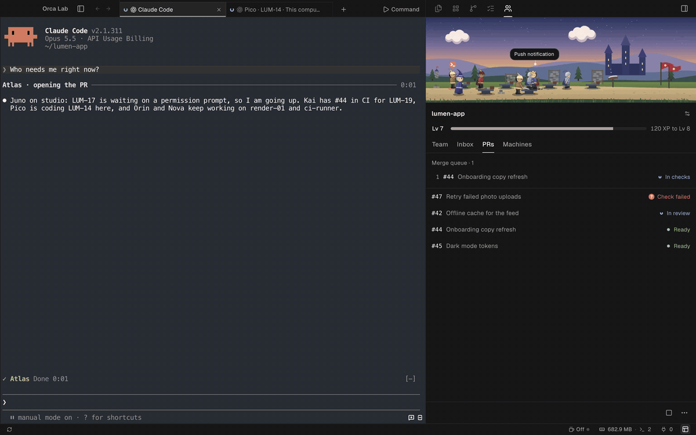

## Under the hood

<picture>
  <source media="(prefers-color-scheme: dark)" srcset="docs/assets/readme/architecture-dark.svg" />
  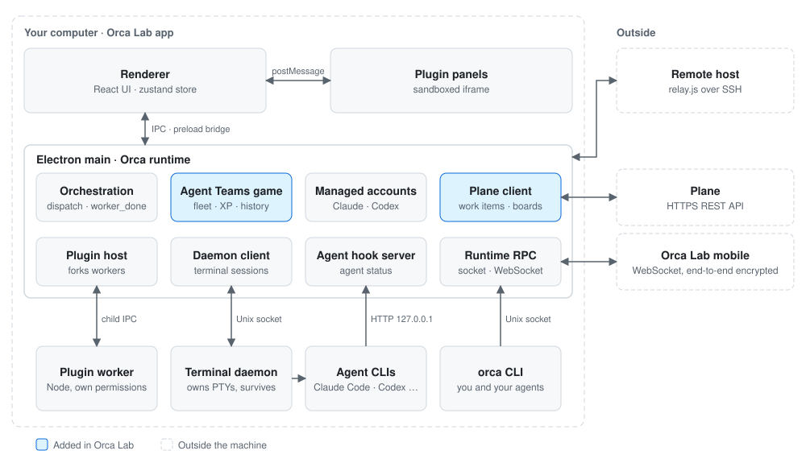
</picture>

The window is an Electron main process plus a React renderer. Terminals live in a separate daemon that outlives the app process, agents report their state to a hook server on `127.0.0.1`, and the `orca` CLI and the phone reach the same runtime over RPC. Blue boxes exist only in Orca Lab.

People, accounts, projects and tickets in the recordings are invented demo data on example.com. The scenes were recorded from the real build by E2E specs under `tests/e2e/*-showcase.spec.ts`.

## Install

- **[Download the latest release](https://github.com/ab2webco/orca-oss/releases/latest)**
- Or pick a build: [macOS Apple Silicon](https://github.com/ab2webco/orca-oss/releases/latest/download/orca-macos-arm64.dmg) · [macOS Intel](https://github.com/ab2webco/orca-oss/releases/latest/download/orca-macos-x64.dmg) · [Windows (.exe)](https://github.com/ab2webco/orca-oss/releases/latest/download/orca-windows-setup.exe) · [Linux AppImage](https://github.com/ab2webco/orca-oss/releases/latest/download/orca-linux.AppImage)
- Running `orca serve` on a headless Linux server? See the [headless Linux server guide](docs/reference/headless-linux-server.md).

## Docs

User guides live in [`docs/user`](docs/user/README.md): [CLI](docs/user/cli/overview.md), [SSH worktrees](docs/user/ssh.md), [usage tracking](docs/user/agents/usage-tracking.md), [supported agents](docs/user/agents/supported.md) and [telemetry](docs/user/telemetry.md). The [release notes](https://github.com/ab2webco/orca-oss/releases) list every change.

## Developing

See [CONTRIBUTING.md](.github/CONTRIBUTING.md). Rendered UI checks run through the E2E harness: [`docs/reference/rendered-ui-checks.md`](docs/reference/rendered-ui-checks.md).

## License

Orca Lab is free and open source under the [MIT License](LICENSE). It builds on [Orca](https://github.com/stablyai/orca) by stablyai.
