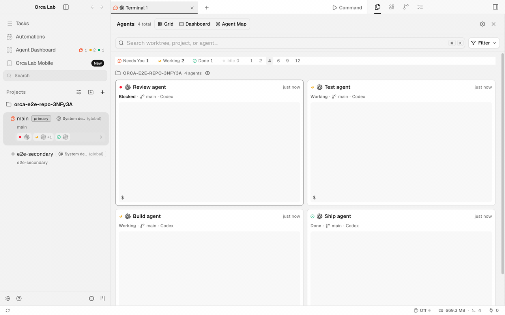
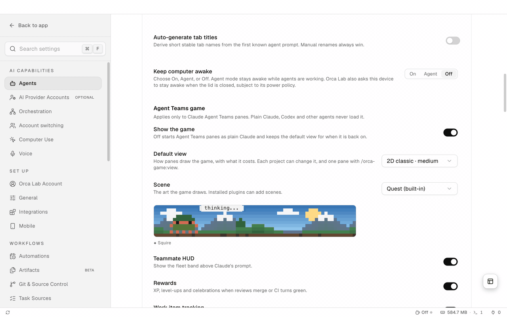
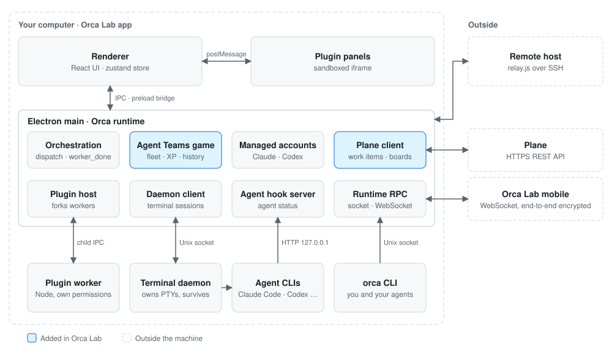

<h1 align="center">
   Orca Lab
</h1>

  
  
  
  

  <a href="../../README.md">English</a> · Español

  <strong>Ejecuta un equipo de agentes de código, cada uno en su propio worktree, y ve quién te necesita.</strong> 
  Orca Lab es la versión de Ab2Web de <a href="https://github.com/stablyai/orca">Orca</a>, con cuentas por worktree, un juego de equipos de agentes, tareas de Plane y una app móvil.

<h3 align="center"><a href="https://github.com/ab2webco/orca-oss/releases/latest"><ins>Descargar Orca Lab</ins></a></h3>

  

## Ve a todos los agentes a la vez

La cuadrícula de agentes reúne en una pantalla a todos los agentes activos de todos los proyectos, agrupados por lo que necesitan de ti: **Needs You**, **Working**, **Done** e **Idle**. Pulsa un grupo para ver solo sus agentes y vuelve a pulsarlo para ver todos. Cada celda muestra la terminal del propio agente.

[Worktrees →](../user/model/worktrees.md) · [Terminal →](../user/terminal.md)

## Juega con el equipo, o apaga el juego

Los paneles de Claude Agent Teams pueden dibujar la flota como un pequeño juego: un líder, miembros como personajes y XP por el trabajo verificado. En Settings → Agents eliges cómo se ve, y cuánto cuesta a tu equipo, entre cinco vistas: **Off**, **Flat** (texto plano, sin escena), **Zen**, **2D classic** y **2D hd**. Cada proyecto puede cambiar la vista por defecto, y un panel puede cambiarla con `/orca-game:view`.

  

## Cómo encaja todo

<picture>
  <source media="(prefers-color-scheme: dark)" srcset="../assets/readme/architecture-dark.svg" />
  
</picture>

La ventana es un proceso principal de Electron más un renderer de React. Las terminales viven en un daemon aparte que sobrevive al proceso de la app, los agentes reportan su estado a un servidor de hooks en `127.0.0.1`, y el CLI `orca` y el teléfono llegan al mismo runtime por RPC. Las cajas azules existen solo en Orca Lab.

## Lo que añade Orca Lab

Todo lo siguiente está en el historial del producto desde el fork de Orca (1.273 commits, 249 de ellos funcionalidades). Las dos escenas de arriba se grabaron desde la app real; el resto sale del registro de commits y de las notas de versión, y aún no tiene grabación.

- **Cuentas por worktree.** Fija una cuenta de Claude o Codex a un worktree, conmuta cuando se acaba la cuota, cambia la cuenta de una terminal en marcha con `orca account switch` y usa endpoints personalizados.
- **Orquestación más robusta.** Reportes `worker_done` tipados, un watchdog de despachos, recuperación tras reinicios y miembros en pausa que retoman donde quedaron.
- **Plane como fuente de tareas.** Tableros, columnas, vínculo con worktrees, comentarios y ciclos desde la app y desde `orca plane`.
- **App móvil.** Empareja un teléfono, recorre el tablero de Plane, abre paneles de plugins y pide una actualización de escritorio desde el teléfono.
- **Plugins.** Paneles, skills, ajustes y consentimiento para plugins, con un ejemplo de worklog en [`examples/plugins`](../../examples/plugins).
- **Barra de estado y uso de los agentes.** Reinicio de cuota, tendencia de contexto y uso por proyecto junto a cada agente.
- **Automatizaciones con cuenta.** Ejecuta prompts programados con la cuenta de Claude o Codex que elija cada automatización.
- **Redes de seguridad.** Un aviso de poca memoria que lista primero las terminales de agentes y dice qué lo abrió, y el rechazo a eliminar el worktree de un miembro del juego mientras tenga commits sin subir.
- **Orca CLI.** `orca events`, `orca game metrics`, `orca plane` y más, para que los agentes manejen la app.

Las [notas de versión](https://github.com/ab2webco/orca-oss/releases) son la lista completa de funcionalidades.

## Instalación

- **[Descarga la última versión](https://github.com/ab2webco/orca-oss/releases/latest)**
- O elige un instalador: [macOS Apple Silicon](https://github.com/ab2webco/orca-oss/releases/latest/download/orca-macos-arm64.dmg) · [macOS Intel](https://github.com/ab2webco/orca-oss/releases/latest/download/orca-macos-x64.dmg) · [Windows (.exe)](https://github.com/ab2webco/orca-oss/releases/latest/download/orca-windows-setup.exe) · [Linux AppImage](https://github.com/ab2webco/orca-oss/releases/latest/download/orca-linux.AppImage)
- ¿Ejecutas `orca serve` en un servidor Linux sin pantalla? Consulta la [guía de servidor Linux headless](../reference/headless-linux-server.md).

## Documentación

Las guías de usuario están en [`docs/user`](../user/README.md): [CLI](../user/cli/overview.md), [worktrees por SSH](../user/ssh.md), [seguimiento de uso](../user/agents/usage-tracking.md), [agentes compatibles](../user/agents/supported.md) y [telemetría](../user/telemetry.md).

## Desarrollo

Consulta [CONTRIBUTING.md](../../.github/CONTRIBUTING.md). Las comprobaciones de UI renderizada usan el harness E2E: [`docs/reference/rendered-ui-checks.md`](../reference/rendered-ui-checks.md).

## Licencia

Orca Lab es software libre y de código abierto bajo la [Licencia MIT](../../LICENSE). Se basa en [Orca](https://github.com/stablyai/orca) de stablyai.
