<h1 align="center">
   Orca Lab
</h1>

  
  
  
  
  

  <a href="../../README.md">English</a> · Español

  <strong>Ejecuta un equipo de agentes de código, cada uno en su propio worktree y en todas tus máquinas, y ve quién te necesita.</strong> 
  Orca Lab es la versión de Ab2Web de <a href="https://github.com/stablyai/orca">Orca</a>: un IDE de escritorio para agentes, una app móvil y un agente líder que lleva un miembro por ticket repartido entre tus máquinas.

<h3 align="center"><a href="https://github.com/ab2webco/orca-oss/releases/latest"><ins>Descargar Orca Lab</ins></a></h3>

  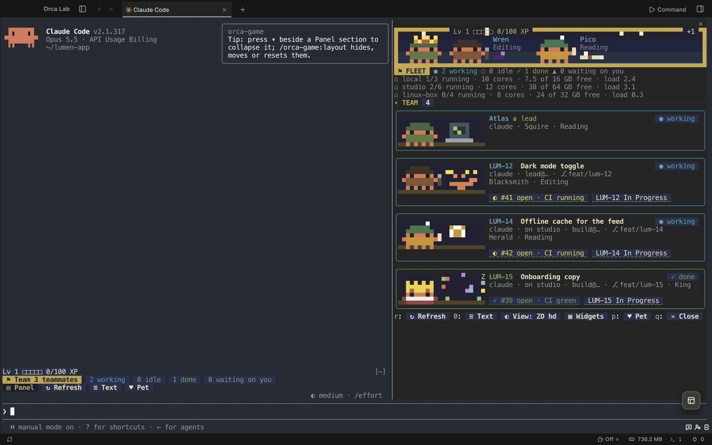

  <a href="#cómo-encaja-todo">Cómo encaja todo</a> ·
  <a href="#escritorio">Escritorio</a> ·
  <a href="#móvil">Móvil</a> ·
  <a href="#orca-game-un-líder-de-equipo-con-disciplina-de-ingeniería">Orca Game</a> ·
  <a href="#ejecuta-miembros-en-todas-tus-máquinas">Varios hosts</a> ·
  <a href="#instalación">Instalación</a>

## Cómo encaja todo

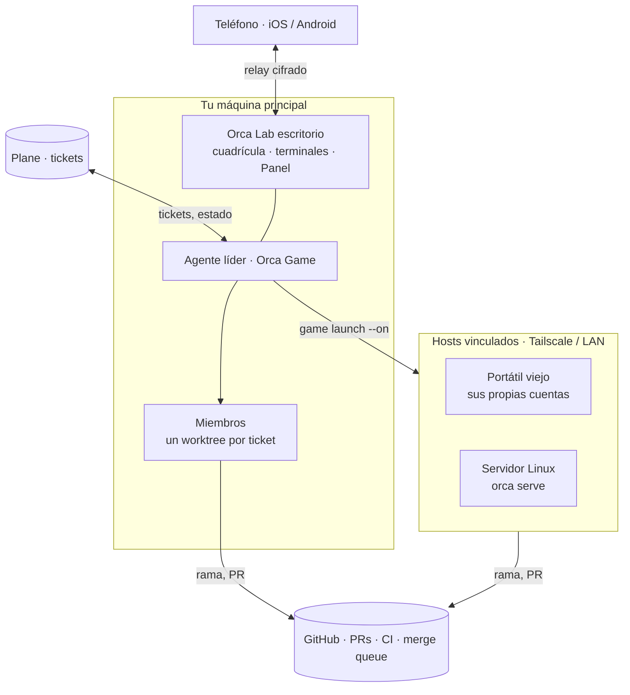

Plane guarda el trabajo, GitHub guarda el código, y el líder convierte uno en el otro mediante miembros que tienen cada uno un ticket, un worktree y una rama, en esta máquina o en una vinculada. El CI en verde y los PR mergeados vuelven al líder como XP. Tú miras y respondes desde el escritorio o desde el teléfono.

## Escritorio

### Ve a todos los agentes a la vez

La cuadrícula de agentes reúne en una pantalla a todos los agentes activos de todos los proyectos, agrupados por lo que necesitan de ti: **Needs You**, **Working**, **Done** e **Idle**. Cada celda es la terminal del propio agente.

  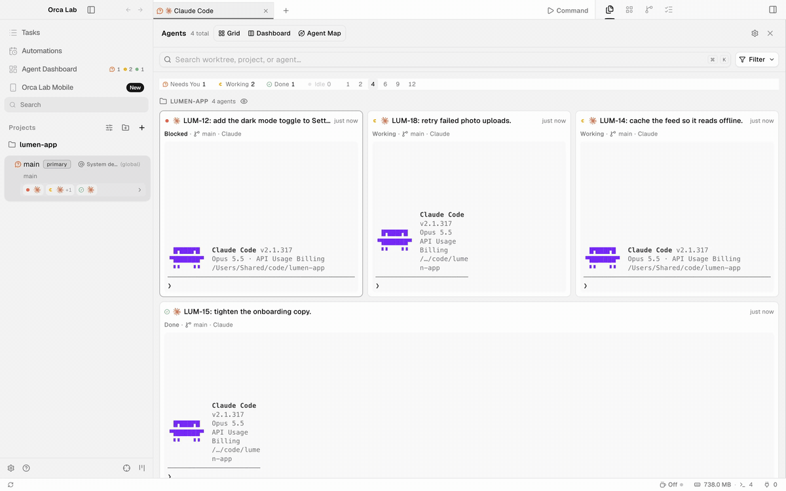

- **Un worktree por agente.** Cada tarea tiene su propio worktree de git, así que los agentes nunca editan la misma copia; las carpetas también sirven como espacios de trabajo. [Worktrees →](../user/model/worktrees.md)
- **Terminales que sobreviven a la ventana.** Las pestañas y los paneles divididos corren en un proceso en segundo plano, así que tras reiniciar se reconectan con su salida reciente. [Terminal →](../user/terminal.md)
- **Worktrees por SSH y hosts sin pantalla.** Ejecuta worktrees en una máquina remota por SSH, o todo el runtime sin ventana con `orca serve`. [SSH →](../user/ssh.md) · [Linux sin pantalla →](../reference/headless-linux-server.md)
- **Apertura rápida, explorador de archivos y visores** para código, imágenes y documentos. [Apertura rápida →](../user/model/quick-open.md) · [Archivos →](../user/editing/file-explorer.md) · [Visores →](../user/editing/viewers.md)

### Cambia de cuenta de Claude y Codex sin perder la sesión

Agrega varias cuentas de Claude y Codex y elige la activa en Settings → AI Provider Accounts, o cambia la de una terminal en marcha con `orca account switch`: Claude se relanza en la misma terminal y retoma la conversación. Un worktree puede quedar fijado a su propia cuenta, y el uso y el reinicio de cuota aparecen junto a cada agente. [Seguimiento de uso →](../user/agents/usage-tracking.md)

  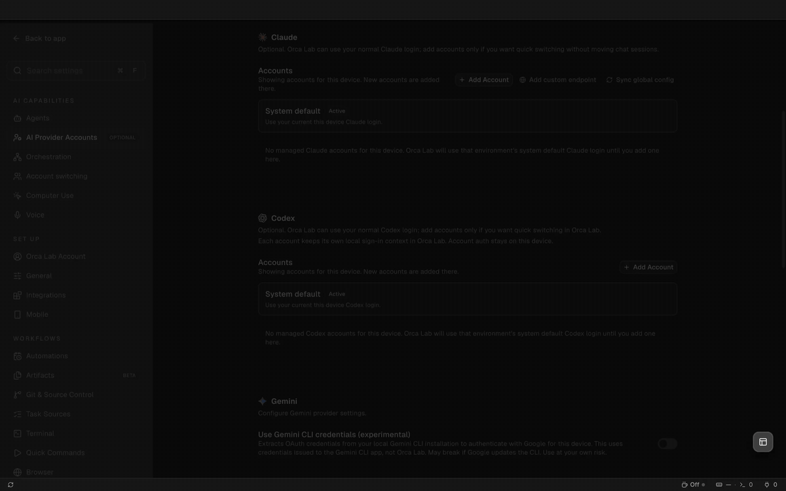

### Trabaja desde tu tablero de Plane

Conecta un espacio de trabajo de Plane y sus proyectos se convierten en fuente de tareas: un tablero con una columna por estado, o una lista agrupada por estado, con prioridad y responsable en cada elemento. Los agentes leen y mueven los mismos tickets con `orca plane`. Linear también sirve como fuente de tareas. [Plane y Linear →](../user/review/linear.md)

  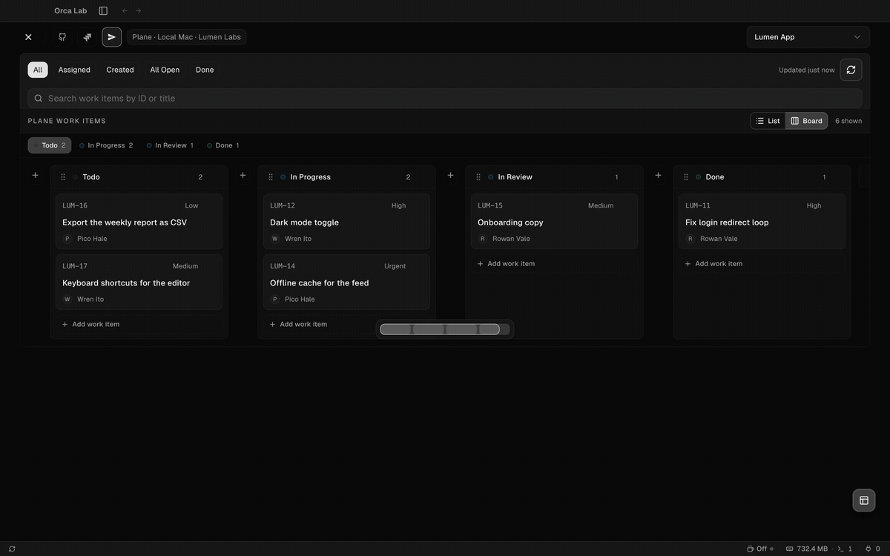

### Revisa lo que construyeron los agentes

- **Anota un diff hecho por IA.** Deja notas en el margen del diff y envíalas directo a la terminal del agente. [Anotar →](../user/review/annotate-ai-diff.md)
- **Navegador integrado con modo diseño.** Previsualiza la página que cambió un agente, elige un elemento y envía una pregunta o un cambio con su selector, estilos y HTML. [Modo diseño →](../user/browser/design-mode.md)

  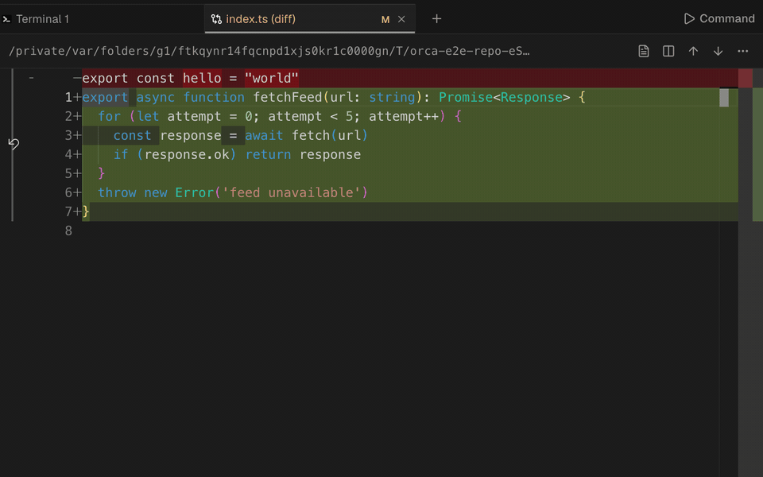

  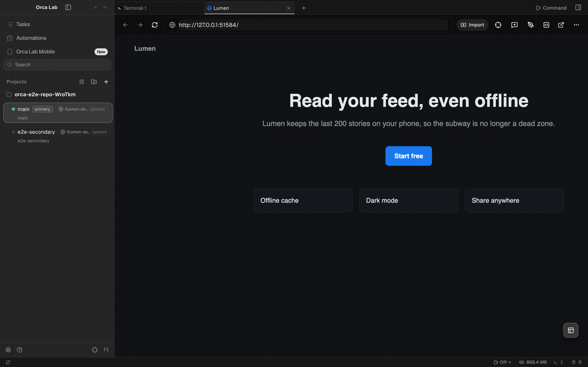

### Extiéndelo con plugins

Un plugin es una carpeta con un `orca-plugin.json`. Nada se ejecuta hasta que revisas lo que pide; entonces su panel, sus ajustes y su worker se activan, aislados. [Orca Sonar](../reference/orca-sonar.md) es uno: `orca sonar find` y `orca sonar symbol` dan a los agentes un índice del repo en lugar de grep. El [ejemplo worklog](../../examples/plugins/worklog) recorre toda la API. [Desarrollo de plugins →](../reference/plugin-development.md)

  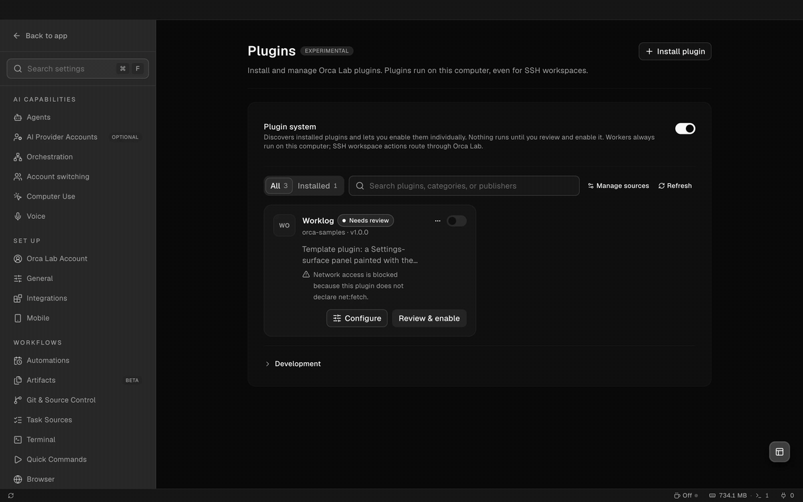

### Redes de seguridad y automatización

- **Informes de fallos** con el proceso que murió, la memoria por tipo de proceso y el estado de GPU/WebGL, desde un diálogo que puedes revisar antes de enviar.
- **Aviso de memoria baja** que lista primero las terminales de agentes y dice qué lo abrió.
- **Automatizaciones** que ejecutan un prompt o un comando programado, con la cuenta de Claude o Codex que elija la automatización.
- **La CLI `orca`** controla todo esto, así que los agentes también pueden: worktrees, terminales, cuentas, Plane, el juego y más. [CLI →](../user/cli/overview.md)

## Móvil

La app Orca Lab se vincula con tu escritorio y te pone a los agentes en el bolsillo. Vincúlala una vez desde Desktop → Settings → Mobile escaneando un código QR; después el teléfono llega al escritorio directo o por un relay cifrado de extremo a extremo. [App móvil →](../../mobile/README.md)

- **Terminales en vivo.** Mira la terminal de cualquier agente en tiempo real y escribe en ella.
- **Bandeja de preguntas para ti.** Cuando un líder necesita una decisión que solo tú puedes tomar, la pregunta llega a la bandeja del teléfono con una notificación. Respóndela ahí y la respuesta vuelve al líder.
- **Toques que llevan al lugar correcto.** Un toque abre el host y la pantalla que corresponden; una pregunta del líder abre su terminal con el cajón del equipo.
- **Cajón del equipo sobre la terminal del líder.** Preguntas abiertas, una tarjeta por miembro con su ticket, estado, PR y CI, y las métricas del equipo: merges por día y lead time mediano.
- **Tablero de Plane y paneles de plugins** desde el teléfono, y un botón que pide al escritorio instalar su actualización pendiente.

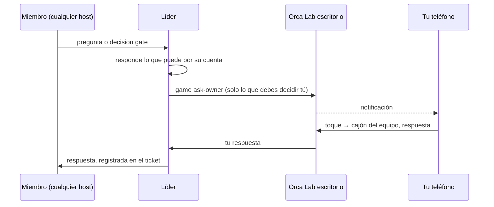

Builds: iOS se distribuye por TestFlight; los APK de Android van adjuntos a las [versiones `mobile-android-v*`](https://github.com/ab2webco/orca-oss/releases?q=mobile-android).

## Orca Game: un líder de equipo con disciplina de ingeniería

Orca Game convierte una sesión de Claude Code en el **líder** de un equipo. El líder no escribe el código: lanza un **miembro** por ticket, cada uno en su propio worktree y su propia rama, espera sus reportes, responde sus preguntas y te pregunta solo lo que únicamente tú puedes decidir.

Parece un juego, con un grupo en pixel art bajo el prompt del líder, XP y subidas de nivel, porque seguir a diez agentes en diez terminales es difícil. Las reglas de fondo son las que ya sigue un buen equipo de ingeniería.

La idea de dirigir un equipo de Claude Code como un juego viene de [Jucer Orozco](https://github.com/Jucerweb).

  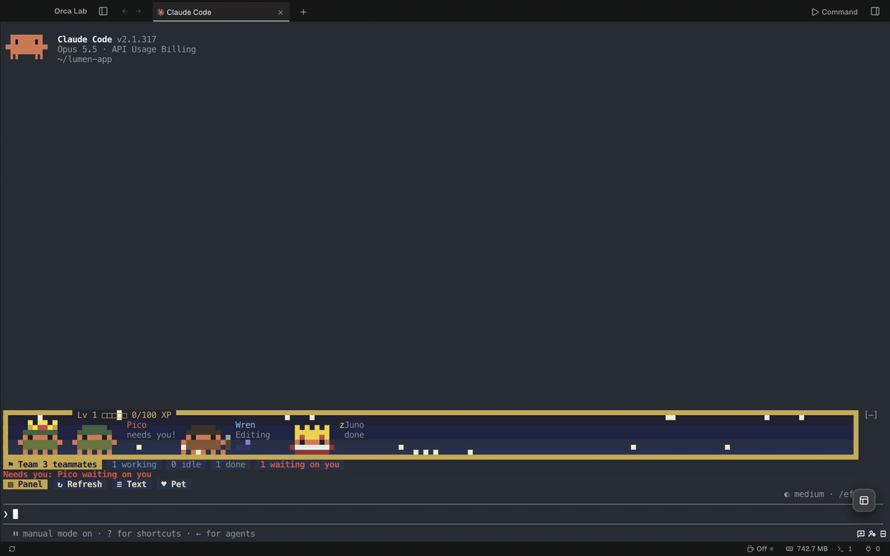

**Lo que lo hace serio**

- **XP solo por señales verificadas.** Un miembro no gana nada por decir que terminó. La XP sale del CI en verde, del ticket que llega a revisión o a Done y del PR mergeado. [La XP del líder →](../reference/orchestrator-game.md#the-leads-xp)

  | Señal                         | XP  |
  | ----------------------------- | --- |
  | Un miembro toma un ticket     | 10  |
  | El CI de su PR queda en verde | 20  |
  | El ticket pasa a revisión     | 50  |
  | El ticket llega a Done        | 70  |
  | El PR se mergea               | 100 |
  | El PR mergeado es perfecto    | 100 |

- **Un agente por ticket; el tracker es la fuente de verdad.** Los miembros se lanzan desde el To Do de Plane (u otro tracker), `game wave` llena los cupos libres en el orden del tablero y se salta un ticket que ya tiene un miembro.
- **Tus reglas, no solo las de Orca.** Las reglas fijas de Orca van primero; un proyecto agrega las suyas en `orca.yaml` (`orchestrator.rules`): TDD estricto, conventional commits, merge solo por la merge queue, lo que tu equipo exija.
- **Reportes tipados.** Un miembro termina con un sobre `worker_done` que declara cada verificación y cómo la hizo: en vivo, solo con tests unitarios o sin verificar. El runtime rechaza un reporte mal formado, y un éxito no puede apoyarse en una afirmación sin verificar.
- **Terminar antes de empezar.** El líder lleva cada miembro hasta el merge antes de lanzar otro ticket, y luego borra el worktree y la rama ya mergeados, para que no se acumule trabajo a medias.
- **Las preguntas van a un lugar real.** Los miembros preguntan al líder, o se detienen en un decision gate; el líder responde lo que puede y registra la respuesta en el ticket. Lo que solo tú puedes decidir (releases, gastos, acciones difíciles de revertir, dirección del producto) se vuelve una pregunta para ti con opciones, guardada en una bandeja en el escritorio y en el teléfono, nunca perdida en el chat.
- **El Panel muestra la verdad.** Una tarjeta por miembro con su ticket, rama, PR, CI y estado, más tus PR abiertos, el To Do y las métricas: merges por día, lead time y qué cuentas están trabajando.
- **La recuperación viene incluida.** `game resume-members` trae de vuelta a los miembros que un reinicio pausó; `game adopt` suma al equipo un agente que la flota encontró en marcha y `game drop` lo deja ir sin detenerlo; `game lead --fresh` rota a un líder nuevo cuando la conversación anterior es demasiado larga.

Una ola llena los cupos libres desde el To Do, un miembro por ticket; el CI en verde y el merge dan XP:

  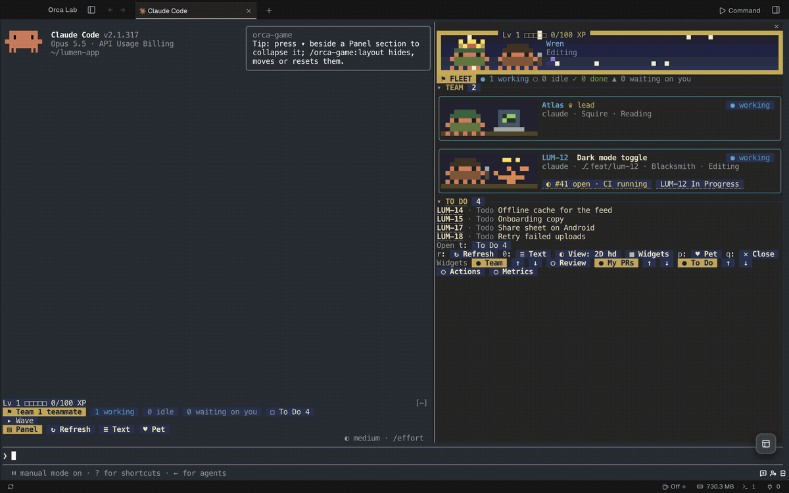

Una pregunta que solo tú puedes responder llega a la bandeja de Orca, y tu respuesta vuelve al líder:

  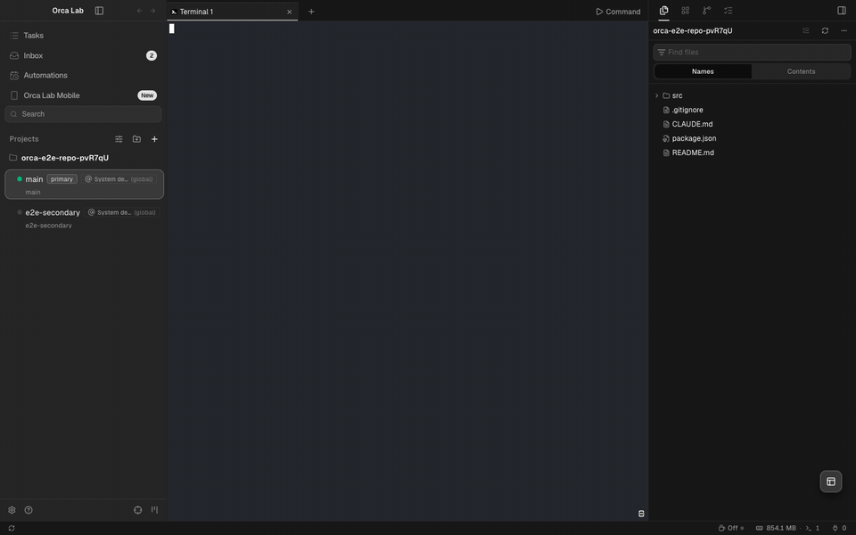

El Panel también muestra tus PR abiertos y los números del equipo:

  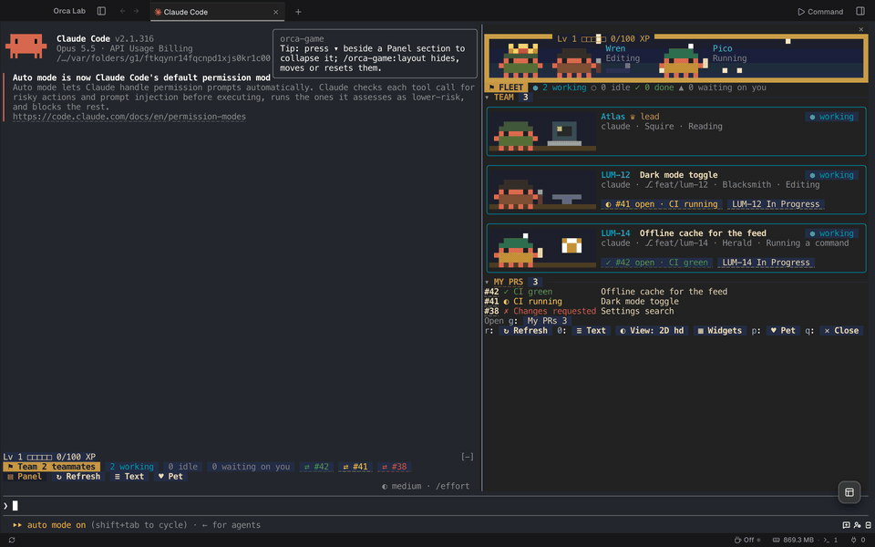

Settings → Agents elige cómo se ve y cuánto le cuesta a tu máquina: **Off**, **Flat** (texto plano), **Zen**, **2D classic** o **2D hd**. Las escenas se pueden personalizar. [Referencia de Orca Game →](../reference/orchestrator-game.md)

  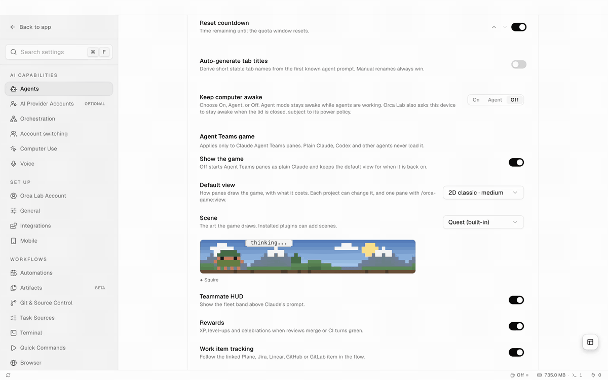

## Ejecuta miembros en todas tus máquinas

Un miembro no tiene que correr en la máquina donde estás sentado. Cada Orca que vinculas se vuelve un host donde el líder puede poner miembros, con `orca game launch <ticket> --on <host>`.

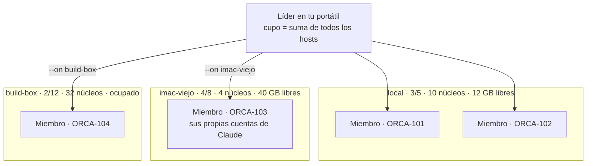

- **Vinculación.** Cualquier máquina con Orca Lab, la app de escritorio u `orca serve` en un servidor Linux sin pantalla, imprime un enlace de vinculación; `orca environment add` lo guarda en la máquina del líder. Una dirección de Tailscale lo mantiene privado. [Servidor sin pantalla →](../reference/headless-linux-server.md)
- **Cupos que se suman.** El cupo de miembros de cada host sale de su propia memoria y sus núcleos, y el cupo del líder es la suma de todos los hosts alcanzables. Un lanzamiento que supera el cupo de un host se rechaza y nombra un host con espacio.
- **Cada host a la vista.** `game fleet`, `game state` y el Panel muestran los miembros de cada host frente a su cupo, sus núcleos, su memoria libre y su carga, marcados como `low memory` o `busy`.
- **Cada host usa sus propias cuentas.** Un miembro remoto elige una cuenta de Claude o Codex del roster de ese host, así que sumar una máquina suma cuota, no solo CPU.
- **Una sola flota, en ambos sentidos.** Los miembros remotos aparecen en el Panel del líder con su ticket, PR y CI, reportan con los mismos mensajes tipados y abren su terminal desde el Panel a través del host vinculado.
- **Sobrevive a los reinicios.** Cuando un host se reinicia, `game resume-members` despierta a los miembros que dejó dormidos, y la tarjeta del Panel ofrece Resume y Reconnect.

**Por qué importa:** el portátil que ya no usas puede correr dos miembros esta noche. Una estación potente puede tomar los tickets pesados y acortar la cola. Y tu máquina principal sigue respondiendo mientras el trabajo corre en otro lado. [Flota y hosts →](../reference/orchestrator-game.md#the-project-lead-orchestratorgameorchestrator)

## Por dentro

<picture>
  <source media="(prefers-color-scheme: dark)" srcset="../assets/readme/architecture-dark.svg" />
  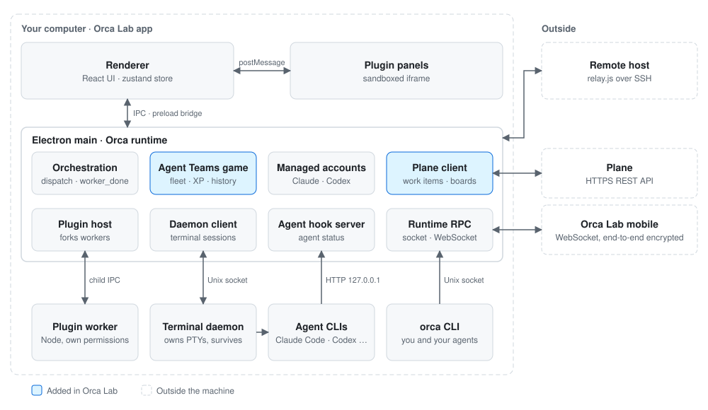
</picture>

La ventana es un proceso principal de Electron más un renderer de React. Las terminales viven en un daemon aparte que sobrevive al proceso de la app, los agentes reportan su estado a un servidor de hooks en `127.0.0.1`, y la CLI `orca` y el teléfono llegan al mismo runtime por RPC. Las cajas azules existen solo en Orca Lab.

Las personas, cuentas, proyectos y tickets de las grabaciones son datos de demostración inventados en example.com. Las escenas se grabaron del build real con specs E2E en `tests/e2e/*-showcase.spec.ts`.

## Instalación

- **[Descarga la última versión](https://github.com/ab2webco/orca-oss/releases/latest)**
- O elige un build: [macOS Apple Silicon](https://github.com/ab2webco/orca-oss/releases/latest/download/orca-macos-arm64.dmg) · [macOS Intel](https://github.com/ab2webco/orca-oss/releases/latest/download/orca-macos-x64.dmg) · [Windows (.exe)](https://github.com/ab2webco/orca-oss/releases/latest/download/orca-windows-setup.exe) · [Linux AppImage](https://github.com/ab2webco/orca-oss/releases/latest/download/orca-linux.AppImage)
- ¿Ejecutas `orca serve` en un servidor Linux sin pantalla? Consulta la [guía del servidor Linux sin pantalla](../reference/headless-linux-server.md).

## Documentación

Las guías de usuario están en [`docs/user`](../user/README.md) (en inglés): [CLI](../user/cli/overview.md), [worktrees por SSH](../user/ssh.md), [seguimiento de uso](../user/agents/usage-tracking.md), [agentes compatibles](../user/agents/supported.md) y [telemetría](../user/telemetry.md). Las [notas de versión](https://github.com/ab2webco/orca-oss/releases) listan cada cambio.

## Desarrollo

Consulta [CONTRIBUTING.md](../../.github/CONTRIBUTING.md). Las comprobaciones de UI renderizada pasan por el harness E2E: [`docs/reference/rendered-ui-checks.md`](../reference/rendered-ui-checks.md).

## Licencia

Orca Lab es libre y de código abierto bajo la [licencia MIT](../../LICENSE). Se basa en [Orca](https://github.com/stablyai/orca) de stablyai.
