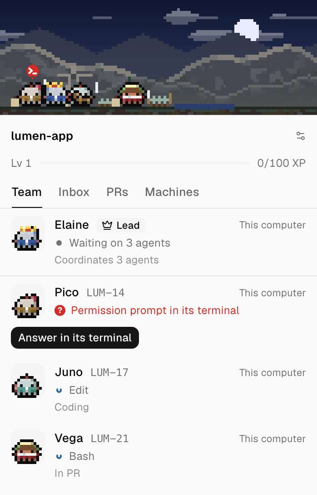
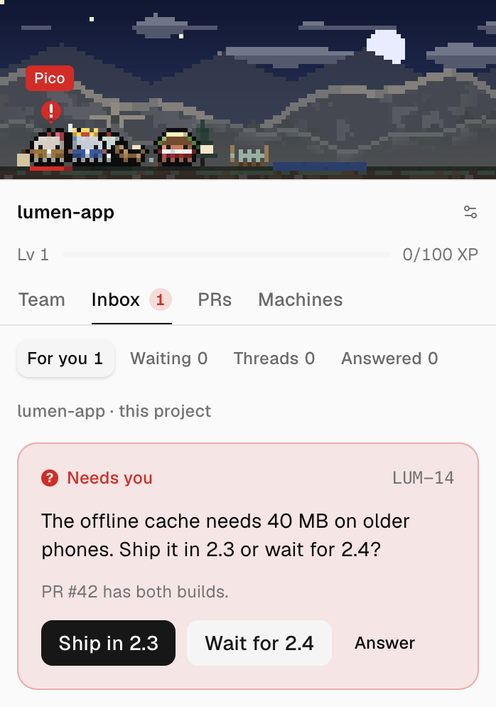

# Agent Teams

A team is one **lead** and its **members**. The lead is a Claude session that talks to you, picks
tickets and starts one member per ticket, each in its own worktree. Members work, open their pull
request and report back; the lead relays only what needs you, and merges what is verified. Orca
Game is this team, drawn as a game in the **Team** panel. This page sets one up on a new project,
step by step.

<figure class="orca-diagram" aria-label="A lead and its members, from tickets to merged pull requests">
<ol class="orca-chain">
<li><strong>Lead</strong>takes your tickets and launches members</li>
<li><strong>Members</strong>one per ticket, each in its own worktree</li>
<li><strong>Inbox</strong>their questions, for you to answer</li>
<li><strong>Merge</strong>by the lead once CI is green</li>
</ol>
</figure>

## 1. Start a lead

1. Open the project and choose **+** at the end of the tab bar. Under **Agents**, choose
   **Claude Agent Teams**. If it is missing, set it to **Enabled** in **Settings > Agents**.
2. In that pane, run `/orca-game:lead` (or `orca game lead`). The session becomes the project's
   lead and prints its standing rules, then your project's own.
3. Once, in the same pane, run `/orca-game:setup`. It asks what to connect, one question at a time:
   the tracker for the To Do, the lead's rules, the scene. It writes only what you confirm to the
   project's `orca.yaml`.

The built-in rules have the lead re-arm its report wait and `orca game watch --lead` on every start,
resume or compaction, plan parallel lanes by the files they touch, ask members for a split plan
before a large first commit, and treat a pull request as done only once it merges. Your project's
`orchestratorGame.orchestrator.rules` in `orca.yaml` print after them, unchanged, and win wherever
they differ.

A project has one lead. Once it has one, **+** shows a **Team** group instead of a second
**Claude Agent Teams** entry: **Go to lead** and **Add member…** while the lead runs, **Reopen
team** and **Start fresh lead…** after you close it. `/orca-game:lead fresh` (`orca game lead
--fresh`) starts a new lead conversation instead of reopening the old one.

## 2. Add members

- Ask the lead in plain words ("take LUM-14 and LUM-17").
- Or open **+ > Add member…**, pick an account under **Member account** and a ticket from the To Do
  ([Trackers and tasks](../review/linear.md#the-to-do-for-a-team) says where it comes from).
- Or run `orca game launch <ticket>` from the lead's terminal. `--on <host>` starts the member on a
  paired Orca Lab host.

## 3. Read the Team panel

Open **Team** in the right sidebar. Without a team the same item is called **Your work** and lists
your own agent sessions under **Activity**. With a team, the header names the project, shows the
team's level and XP, and its gear opens **Project settings**. The tabs are **Team**, **Inbox**,
**PRs** and **Machines**.

On **Team**, the lead comes first, with a crown and what it is doing: **Orchestrating**, **Waiting
on 2 agents** or **Waiting for you**; click it to open the lead's session. The advisor follows when it is installed, then one card per
member:

- The card's line says what the member is doing now, and its meta line its phase: **Planning**,
  **Documenting**, **Coding**, **Testing**, **In PR** or **Merging**.
- A member that needs you says **Waiting for your answer** and has **Answer in Inbox**; one stopped
  at a permission prompt has **Answer in its terminal** instead.
- Click a card to open the member's terminal and expand it: ticket title, **Branch**, **Last tool**,
  the PR with its CI (**CI running**, **CI green**, **CI failing**, **Merged**), its helpers, and its
  account's **5 h** and **Week** use. Click again to fold it.

## 4. Answer from the Inbox

When a member or the lead needs a decision, the question lands in **Inbox** with a red count, and
its notification opens the panel there. **Inbox** has **For you**, **Waiting**, **Threads** and
**Answered**; questions from other projects sit folded under **Other projects**.

Pick one of the question's options, or choose **Answer**, write in **Your answer** and **Send**. The
answer goes to the lead's mail, and the lead carries on. The phone shows the same questions; see
[Mobile](../mobile.md).

## 5. From pull request to merge

**PRs** lists the team's open pull requests, each with what it waits for: **Check failed**,
**Conflict**, **In review**, **Ready** and so on. When the default branch uses GitHub's merge queue,
**Merge queue** sits on top with each entry's state.

The lead merges. It checks each member's work, merges it or queues it once CI is green, and acts on
a red run or a stuck queue entry. A member reads its own CI with `orca game state --json`:
`review.ci`, and `review.mergeState`, where only `clean` can merge. After each merge the lead moves
the ticket to done, removes the worktree and its branch, and frees the member with
`orca game sweep --close`, which records it in the history.

## 6. Machines

**Machines** lists each host the team can use, with how much it has free and how many agents it
runs. With one machine it says **Only this machine**; [SSH](../ssh.md) covers adding more.

## 7. Levels

In the **Game** look, the header shows the team's level (**Lv 3**) and its XP. XP rewards only what
landed: each member that ends with its pull request merged adds 100 XP, one that ends in QA adds 50.
Level 2 takes 100 XP, and each level after takes 100 more than the last.

## Looks, scenes and settings

The panel's looks, styles and scenes, which settings layer wins, and what changes at once are in
[Scenes, styles and settings](scenes-and-settings.md).

## History and lessons

- `orca game history` lists the project's freed members with their outcome, PR and character.
- When a member ends, Orca keeps a short lesson from its outcome (merged, failed, hit its account
  limit) for 30 days. New members get the project's lessons in their launch brief, marked as data,
  not instructions.
- If a project's repo was removed and added again, `orca game adopt-history --from-repo-id <id>`
  brings its history and lessons over.
- After an Orca Lab restart, `orca game resume-members` brings back the members that were paused.

Every `orca game` command is listed in the [CLI](../cli/overview.md#run-a-team-orca-game) page. The
full behavior is in the [Orca Game reference](../../reference/orchestrator-game.md).
