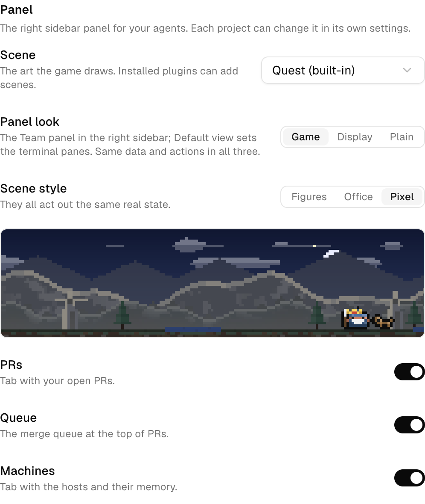

# Scenes, styles and settings

The Team panel can look like a game, a dashboard or a plain list. This page covers its looks,
styles and scenes, which setting wins when several say different things, what changes at once and
what waits, and what happens when you bring a team to a project that already has agents running.

## Looks and styles

The panel has three looks with the same data and actions: **Game** (a scene, levels and XP),
**Display** (a carousel of team metrics) and **Plain**. In the **Game** look the scene comes in
three styles, all acting out the real state of the work, never a timer:

- **Pixel**: a garden; each member's bed grows with its phase, and merged work fills harvest
  crates. With members on more than one machine it becomes a floor per machine, like Office.
- **Figures**: a 3D base of islands, one per machine, sized by how many members it can run. Each
  member builds a house at its own plot that rises from foundation to roof as its work moves; a red
  CI sets the roof on fire, and a merge throws confetti and flies its flag. The lead walks the
  roads to the member who needs you, and rows a boat to the other islands. Free members fish, farm
  or chop wood, and limited ones sit by the fire. Jev watches from its lookout tower and sends a
  messenger bird when it decides. A new member walks out of the keep; a newly connected machine's
  island rises out of the sea.
- **Office**: a 3D building with one floor per machine over a Lobby, the lead's first. Members sit at
  their desks in sweaters, each monitor showing what its member is doing, a mark over the head of
  whoever needs you, and a board over each desk whose note moves toward done. The lead, in a violet
  coat, works from its own office and rides the glass lift to a member whose CI went red. Each
  machine's Jev sits in a control room on its own floor, drawn only where Jev is installed and has
  spoken. With **Low resources** the Office draws as before: 2D floors with whiteboards and plaques,
  and **All** shows every floor.

In Figures the camera follows the lead. **Show all** frames every island, a drag moves around the
base, and the scroll wheel or a pinch zooms; **Follow the lead** goes back. At the zoom limit the
wheel scrolls the panel again. The 3D Office's camera works the same way. Drag the bottom edge of
either scene to make it taller (Figures up to twice its height, the Office up to the whole
building); a double click puts it back. Members in the Office go where their work is: to their
desks while they work, to the lead's office when they have a question for you, to the cafeteria or
the games room while CI runs, and to the games room when they are done. Two rows in
**Settings > Agents > Panel** tune it, and the Office too:

- **Scene quality**: **Illustrated** (outlined figures with shadows) or **Low resources** (flat
  figures, no shadows), for slower machines. Scene quality also switches the Office between 3D
  (**Illustrated**) and 2D (**Low resources**), and the row shows for the Office too.
- **Lead's pace**: **Normal** (it walks like a person), **Fast** (2.5 times faster) or **Direct**
  (in Figures the court mage sends it by magic; in the Office it steps out of the lift where it is
  needed).

Figures needs WebGL. With hardware acceleration off, Figures draws in 2D instead: a castle tower
per member that rises from foundation to finished, and merged towers become trophies on the hills.
`orchestratorGame.panel.diorama: false` keeps the 2D Figures on any machine. The 3D Office needs
WebGL too; without it the Office draws in 2D, as with **Low resources**.

Red CI shows the build broken. **Settings > Appearance > Status colors** sets one color per state
(**Needs you**, **At risk**, **Working**, **Verified**, **Idle**), for light and dark; the panel and
the scene use them.

## Scenes

A scene is a built-in one (**Quest**, **Night Watch**, **Crystal Saga**, **Beast Tamer**), one a
plugin adds, or a scene file in the project. A scene themes Pixel; Figures and Office always draw
Orca's own art, and a note in Settings says so when a scene other than Quest is chosen. The preview
in Settings shows the chosen scene in the chosen style.

## Which setting wins

The same settings exist in three places, and each field resolves on its own: the later layer wins.

<figure class="orca-diagram" aria-label="Settings layers, from Orca's defaults to this machine's project settings">
<ol class="orca-chain">
<li><strong>Defaults</strong>Game, Pixel and the Quest scene</li>
<li><strong>Global Settings</strong>every project on this machine</li>
<li><strong>orca.yaml</strong>committed, shared with everyone on the repo</li>
<li><strong>This machine</strong>the project's page in Settings</li>
</ol>
</figure>

- **Settings > Agents**: **Panel** (look, style, scene, **Scene quality** and **Lead's pace** for
  Figures and Office, and the **PRs** and **Machines** switches) and **Agent Teams game** (the game in panes,
  and the **Terminal band** for a pixel view), for every project. Each row shows only while your
  current choices use it.
- `orca.yaml`: `orchestratorGame.panel` (`look`, `style`, `tabs`, `advisor`, `arcade`, `quality`,
  `pace`, `diorama`),
  `orchestratorGame.scene` and `orchestratorGame.sceneFile`, plus the lead's
  `orchestratorGame.orchestrator.rules`.
- The project's page in **Settings**, section **Agent Teams game**: the same rows for this project
  on this machine, plus **Advisor**, **Arcade** and a scene file. Each row shows the value it
  applies and where it comes from; **Reset to …** appears while this machine changes it.

So a setting you change on the project's page beats the repo's `orca.yaml` on your machine only,
and `orca.yaml` beats your global Settings. To see what a pane resolved and which layer set each
field, run `/orca-game:state` in it.

## What changes at once, and what waits

- **The panel**: a look, style or scene picked in Settings shows at once. A change to `orca.yaml`
  shows on the panel's next read of the game state, within about 20 seconds.
- **The lead's rules**: the lead reads them when it runs `/orca-game:lead`. After you change
  `orchestratorGame.orchestrator.rules`, ask it to run `/orca-game:lead` again. It also goes back to
  them after a compaction.
- **Members already running** keep the brief they started with. Members the lead launches after
  the change get the new one; to reach a running member sooner, ask the lead to tell it.
- **The terminal band** is off by default. Turn it on with **Show the band** under **Terminal band**,
  or by choosing Zen or a 2D view under **Default view**; **Render**, **Time zone** and **Teammate
  HUD** appear while it is on. A pane picks the band up when it starts.

## An existing project

A project does not need to be new. Open **+ > Claude Agent Teams** in it and run `/orca-game:lead`
as in [Agent Teams](agent-teams.md#1-start-a-lead); `orca.yaml` is optional, and `/orca-game:setup`
adds it whenever you want.

Agents you already had running on this machine, in any worktree or folder, show up in the lead's
Team panel as members named after their worktree. They take no member slot, earn no XP, and the
lead's sweep, push and stop-all leave them alone; `orca game stop <name>` closes one.

When Orca Lab or the machine restarts, the lead's members stop with it and are kept as paused, with
their ticket and slot. When the lead starts again it runs `orca game resume-members`, or asks you
first if the project says so: each Claude member reopens its own conversation in its worktree, and
any other agent starts again on the same task.
