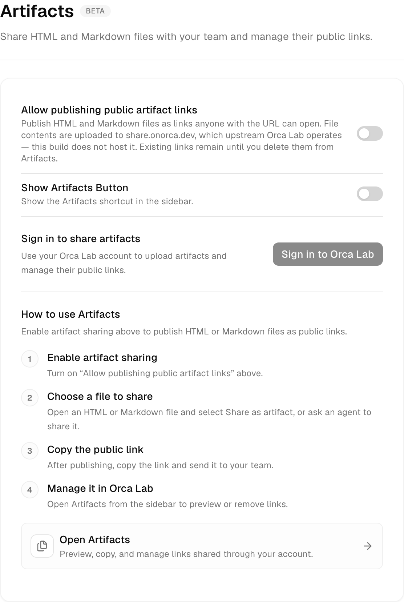

# Artifacts and automations

Two ways to put work in front of people, or on a schedule: an **artifact** shares an HTML or
Markdown file as a public link, and an **automation** starts an agent on a prompt at the times you
choose.

## Artifacts

An artifact is a local HTML or Markdown file, under 800 KB, uploaded to a link that anyone with the
URL can open. Sharing is off until you turn it on.

1. Open **Settings > Artifacts** and turn on **Allow publishing public artifact links**. The
   setting says where files go: `share.onorca.dev`, which upstream Orca Lab runs, not this build.
2. Sign in with your Orca Lab account when it asks.
3. Open the file in the Markdown editor, or a local HTML file in the browser, and choose **Share as
   artifact**. Before anything is uploaded it names the host again; choose **Share public link**.

**Update shared content** replaces what the link shows. **Artifacts** in the sidebar (turn on
**Show Artifacts Button** in the same settings) lists every link you shared; **Delete artifact**
removes one, and the link stops working. The CLI has the same verbs:
`orca artifacts share|update|unshare|list|delete`.

## Automations

An automation runs an agent on a prompt, or a command, on a schedule.

<figure class="orca-diagram" aria-label="From an automation to its results">
<ol class="orca-chain">
<li><strong>Describe</strong>project, agent, prompt and schedule</li>
<li><strong>Run</strong>in a fresh workspace each time, or one you pick</li>
<li><strong>Review</strong>its run history and the workspace it left</li>
</ol>
</figure>

Open **Automations** in the sidebar and choose **New Automation**, or **Start from a template**.

- **Launch an agent** with a **Prompt**, or **Run a command** with a **Timeout (seconds)**.
- **Cadence**: **Hourly**, **Daily**, **Weekdays**, **Weekly** or a **Custom cron**.
- **Project**, **Agent** and **Workspace**: **New run** gives each run a fresh workspace from the
  branch under **Branch from**; **Worktree** runs in the one you pick.

Schedules fire only while Orca Lab is running; a run missed while it was closed is caught up only
within the **Grace** you set. Each automation has **Run Now**, **Pause** and a **Run history** with
its workspace, spend and status. Workspaces it creates carry **Created by automation** in the
sidebar, and **Hide automation-created** in the sidebar's filters hides them. Deleting an
automation keeps the workspaces its runs made.

From a terminal, `orca automations list|show|create|edit|remove|run|runs` does the same; without
`--workspace`, each run gets a new worktree.
