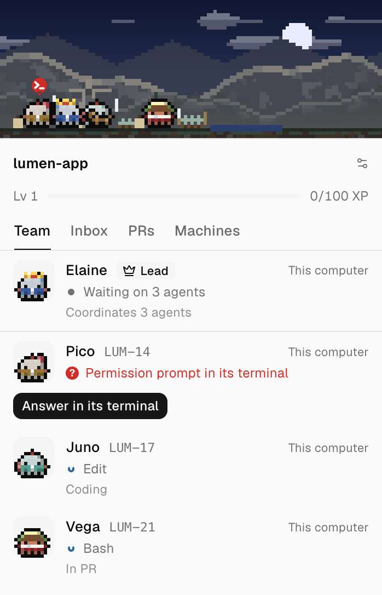
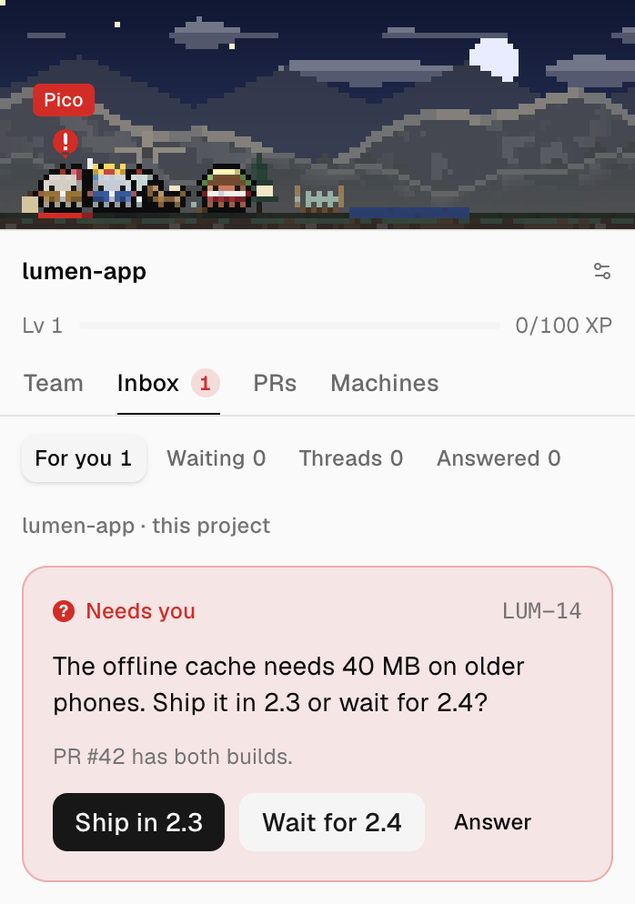

# Agent Teams

Un equipo es un **líder** y sus **miembros**. El líder es una sesión de Claude que habla contigo,
elige tickets e inicia un miembro por ticket, cada uno en su propio worktree. Los miembros trabajan,
abren su pull request e informan; el líder te transmite solo lo que te necesita y mergea lo que está
verificado. Orca Game es ese equipo, dibujado como un juego en el panel **Team**. Esta página lo
monta en un proyecto nuevo, paso a paso.

<figure class="orca-diagram" aria-label="Un líder y sus miembros, de los tickets a los pull requests mergeados">
<ol class="orca-chain">
<li><strong>Líder</strong>toma tus tickets y lanza miembros</li>
<li><strong>Miembros</strong>uno por ticket, cada uno en su propio worktree</li>
<li><strong>Inbox</strong>sus preguntas, para que las respondas</li>
<li><strong>Merge</strong>lo hace el líder cuando el CI está en verde</li>
</ol>
</figure>

## 1. Inicia un líder

1. Abre el proyecto y elige **+** al final de la barra de pestañas. En **Agents**, elige
   **Claude Agent Teams**. Si no aparece, ponlo en **Enabled** en **Settings > Agents**.
2. En ese panel, ejecuta `/orca-game:lead` (u `orca game lead`). La sesión pasa a ser el líder del
   proyecto e imprime sus reglas de base y luego las de tu proyecto.
3. Una vez, en el mismo panel, ejecuta `/orca-game:setup`. Pregunta qué conectar, de a una
   pregunta: el tracker del To Do, las reglas del líder, la escena. Escribe en el `orca.yaml` del
   proyecto solo lo que confirmas.

Las reglas de base hacen que el líder vuelva a armar su espera de informes y `orca game watch --lead`
en cada inicio, reanudación o compactación, planifique carriles en paralelo según los archivos que
tocan, pida a los miembros un plan de división antes de un primer commit grande y dé un pull request
por terminado solo cuando se mergea. Las `orchestratorGame.orchestrator.rules` de tu proyecto en
`orca.yaml` se imprimen después, sin cambios, y ganan donde difieren.

Un proyecto tiene un solo líder. Cuando ya lo tiene, **+** muestra un grupo **Team** en lugar de una
segunda entrada **Claude Agent Teams**: **Go to lead** y **Add member…** mientras el líder corre,
**Reopen team** y **Start fresh lead…** después de cerrarlo. `/orca-game:lead fresh`
(`orca game lead --fresh`) inicia una conversación de líder nueva en lugar de reabrir la anterior.

## 2. Agrega miembros

- Pídeselo al líder con palabras simples ("toma LUM-14 y LUM-17").
- O abre **+ > Add member…**, elige una cuenta en **Member account** y un ticket del To Do
  ([Trackers y tareas](../review/linear.md#el-to-do-de-un-equipo) dice de dónde sale).
- O ejecuta `orca game launch <ticket>` desde la terminal del líder. `--on <host>` inicia el miembro
  en un host de Orca Lab emparejado.

## 3. Lee el panel Team

Abre **Team** en la barra lateral derecha. Sin equipo, el mismo elemento se llama **Your work** y
lista tus propias sesiones de agente en **Activity**. Con equipo, la cabecera nombra el proyecto,
muestra el nivel y la XP del equipo, y su engranaje abre **Project settings**. Las pestañas son
**Team**, **Inbox**, **PRs** y **Machines**.

En **Team**, primero va el líder, con una corona y lo que está haciendo: **Orchestrating**,
**Waiting on 2 agents** o **Waiting for you**; haz clic para abrir la sesión del líder. Si el
asesor está instalado va después, y luego una tarjeta por miembro:

- La línea de la tarjeta dice qué hace el miembro ahora, y su línea de detalle su fase:
  **Planning**, **Documenting**, **Coding**, **Testing**, **In PR** o **Merging**.
- Un miembro que te necesita dice **Waiting for your answer** y tiene **Answer in Inbox**; uno
  detenido en un permiso tiene **Answer in its terminal**.
- Haz clic en una tarjeta para abrir la terminal del miembro y expandirla: título del ticket,
  **Branch**, **Last tool**, el PR con su CI (**CI running**, **CI green**, **CI failing**,
  **Merged**), sus ayudantes y el uso de su cuenta en **5 h** y **Week**. Otro clic la pliega.

## 4. Responde desde el Inbox

Cuando un miembro o el líder necesita una decisión, la pregunta llega al **Inbox** con un contador
rojo, y su notificación abre el panel ahí. **Inbox** tiene **For you**, **Waiting**, **Threads** y
**Answered**; las preguntas de otros proyectos quedan plegadas en **Other projects**.

Elige una de las opciones de la pregunta, o elige **Answer**, escribe en **Your answer** y
**Send**. La respuesta llega al correo del líder, y el líder sigue. El teléfono muestra las mismas
preguntas; consulta [Móvil](../mobile.md).

## 5. Del pull request al merge

**PRs** lista los pull requests abiertos del equipo, cada uno con lo que espera: **Check failed**,
**Conflict**, **In review**, **Ready**, etc. Cuando la rama por defecto usa la merge queue de
GitHub, **Merge queue** va arriba con el estado de cada entrada.

El líder mergea. Revisa el trabajo de cada miembro, lo mergea o lo encola cuando el CI está en verde,
y actúa ante una ejecución en rojo o una entrada atascada en la cola. Un miembro lee su propio CI
con `orca game state --json`: `review.ci`, y `review.mergeState`, donde solo `clean` se puede
mergear. Después de cada merge, el líder pasa el ticket a terminado, elimina el worktree y su rama,
y libera al miembro con `orca game sweep --close`, que lo registra en el historial.

## 6. Machines

**Machines** lista cada host que el equipo puede usar, con cuánto tiene libre y cuántos agentes
corre. Con una sola máquina dice **Only this machine**; [SSH](../ssh.md) explica cómo sumar más.

## 7. Niveles

En la apariencia **Game**, la cabecera muestra el nivel del equipo (**Lv 3**) y su XP. La XP premia
solo lo que llegó: cada miembro que termina con su pull request mergeado suma 100 XP, y uno que
termina en QA suma 50. El nivel 2 pide 100 XP, y cada nivel siguiente 100 más que el anterior.

## Apariencias, escenas y ajustes

Las apariencias, estilos y escenas del panel, qué capa de ajustes gana y qué cambia al momento están
en [Escenas, estilos y ajustes](scenes-and-settings.md).

## Historial y lecciones

- `orca game history` lista los miembros liberados del proyecto con su resultado, PR y personaje.
- Cuando un miembro termina, Orca guarda una lección breve de su resultado (merge, fallo, límite de la
  cuenta alcanzado) durante 30 días. Los miembros nuevos reciben las lecciones del proyecto en su brief
  de lanzamiento, marcadas como datos, no como instrucciones.
- Si el repo de un proyecto se eliminó y se volvió a agregar,
  `orca game adopt-history --from-repo-id <id>` trae su historial y sus lecciones.
- Tras reiniciar Orca Lab, `orca game resume-members` recupera los miembros que quedaron en pausa.

Todos los comandos de `orca game` están en la página de la [CLI](../cli/overview.md#dirigir-un-equipo-orca-game).
El comportamiento completo está en la [referencia de Orca Game](../../../reference/es/orchestrator-game.md).
