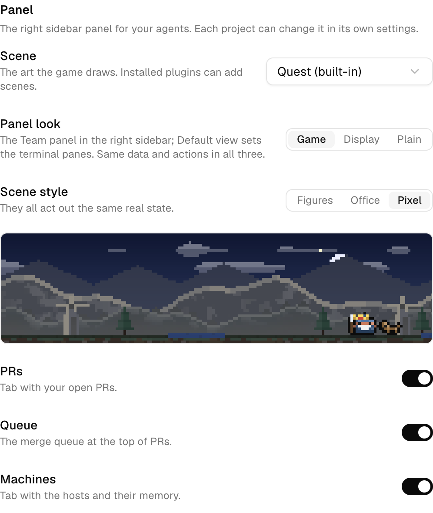

# Escenas, estilos y ajustes

El panel Team puede verse como un juego, como un tablero o como una lista simple. Esta página cubre
sus apariencias, estilos y escenas, qué ajuste gana cuando varios dicen cosas distintas, qué cambia
al momento y qué espera, y qué pasa cuando llevas un equipo a un proyecto que ya tiene agentes en
marcha.

## Apariencias y estilos

El panel tiene tres apariencias con los mismos datos y acciones: **Game** (una escena, niveles y
XP), **Display** (un carrusel de métricas del equipo) y **Plain**. En la apariencia **Game** la
escena viene en tres estilos, todos representando el estado real del trabajo, nunca un temporizador:

- **Pixel**: un huerto; el cantero de cada miembro crece con su fase, y el trabajo mergeado llena
  cajas de cosecha. Con miembros en más de una máquina se convierte en un piso por máquina, como
  Office.
- **Figures**: una base 3D de islas, una por máquina, del tamaño de cuántos miembros puede correr.
  Cada miembro construye una casa en su parcela, que sube de los cimientos al techo a medida que
  avanza su trabajo; un CI en rojo le prende fuego al techo, y un merge lanza confeti e iza su
  bandera. El líder camina por los caminos hasta el miembro que te necesita y rema en bote hasta las
  otras islas. Los miembros libres pescan, siembran o cortan leña, y los limitados se sientan junto
  al fuego. Jev vigila desde su torre con un catalejo y manda una paloma mensajera cuando decide. Un
  miembro nuevo sale del castillo; la isla de una máquina recién conectada sube del mar.
- **Office**: un edificio 3D con un piso por máquina sobre un Lobby, primero el del líder. Los miembros trabajan
  en sus escritorios con suéter, cada monitor muestra lo que hace su miembro, una marca sobre la
  cabeza de quien te necesita y una pizarra sobre cada escritorio cuya nota avanza hacia terminado.
  El líder, con abrigo violeta, trabaja desde su propia oficina y sube en el ascensor de vidrio
  hasta un miembro cuyo CI quedó en rojo. El Jev de cada máquina se sienta en un cuarto de control en su
  propio piso, dibujado solo donde Jev está instalado y ya habló. Con **Low resources** la Office se
  dibuja como antes: pisos en 2D con pizarras y placas, y **All** muestra todos los pisos.

En Figures la cámara sigue al líder. **Show all** encuadra todas las islas, arrastrar mueve la vista
por la base, y la rueda o pellizcar acerca o aleja; **Follow the lead** vuelve. En el límite del
zoom la rueda vuelve a desplazar el panel. La cámara de la Office 3D funciona igual. Arrastra el
borde inferior de cualquiera de las dos escenas para hacerla más alta (Figures hasta el doble de su
altura, la Office hasta el edificio entero); un doble clic la devuelve. Los miembros de la Office van
a donde está su trabajo: a su escritorio mientras trabajan, a la oficina del líder cuando tienen una
pregunta para ti, a la cafetería o la sala de juegos mientras corre CI, y a la sala de juegos cuando
terminan. Dos filas en **Settings > Agents > Panel** lo ajustan, y también la Office:

- **Scene quality**: **Illustrated** (figuras con contorno y sombras) o **Low resources** (figuras
  planas, sin sombras), para equipos más lentos. Scene quality también cambia la Office entre 3D
  (**Illustrated**) y 2D (**Low resources**), y la fila también aparece con la Office.
- **Lead's pace**: **Normal** (camina como una persona), **Fast** (2,5 veces más rápido) o
  **Direct** (en Figures el mago de la corte lo envía con magia; en la Office sale del ascensor
  donde lo necesitan).

Figures necesita WebGL. Con la aceleración por hardware apagada, Figures se dibuja en 2D: una torre
de castillo por miembro que sube de los cimientos a terminada, y las torres mergeadas pasan a ser
trofeos en las colinas. `orchestratorGame.panel.diorama: false` deja Figures en 2D en cualquier
equipo. La Office 3D también necesita WebGL; sin él la Office se dibuja en 2D, como con **Low
resources**.

Un CI en rojo muestra la build rota. **Settings > Appearance > Status colors** define un color por
estado (**Needs you**, **At risk**, **Working**, **Verified**, **Idle**), para claro y oscuro; el
panel y la escena los usan.

## Escenas

Una escena es una de las incluidas (**Quest**, **Night Watch**, **Crystal Saga**, **Beast Tamer**),
una que agrega un plugin o un archivo de escena del proyecto. Una escena cambia Pixel; Figures y
Office siempre usan el arte propio de Orca, y una nota en Settings lo dice cuando se elige una escena
que no es Quest. La vista previa en Settings muestra la escena elegida en el estilo elegido.

## Qué ajuste gana

Los mismos ajustes existen en tres lugares, y cada campo se resuelve por separado: gana la capa
posterior.

<figure class="orca-diagram" aria-label="Capas de ajustes, de los valores por defecto de Orca a los ajustes del proyecto en este equipo">
<ol class="orca-chain">
<li><strong>Por defecto</strong>Game, Pixel y la escena Quest</li>
<li><strong>Settings global</strong>todos los proyectos de este equipo</li>
<li><strong>orca.yaml</strong>en el repo, compartido con todos</li>
<li><strong>Este equipo</strong>la página del proyecto en Settings</li>
</ol>
</figure>

- **Settings > Agents**: **Panel** (apariencia, estilo, escena, **Scene quality** y **Lead's pace**
  para Figures y Office, y los interruptores **PRs** y **Machines**) y **Agent Teams game** (el juego en los
  paneles y, con una vista de píxeles, la **Terminal band**), para todos los proyectos. Cada fila
  aparece solo mientras tus elecciones actuales la usan.
- `orca.yaml`: `orchestratorGame.panel` (`look`, `style`, `tabs`, `advisor`, `arcade`, `quality`,
  `pace`, `diorama`),
  `orchestratorGame.scene` y `orchestratorGame.sceneFile`, más las
  `orchestratorGame.orchestrator.rules` del líder.
- La página del proyecto en **Settings**, sección **Agent Teams game**: las mismas filas para este
  proyecto en este equipo, más **Advisor**, **Arcade** y un archivo de escena. Cada fila muestra el
  valor que aplica y de dónde viene; **Reset to …** aparece mientras este equipo lo cambia.

Así, un ajuste que cambias en la página del proyecto gana al `orca.yaml` del repo solo en tu equipo,
y `orca.yaml` gana a tus ajustes globales. Para ver qué resolvió un panel y qué capa definió cada
campo, ejecuta `/orca-game:state` en él.

## Qué cambia al momento y qué espera

- **El panel**: una apariencia, un estilo o una escena elegidos en Settings se ven al momento. Un
  cambio en `orca.yaml` se ve en la siguiente lectura del estado del juego que hace el panel, en
  unos 20 segundos.
- **Las reglas del líder**: el líder las lee cuando ejecuta `/orca-game:lead`. Después de cambiar
  `orchestratorGame.orchestrator.rules`, pídele que vuelva a ejecutar `/orca-game:lead`. También
  vuelve a ellas después de una compactación.
- **Los miembros que ya están en marcha** conservan las instrucciones con las que empezaron. Los que
  el líder lance después del cambio reciben las nuevas; para llegar antes a un miembro en marcha,
  pídele al líder que se lo diga.
- **La banda de la terminal** está desactivada por defecto. Actívala con **Show the band** en
  **Terminal band**, o eligiendo Zen o una vista 2D en **Default view**; **Render**, **Time zone** y
  **Teammate HUD** aparecen mientras está activa. Un panel toma la banda cuando arranca.

## Un proyecto existente

Un proyecto no tiene que ser nuevo. Abre **+ > Claude Agent Teams** en él y ejecuta
`/orca-game:lead` como en [Agent Teams](agent-teams.md#1-inicia-un-líder); `orca.yaml` es opcional,
y `/orca-game:setup` lo agrega cuando quieras.

Los agentes que ya tenías en marcha en este equipo, en cualquier worktree o carpeta, aparecen en el
panel Team del líder como miembros con el nombre de su worktree. No ocupan un lugar de miembro, no
ganan XP, y el barrido, el push y la detención general del líder no los tocan;
`orca game stop <name>` cierra uno.

Cuando Orca Lab o el equipo se reinician, los miembros del líder se detienen con él y quedan en
pausa, con su ticket y su lugar. Cuando el líder vuelve a arrancar ejecuta
`orca game resume-members`, o te pregunta antes si el proyecto lo pide así: cada miembro de Claude
reabre su propia conversación en su worktree, y cualquier otro agente vuelve a empezar en la misma
tarea.
