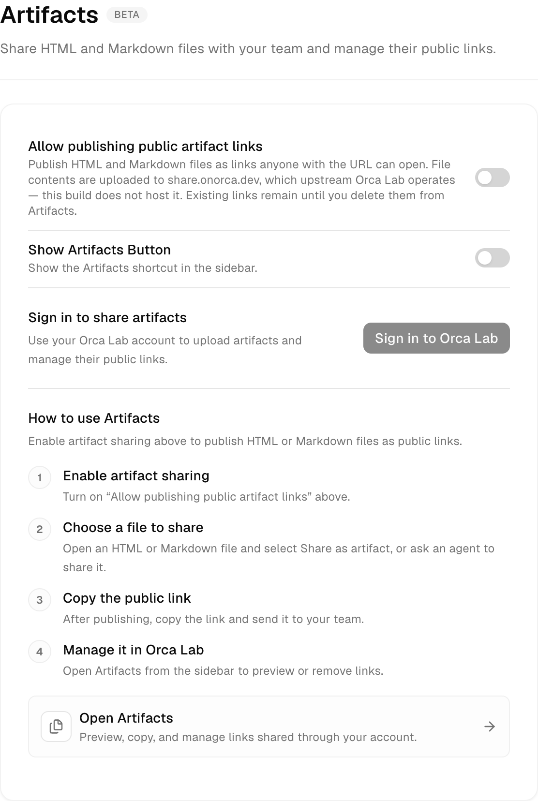

# Artefactos y automatizaciones

Dos maneras de poner trabajo frente a otras personas, o en un horario: un **artefacto** comparte un
archivo HTML o Markdown como un enlace público, y una **automatización** arranca un agente con un
prompt en los momentos que elijas.

## Artefactos

Un artefacto es un archivo HTML o Markdown local, de menos de 800 KB, subido a un enlace que
cualquiera con la URL puede abrir. Compartir está desactivado hasta que lo actives.

1. Abre **Settings > Artifacts** y activa **Allow publishing public artifact links**. El ajuste dice
   adónde van los archivos: `share.onorca.dev`, que opera Orca Lab upstream, no este build.
2. Inicia sesión con tu cuenta de Orca Lab cuando lo pida.
3. Abre el archivo en el editor de Markdown, o un archivo HTML local en el navegador, y elige
   **Share as artifact**. Antes de subir nada vuelve a nombrar el host; elige
   **Share public link**.

**Update shared content** reemplaza lo que muestra el enlace. **Artifacts** en la barra lateral
(activa **Show Artifacts Button** en los mismos ajustes) lista cada enlace que compartiste;
**Delete artifact** quita uno, y el enlace deja de funcionar. La CLI tiene los mismos verbos:
`orca artifacts share|update|unshare|list|delete`.

## Automatizaciones

Una automatización ejecuta un agente con un prompt, o un comando, según un horario.

<figure class="orca-diagram" aria-label="De una automatización a sus resultados">
<ol class="orca-chain">
<li><strong>Describe</strong>proyecto, agente, prompt y horario</li>
<li><strong>Ejecuta</strong>en un espacio de trabajo nuevo cada vez, o en uno que elijas</li>
<li><strong>Revisa</strong>su historial de ejecuciones y el espacio que dejó</li>
</ol>
</figure>

Abre **Automations** en la barra lateral y elige **New Automation**, o **Start from a template**.

- **Launch an agent** con un **Prompt**, o **Run a command** con un **Timeout (seconds)**.
- **Cadence**: **Hourly**, **Daily**, **Weekdays**, **Weekly** o un **Custom cron**.
- **Project**, **Agent** y **Workspace**: **New run** da a cada ejecución un espacio de trabajo
  nuevo desde la rama de **Branch from**; **Worktree** ejecuta en el que elijas.

Los horarios solo se disparan mientras Orca Lab está abierto; una ejecución que se perdió mientras
estaba cerrado se recupera solo dentro del **Grace** que definas. Cada automatización tiene
**Run Now**, **Pause** y un **Run history** con su espacio de trabajo, su gasto y su estado. Los
espacios de trabajo que crea llevan **Created by automation** en la barra lateral, y
**Hide automation-created** en los filtros de la barra lateral los oculta. Al borrar una
automatización se conservan los espacios de trabajo que crearon sus ejecuciones.

Desde una terminal, `orca automations list|show|create|edit|remove|run|runs` hace lo mismo; sin
`--workspace`, cada ejecución recibe un worktree nuevo.
