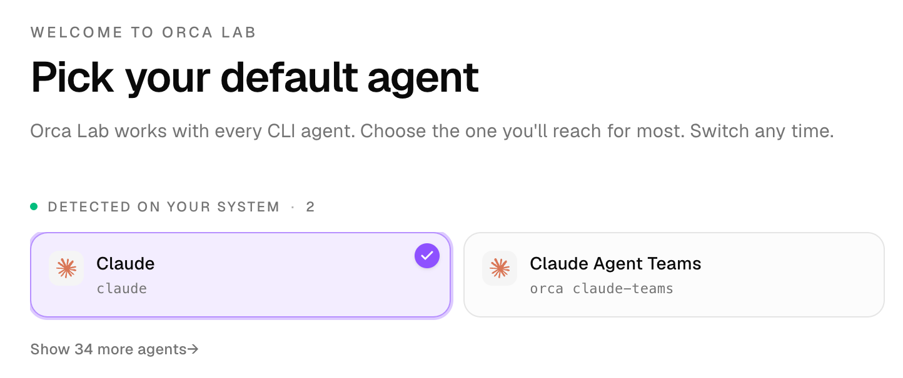
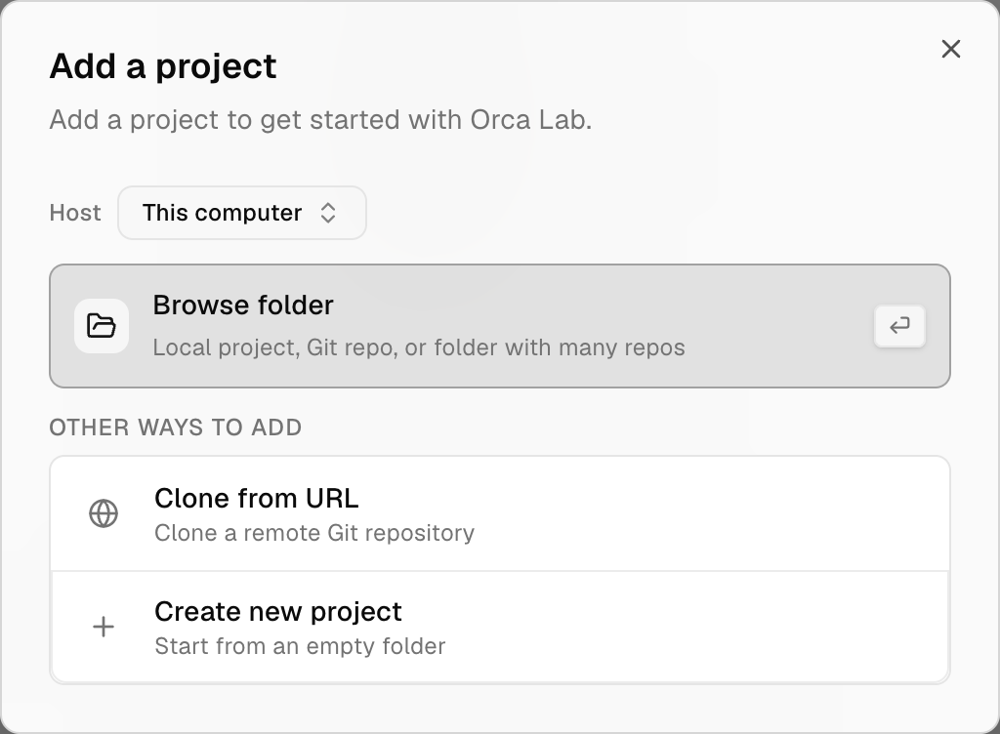
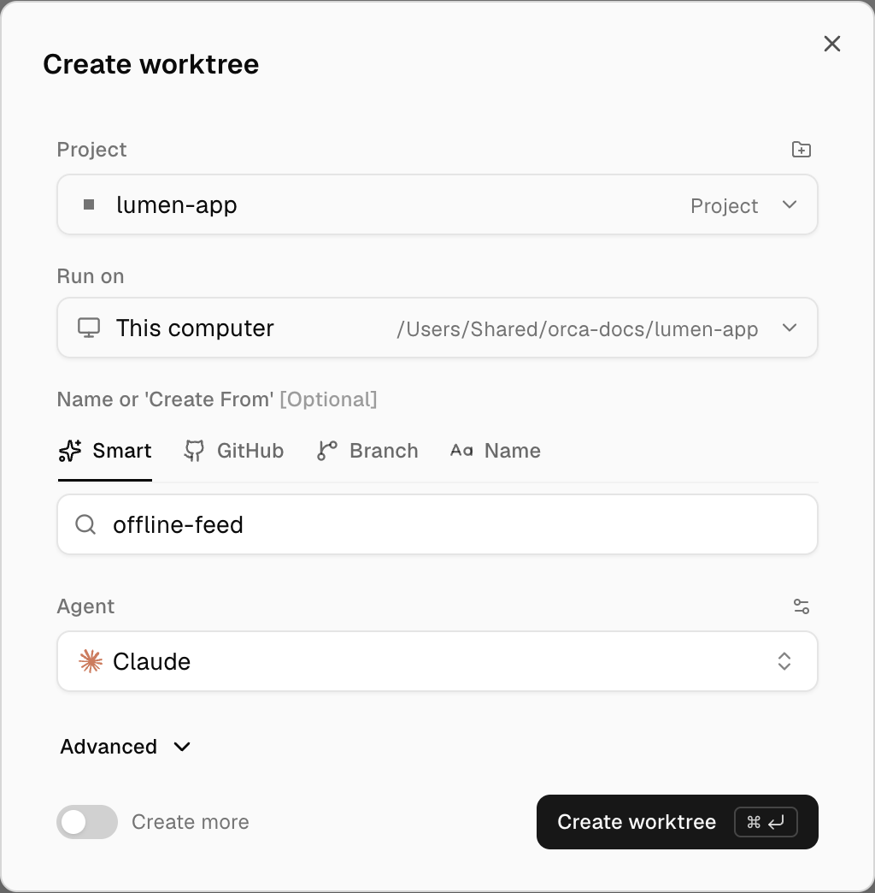
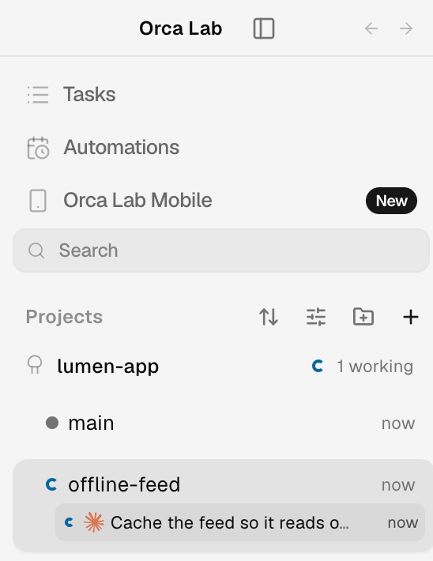
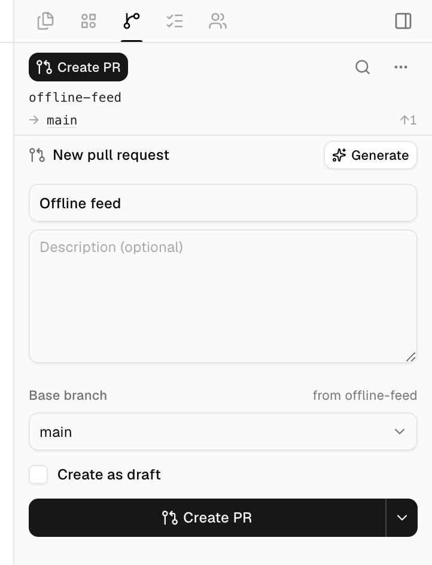

# Primeros pasos

Seis pasos te llevan de la descarga a un pull request mergeado que abrió un agente. Cada paso
enlaza a la página completa cuando quieras saber más.

## 1. Instala Orca Lab

Descarga el build para tu plataforma desde la
[última versión](https://github.com/ab2webco/orca-oss/releases/latest) y ábrelo.
[Instalación](install.md) indica el archivo de cada plataforma.

El primer arranque te lleva por unas pocas pantallas: **Pick your default agent**, entre los que
encuentra en tu sistema; **Make it feel like home**, el tema; **Set up GitHub tasks**, cuando falta
la CLI de GitHub; y **Set up notifications**. En la pantalla del agente,
**Yolo / Dangerously skip permissions** viene activado, así que Orca Lab inicia el agente con su
opción para saltarse los permisos (en Claude, `--dangerously-skip-permissions`) y el agente ejecuta
comandos sin preguntarte antes. Desmárcalo si quieres aprobar cada uno.

## 2. Inicia sesión en tu agente

Un agente que ya tiene la sesión iniciada en esta máquina funciona tal cual. Para tener varias
cuentas y ver cuánto le queda del límite a cada una, abre **Settings > AI Provider Accounts** y
elige **Add Account**. [Uso y cuentas](agents/usage-tracking.md) explica cómo cambiar de cuenta y
los tokens de larga duración.

## 3. Abre un repositorio

En **Add a project**, elige **Browse folder** y selecciona un repositorio Git de tu máquina, o
elige **Clone from URL**. El proyecto aparece en **Projects**, en la barra lateral izquierda.

## 4. Crea un worktree con un agente

Haz clic en **+** arriba en la barra lateral (**New workspace**) o pulsa `Mod+N` (Cmd en macOS,
Ctrl en Windows y Linux). Revisa el **Project**, escribe un nombre para la tarea, elige un
**Agent** y pulsa **Create worktree**. Orca Lab crea una rama nueva en su propio worktree e inicia
el agente en una pestaña de terminal ahí, así tu checkout principal queda como estaba.

Escribe la tarea en la pestaña de terminal del agente. La fila del worktree en la barra lateral
muestra en qué está el agente, con un indicador mientras trabaja y una marca cuando termina.

## 5. Abre el pull request

Cuando el agente haya hecho commit de su trabajo, abre **Source Control** en la barra lateral
derecha (`Mod+Shift+G`). En **New pull request**, revisa el título y la **Base branch**, y elige
**Create PR**. En GitLab el mismo formulario abre un merge request.

## 6. Haz el merge

El mismo panel muestra después los checks y el estado de revisión del pull request. Cuando están en
verde, elige **Merge**, o **Enable auto-merge** para que GitHub lo mergee en cuanto lo estén.

## Siguiente: dirige un equipo con Orca Game

Un agente en un worktree es la unidad básica. Orca Game pone un agente lead encima: le das
tickets, inicia un member por ticket en su propio worktree y solo te trae lo que tienes que decidir.

<figure class="orca-diagram" aria-label="Un lead y sus members, de los tickets a los pull requests mergeados">
<ol class="orca-chain">
<li><strong>Lead</strong>toma tus tickets y lanza members</li>
<li><strong>Members</strong>uno por ticket, cada uno en su worktree</li>
<li><strong>Inbox</strong>sus preguntas y pull requests, para ti</li>
<li><strong>Merge</strong>el lead lo encola cuando el CI está en verde</li>
</ol>
</figure>

[Agent Teams](agents/agent-teams.md) explica cómo iniciar un lead, sumar members y leer el panel
Team; [Orca Game](../../reference/orchestrator-game.md) es la referencia completa.
