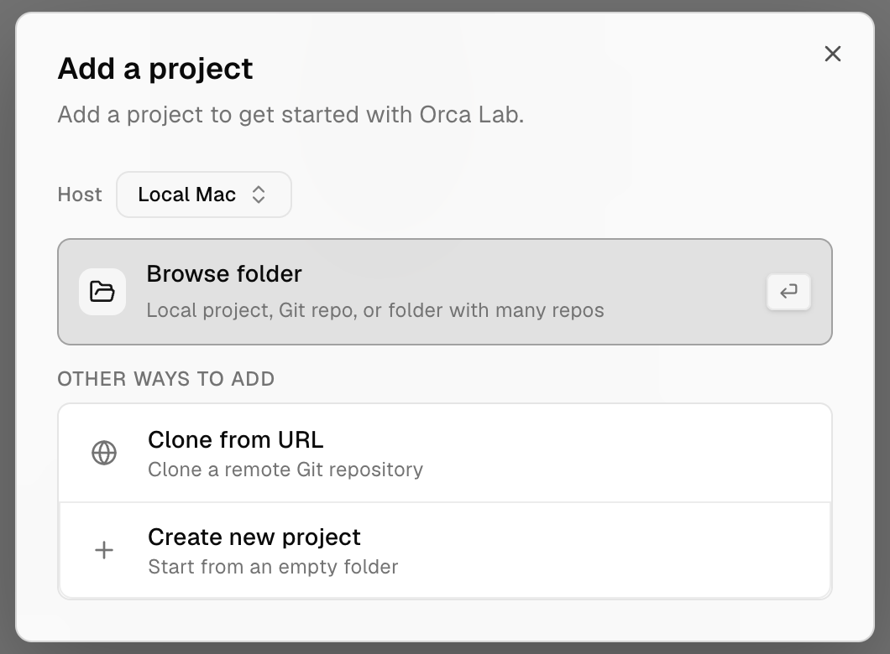
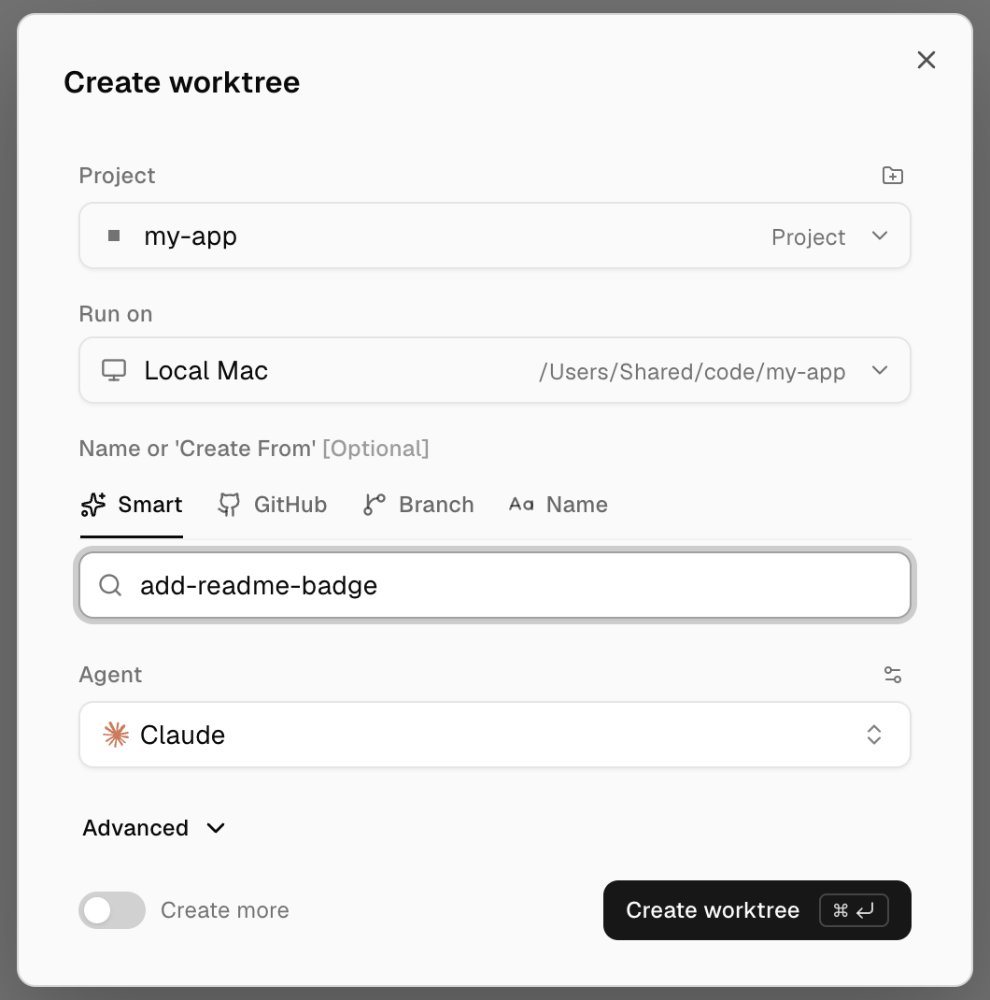
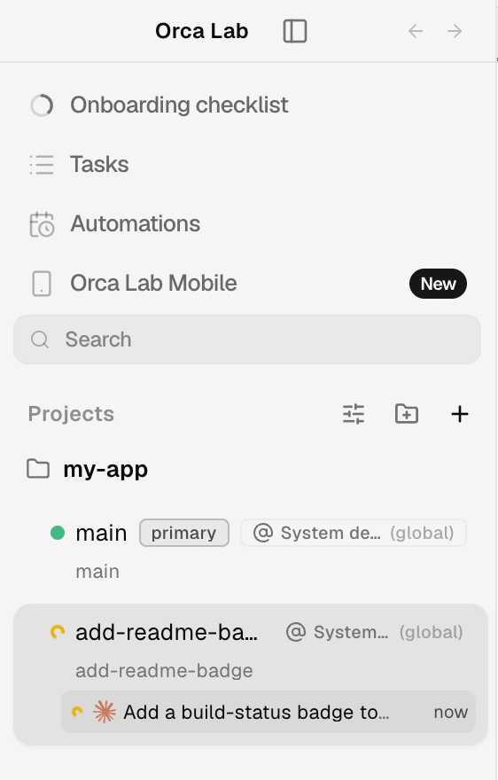
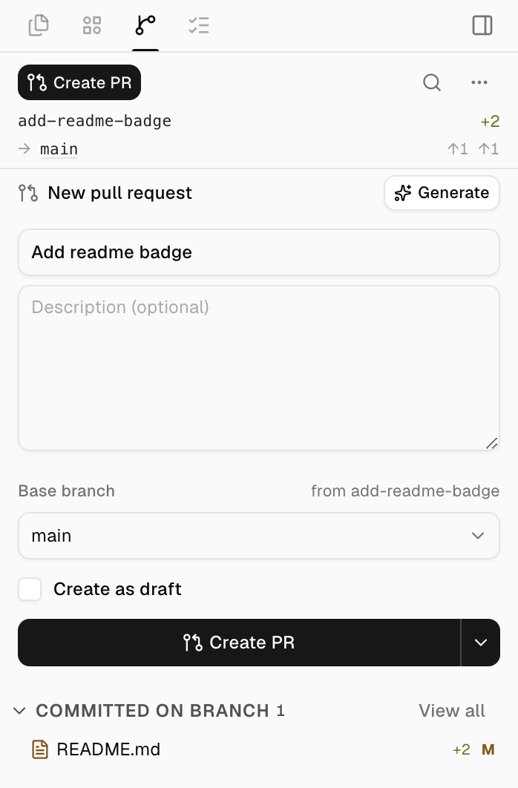

# Primeros pasos

Cinco pasos te llevan de la descarga a un pull request abierto por un agente. Cada paso enlaza a
la página completa cuando quieras saber más.

## 1. Instala Orca Lab

Descarga el build para tu plataforma desde la
[última versión](https://github.com/ab2webco/orca-oss/releases/latest) y ábrelo.
[Instalación](install.md) indica el archivo de cada plataforma.

El primer arranque te pide tres cosas: tu agente predeterminado, entre los que detecta en tu
sistema; un tema; y las notificaciones. **Yolo / Dangerously skip permissions** viene activado, así
que Orca Lab inicia el agente con su opción para saltarse los permisos (en Claude,
`--dangerously-skip-permissions`) y el agente ejecuta comandos sin preguntarte antes. Desmárcalo
si quieres aprobar cada uno. Termina con **Add your first project**.

## 2. Abre un repositorio

En **Add a project**, elige **Browse folder** y selecciona un repositorio Git de tu máquina, o
elige **Clone from URL**. El proyecto aparece en **Projects**, en la barra lateral izquierda. El
icono de carpeta junto a **Projects** (**Add Project**) agrega otro más adelante.

## 3. Crea un worktree con un agente

Pulsa `Mod+N` (Cmd en macOS, Ctrl en Windows y Linux), o haz clic en **+** junto a **Projects**.
En **Create worktree**, revisa el proyecto, escribe un nombre para la tarea, elige un **Agent** y
pulsa **Create worktree**. Orca Lab crea una rama nueva en su propio worktree e inicia el agente
en una pestaña de terminal allí, así que tu checkout principal queda como estaba.
[Worktrees](model/worktrees.md) cubre las demás opciones.

## 4. Dale su tarea al agente

Escribe la tarea en la pestaña de terminal del agente, como en cualquier terminal. La tarjeta del
worktree en la barra lateral muestra en qué está el agente, con un indicador giratorio mientras
trabaja y una marca verde cuando termina, así que puedes pasar a otro worktree y volver.
[Agentes compatibles](agents/supported.md) explica cómo sigue Orca Lab a cada agente.

## 5. Abre el pull request

Cuando el agente haya hecho commit de su trabajo, abre **Source Control** en la barra lateral
derecha (`Mod+Shift+G`). En **New pull request**, revisa el título y la **Base branch**, y pulsa
**Create PR**. En GitLab el mismo formulario abre un merge request.

## Siguiente: lleva un equipo con Orca Game

Un agente en un worktree es la unidad básica. [Orca Game](../../reference/orchestrator-game.md)
pone un agente líder por encima: toma tus tickets, inicia un miembro por ticket en su propio
worktree y solo te pregunta lo que tienes que decidir tú.
