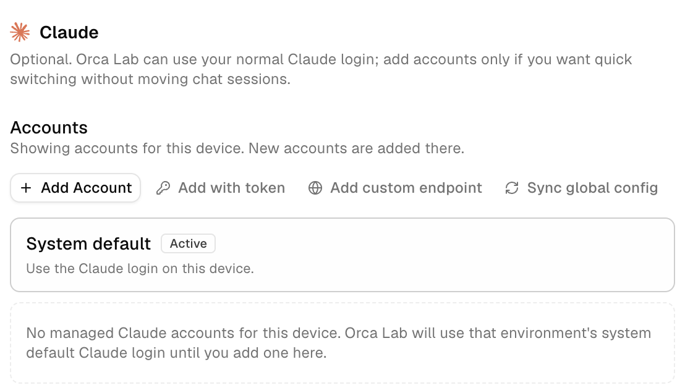

# Instalación

Orca Lab se distribuye desde la [página de releases de GitHub](https://github.com/ab2webco/orca-oss/releases/latest)
con un build para cada plataforma de escritorio. Descárgalo, ábrelo, y el primer arranque te lleva
hasta tu primer proyecto.

<figure class="orca-diagram" aria-label="De la descarga a tu primer proyecto">
<ol class="orca-chain">
<li><strong>Descarga</strong><span>el build de tu plataforma</span></li>
<li><strong>Abre</strong><span>pasando el control del sistema</span></li>
<li><strong>Primer arranque</strong><span>agente, tema, notificaciones</span></li>
<li><strong>Inicia sesión</strong><span>el login de tu agente, o varias cuentas</span></li>
</ol>
</figure>

## Descarga

| Plataforma            | Archivo                                                                                                      |
| --------------------- | ------------------------------------------------------------------------------------------------------------ |
| macOS (Apple Silicon) | [`orca-macos-arm64.dmg`](https://github.com/ab2webco/orca-oss/releases/latest/download/orca-macos-arm64.dmg) |
| macOS (Intel)         | [`orca-macos-x64.dmg`](https://github.com/ab2webco/orca-oss/releases/latest/download/orca-macos-x64.dmg)     |
| Windows               | [`orca-windows-setup.exe`](https://github.com/ab2webco/orca-oss/releases/latest/download/orca-windows-setup.exe) |
| Linux x64             | [`orca-linux.AppImage`](https://github.com/ab2webco/orca-oss/releases/latest/download/orca-linux.AppImage), o el `orca-ide_<versión>_amd64.deb` de la página del release |

## macOS

Abre el `.dmg` y arrastra **Orca Lab** a **Applications**. El build está firmado y notarizado, así
que se abre como cualquier otra app, y se actualiza solo cuando sale una versión nueva.

## Windows

Ejecuta `orca-windows-setup.exe`. El build de Windows todavía no está firmado, así que SmartScreen
muestra **Windows protected your PC**: elige **More info** y luego **Run anyway**. Por la misma
razón, la app no puede actualizarse sola en Windows; para actualizar, descarga y ejecuta el
instalador más reciente.

Los worktrees pueden estar dentro de WSL, y la CLI tiene su propio comando de shell para WSL.

## Linux

Para el AppImage, hazlo ejecutable y ábrelo:

```bash
chmod +x orca-linux.AppImage
./orca-linux.AppImage
```

Para el `.deb`, instálalo con `apt`, que trae sus dependencias:

```bash
sudo apt install ./orca-ide_*_amd64.deb
```

El build de Linux está pensado para Ubuntu 20.04 estándar y versiones más recientes (glibc 2.31).

## Inicia sesión en tu agente

Orca Lab ejecuta las herramientas de línea de comandos de cada agente, así que un agente que ya
tiene la sesión iniciada en esta máquina funciona tal cual. Si no la tiene, inicia sesión como lo
harías siempre con ese agente, por ejemplo ejecutando `claude` o `codex` una vez en cualquier
terminal.

Para tener varias cuentas de Claude o de Codex y cambiar entre ellas, abre
**Settings > AI Provider Accounts** y elige **Add Account** en **Claude** o **Codex**. Orca Lab
ejecuta el inicio de sesión del propio agente y lo abre en tu navegador; no hay que escribir ningún
correo. En un servidor remoto, el diálogo **Sign in on** te da el enlace y un código para
introducirlo allí. **Add with token** agrega una cuenta de Claude a partir de un token de larga
duración.



La primera fila de cada lista, **System default**, es el login que el agente ya tenía. Haz clic en
una fila para que sea la predeterminada de las terminales nuevas. Un worktree puede usar su propia
cuenta: haz clic derecho sobre él en la barra lateral y elige **Assign Account**.

Solo Claude y Codex tienen cuentas gestionadas. Gemini, OpenCode Go, MiniMax y Grok aparecen en el
mismo panel solo para seguir su uso; cualquier otro agente usa su propio login.

## Cuotas

La barra de estado muestra cuánto se ha usado del límite de cada cuenta y cuándo se reinicia.
Ábrela para ver el panel **Usage**, donde **Refresh rate limits** lo consulta en el momento y
**Manage Accounts…** vuelve al panel de cuentas. Con **Auto-switch Limited Agents** activado, una
sesión que llega a su límite pasa a otra cuenta. [Uso y cuentas](agents/usage-tracking.md) cubre
los detalles, el cambio de cuenta desde la CLI y los tokens de larga duración.

## El comando `orca`

Abre **Settings > General > Orca Lab CLI** y elige **Register** en **Shell command**. A partir de
ahí, los agentes y los scripts controlan Orca Lab desde cualquier terminal. Consulta la
[guía de la CLI](cli/overview.md).

## Sin ventana

Para ejecutar Orca Lab en un servidor y emparejarlo como host de miembros remotos, ejecuta
`orca serve` en una máquina Linux sin interfaz gráfica. La
[guía del servidor Linux sin interfaz](../../reference/es/headless-linux-server.md) cubre la unidad
de servicio, el emparejamiento y las actualizaciones.

## Teléfono

La app complementaria se empareja con el escritorio desde **Settings > Mobile**. Consulta
[Móvil](mobile.md).
