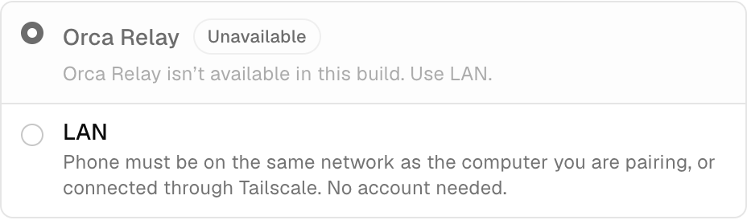

# Móvil

La app de Orca Lab se empareja con tu escritorio y te pone los agentes en el bolsillo. Esta página
describe la versión 0.0.64.

<figure class="orca-diagram" aria-label="De instalar la app del teléfono a responder a tu equipo">
<ol class="orca-chain">
<li><strong>Instala</strong>TestFlight en iPhone, el APK en Android</li>
<li><strong>Empareja</strong>escanea el QR del escritorio, o pega su código</li>
<li><strong>Observa</strong>el equipo, las cuentas y las terminales de cada escritorio</li>
<li><strong>Responde</strong>las preguntas de tu equipo desde el Inbox</li>
</ol>
</figure>

## Instalar

Abre **Settings > Mobile** en el escritorio, u **Orca Lab Mobile** en la barra lateral. Enlazan el
build de [TestFlight](https://testflight.apple.com/join/xbePNDGj) para iPhone y el
**Android APK**, que descarga el último release `mobile-android-v*`. La app todavía no está en la
App Store ni en Google Play.

## Emparejar

En **Pair a phone**, elige cómo llega el teléfono a este equipo:

- **Orca Relay**: el teléfono funciona con datos móviles o cualquier Wi-Fi. Necesita que inicies
  sesión con una cuenta de Orca Lab, y **Also use a faster local path** deja que el teléfono vaya
  directo cuando está cerca. El relay corre en los servidores de Orca upstream (`relay.onorca.dev`),
  no en los de este build: lo que transporta va cifrado de extremo a extremo, pero los metadatos,
  como el momento y el volumen, no.
- **LAN**: el teléfono tiene que estar en la misma red que el equipo, o llegar a él por Tailscale.
  No hace falta cuenta.

Un build sin el relay, como un build de desarrollo, muestra **Orca Relay** como **Unavailable** y
dice que uses LAN.

Elige **Generate QR code** y luego, en la app, toca **Pair Desktop** y escanéalo, o pega el código
de **Copy pairing code**. **Paired Devices** lista cada teléfono; revocar uno lo desconecta al
momento.

## Inicio

- Cada escritorio emparejado tiene una tarjeta con su estado y sus worktrees.
- Mientras el escritorio está conectado, la tarjeta muestra su equipo: cuántos miembros hay, cuántos
  están trabajando y **N needs you** en rojo cuando un miembro te espera. También muestra la cuenta de
  Claude activa y su uso de 5 horas, en verde por debajo del 60 %, ámbar desde el 60 % y rojo desde
  el 80 %.
- Cuando el escritorio se desconecta, la línea del equipo dice **Last known:** con la hora en que se vio
  por última vez. La app la olvida cuando se reinicia.
- Los escritorios antiguos que no comparten su equipo no muestran línea de equipo.

## Cuentas

Toca una tarjeta **Account usage** en Inicio, o el icono de persona en la lista de worktrees de un
escritorio.

- El nombre del escritorio bajo **Accounts** abre **Accounts on**, una lista de tus escritorios
  emparejados con su estado. Abrir la lista no conecta con ningún escritorio por sí solo.
- **Claude** y **Codex** listan **System default** y cada cuenta con sus barras de 5 horas y 7 días.
  Toca una cuenta para cambiar a ella.
- Bajo cada cuenta, una línea nombra quién corre en ella, como el líder y sus miembros.
- Agrega cuentas o inicia sesión en ellas desde el escritorio.

## Cajón del equipo e Inbox

- **Cajón del equipo.** En la terminal de un líder, una barra en la parte inferior abre el cajón con
  dos pestañas:
  - **Team**: una tarjeta por miembro con su ticket, host, estado, uso de la cuenta y PR con CI. Toca
    una tarjeta para ver su título, su resumen y **Open terminal**. **Metrics** muestra los merges por
    día y el lead time mediano.
  - **Inbox**: las preguntas del líder para ti y los hilos. El cajón se abre aquí cuando hay una
    pregunta esperando, y **Answer in Inbox** en una tarjeta te lleva a ella.
- **Inbox por escritorio.** La fila **Inbox** en la lista de worktrees de un escritorio abre todas las
  preguntas en espera de ese escritorio, con una sección por proyecto.
- **Enrutado al tocar una notificación.** Un toque abre el host y la pantalla correctos; la pregunta
  de un líder abre la terminal del líder con el cajón del equipo.

## También en el teléfono

- **Terminales en vivo.** Mira en directo la salida de la terminal de cualquier agente y escribe en
  ella. El texto tenue sobre un fondo oscuro se eleva a un contraste legible.
- **Tablero de Plane y paneles de plugins**, y un botón que pide al escritorio instalar su
  actualización pendiente.

El teléfono todavía no inicia miembros, no abre el panel Team ni cambia escenas o ajustes; hazlo
desde el escritorio. El líder y sus miembros se describen en [Agent Teams](agents/agent-teams.md).
