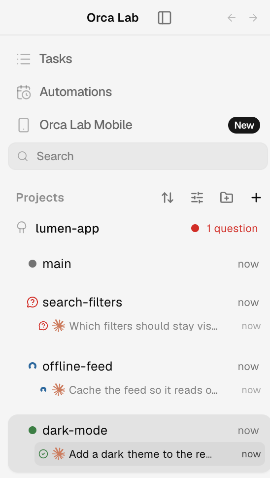
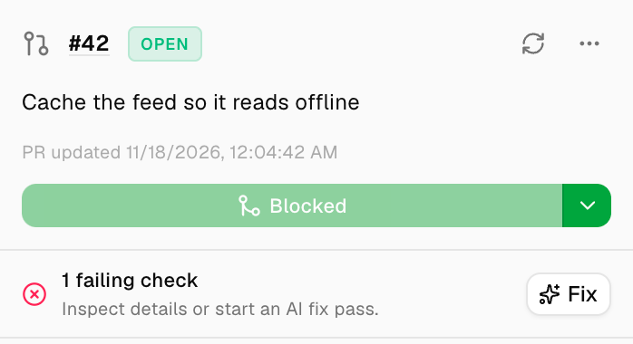
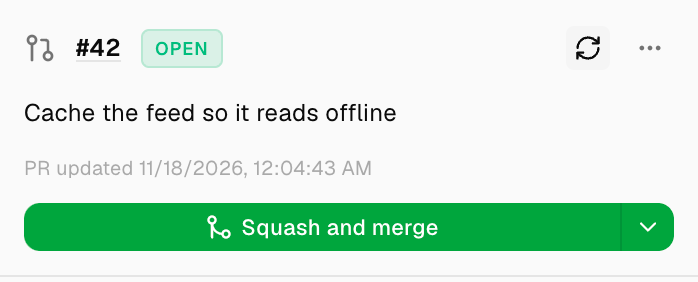

# Un agente hasta un PR mergeado

Un agente en un espacio de trabajo es la unidad sobre la que se construye todo lo demás en Orca
Lab. Esta página lo sigue desde la tarea que escribes hasta el merge, en GitHub o GitLab, sin salir
de la app.

<figure class="orca-diagram" aria-label="Del trabajo de un agente a un pull request mergeado">
<ol class="orca-chain">
<li><strong>Agente</strong>trabaja en su propio worktree y te avisa cuando te necesita</li>
<li><strong>Pull request</strong>abierto desde Source Control</li>
<li><strong>Revisión</strong>checks y comentarios, devueltos a un agente para corregir</li>
<li><strong>Merge</strong>ahora, o solo cuando pasen los checks</li>
</ol>
</figure>

## Conecta GitHub o GitLab

Orca Lab lee los pull requests, los checks y los comentarios con la herramienta de línea de
comandos de cada proveedor: `gh` para GitHub y `glab` para GitLab. Elige el proveedor según el
remoto del repositorio, así que no hay nada que cambiar. **Settings > Integrations** muestra cada
uno como **Connected**, **Not installed** o **Not authenticated**; en el último caso, ejecuta
`gh auth login` o `glab auth login` en una terminal y elige **Re-check**.

En GitLab, todo lo que sigue dice **MR** y **merge request** donde GitHub dice **PR** y
**pull request**.

## Lee el estado del agente

Arranca el agente como en [Proyectos y espacios de trabajo](projects.md) y escribe la tarea en su
pestaña de terminal. Su fila en la barra lateral, y su pestaña de terminal, muestran qué está
haciendo:

| Marca             | Estado                | Qué significa                                        |
| ----------------- | --------------------- | ---------------------------------------------------- |
| Spinner           | **Working**           | El agente está trabajando; no tienes que hacer nada. |
| Signo de pregunta | **Waiting for input** | Te preguntó algo o pide un permiso. Respóndele.      |
| Check             | **Done**              | Terminó su turno. Lee lo que hizo.                   |
| Punto gris        | **Idle**              | Ningún agente está trabajando ahí.                   |

Para responder, haz clic en la fila y contesta en su terminal. Con **Group by > Status** en
**Workspace options** de la barra lateral, las filas que te esperan se juntan arriba, en
**Needs you**.

## Abre el pull request

Abre **Source Control** en la barra lateral derecha (`Mod+Shift+G`). Su botón principal sigue a la
rama: **Commit** con un mensaje, **Publish Branch** para una rama que el remoto todavía no conoce,
**Push** para commits nuevos y luego **Create PR**.

En **New pull request**, escribe el **Title** y una **Description** opcional, o elige **Generate**
para redactar ambos con IA a partir de los cambios. Revisa la **Base branch**, marca
**Create as draft** si todavía no está listo y elige **Create PR**. Si la rama aún tiene commits
locales, el botón dice **Push & Create PR** y hace las dos cosas.

[Primeros pasos](get-started.md#5-abre-el-pull-request) muestra el formulario.

## Revísalo en Orca Lab

Una vez que existe el pull request, la fila del worktree lleva su icono, coloreado según sus checks:
verde cuando pasan, ámbar mientras corren y rojo cuando uno falla. **Checks**, en la barra lateral
derecha, tiene el resto: el estado del pull request, cuántos checks pasan, fallan o están
pendientes, y sus comentarios.

- **Un check fallido**: elige **Fix**. **Fix With AI** muestra el prompt con los detalles de los
  checks fallidos; **Start agent** abre una pestaña de agente nueva con él en el mismo worktree.
  **View full logs** abre el log de un check.
- **Comentarios de revisión**: **Reply** y **Resolve** funcionan como en la web.
  **Queue for agent** junta comentarios; **Send unresolved PR comments** se los pasa a un agente.
  Una vez entregado el prompt, Orca Lab resuelve esos hilos en GitHub y responde a los comentarios
  que no puede resolver.
- **Conflictos con la rama base**: **Resolve** arranca un agente sobre ellos.

## Mergéalo

El botón de merge está bajo el título del pull request en **Checks** y sigue lo que informa GitHub.
Cuando el pull request se puede mergear, dice **Squash and merge**, o el método por defecto del
repositorio; su menú ofrece **Create merge commit**, **Rebase and merge** y **Close PR**.

- **Cuando todavía no se puede mergear**, el botón nombra el motivo: **Approval required**,
  **Changes requested**, **Conflicts**, **Behind** o **Blocked**. Pasa el cursor por encima para
  ver la explicación de GitHub. Si el repositorio permite el auto-merge, dice
  **Enable auto-merge**, que mergea el pull request en cuanto se cumplen sus requisitos.
- **Cuando la rama base usa una merge queue**, dice **Merge when ready** y agrega el pull request a
  la cola.
- **En GitLab**, nombra **Unresolved threads**, o **Checks must pass** cuando el proyecto exige un
  pipeline en verde.

Después del merge, **Delete Workspace** elimina el worktree.

## Siguiente

Un agente a la vez basta para trabajos pequeños. [Agent Teams](agents/agent-teams.md) corre varios:
un lead reparte los tickets y los miembros te traen sus pull requests.
