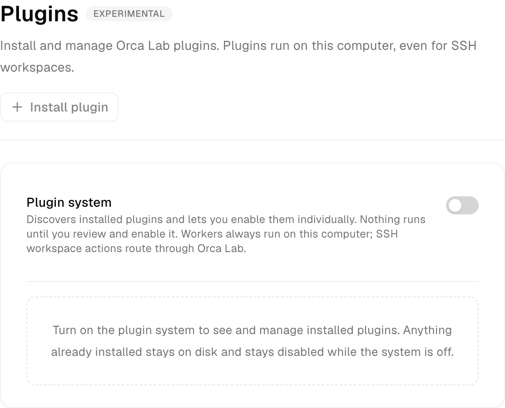

# Plugins, el asesor y skills

Los plugins agregan paneles, comandos, escenas y skills de agente a Orca Lab. El asesor Jev es uno
de ellos, y las skills enseñan a tus agentes a usar Orca Lab y tus trackers. Esta página es para
usarlos; [Plugins](../../reference/plugin-development.md) explica cómo escribir uno.

<figure class="orca-diagram" aria-label="De activar los plugins a un plugin en marcha">
<ol class="orca-chain">
<li><strong>Activa</strong><span>el sistema de plugins, en Settings</span></li>
<li><strong>Instala</strong><span>desde un marketplace, una carpeta o una URL de Git</span></li>
<li><strong>Revisa</strong><span>qué puede hacer, antes de que corra nada</span></li>
<li><strong>Habilita</strong><span>y configúralo</span></li>
</ol>
</figure>

## Activa los plugins

Los plugins son experimentales y vienen desactivados. Abre **Settings > Plugins** y activa
**Plugin system**. Todavía no corre nada: cada plugin espera a que lo revises y lo habilites. Los
plugins corren en este equipo, incluso para espacios de trabajo SSH.



## Instala un plugin

- **Desde un marketplace**: la pestaña **All** lista los plugins de cada marketplace que tengas,
  primero el oficial. **Manage sources** agrega otro marketplace de Git. Elige **Install** en un
  plugin, revisa **Includes** y **Requested access** y luego **Install plugin**.
- **Desde una carpeta o Git**: **Install plugin** abre un diálogo con **Local folder** (la carpeta
  que contiene `orca-plugin.json`) o **Git URL** (una URL de repositorio que termina en `#` y una
  etiqueta o un commit, para que la instalación quede fijada).

Instalar copia el plugin y muestra sus permisos; ningún código del plugin corre hasta que lo
habilitas.

## Revisa y habilita

Un plugin nuevo dice **Needs review**. **Review & enable** abre sus permisos: quién lo publicó, de
dónde viene y una lista **This plugin can**, más los atajos de teclado, las automatizaciones
programadas o los comandos de recetas de VM que agregue. Elige **Enable plugin**, o
**Keep Disabled**.

Un plugin que agrega atajos, automatizaciones, skills, recetas de VM o perfiles de agente vuelve a
preguntar después de cada actualización, porque lo que hace puede haber cambiado. Los demás vuelven
a preguntar solo cuando cambian sus permisos.

La tarjeta de cada plugin tiene un interruptor para apagarlo, **Configure** para sus propios ajustes
(**Finish setup** cuando falta un valor obligatorio) y un menú con **View logs**, **Roll back** y
**Remove**. El panel de un plugin aparece como un icono en la barra lateral derecha de cada espacio
de trabajo.

## El asesor Jev

Jev es un plugin que observa cada paso de un agente y elige el modelo y el esfuerzo para ese paso,
diciendo por qué. Con él instalado y los plugins activos, el panel Team muestra su último consejo en
una fila bajo el líder, y la escena representa ese consejo.

La fila se llama **Advisor**, y aparece como **Wizard** en la apariencia **Game**.

La fila está activa por defecto. Para ocultarla en un proyecto, pon **Advisor** en **Off** en la
página del proyecto en **Settings**, sección **Agent Teams game**; `orchestratorGame.panel.advisor`
en `orca.yaml` hace lo mismo para todos en el repo. La fila solo aparece mientras el plugin está
instalado.

## Skills

Una skill es un conjunto de instrucciones que un agente carga cuando la necesita. A tus agentes les
llegan tres tipos:

- **Las skills de Orca Lab** enseñan a un agente a manejar Orca Lab y tus trackers: `orca-cli`,
  `orchestration`, `orca-plane`, `orca-linear`, `switch-account` y más. Instálalas desde las
  páginas de skills en Settings (**CLI skill** en **Orca Lab CLI**, **Plane skill**,
  **Linear skill**), que ejecutan el comando de instalación por ti, o desde una terminal:

  ```bash
  orca skills install --all
  ```

  `orca skills list` muestra lo disponible y `orca skills update` las actualiza.
- **Las skills de orca-game** vienen con los paneles de Claude Agent Teams: `/orca-game:lead`,
  `/orca-game:setup`, `/orca-game:state`, `/orca-game:view` y las demás. No hace falta instalarlas.
- **Las skills de plugins** llegan con un plugin que pide enseñar a tus agentes. Llegan a todos los
  agentes mientras el plugin está habilitado y aprobaste ese permiso.
