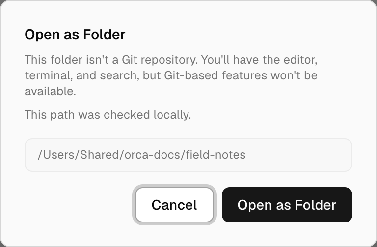
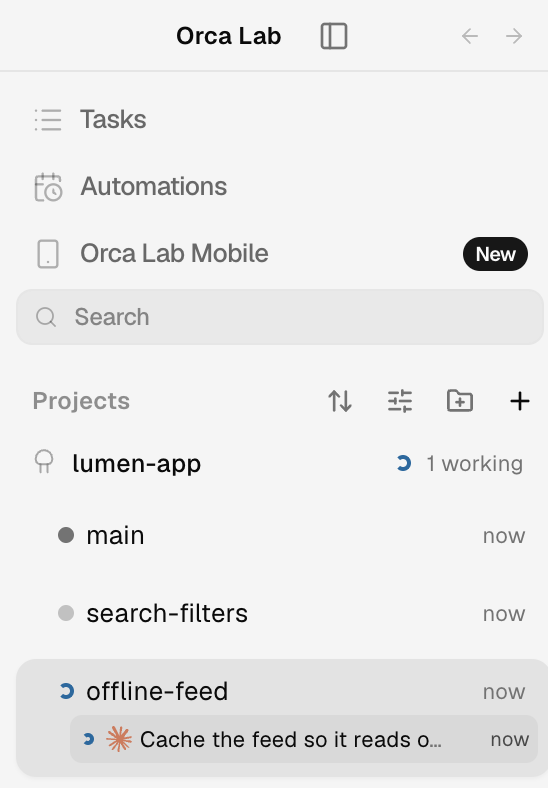
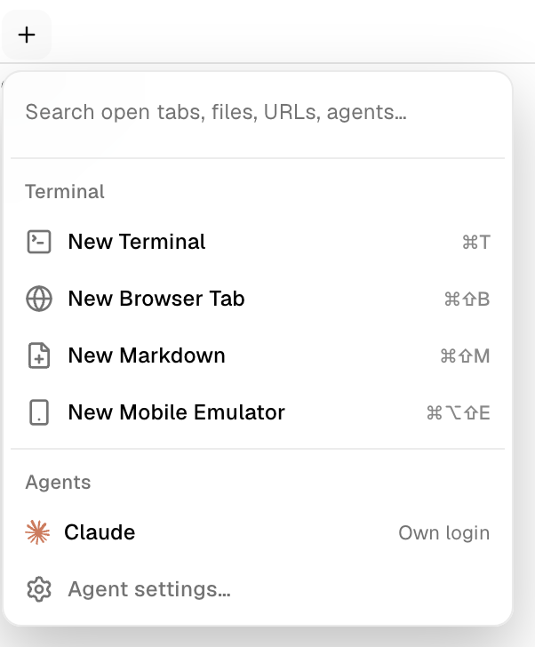

# Proyectos y espacios de trabajo

Un proyecto es un repositorio o una carpeta que agregas una sola vez. Después, cada tarea tiene su
propio espacio de trabajo dentro de él, y cada espacio tiene sus pestañas: terminales, agentes,
archivos y un navegador.

<figure class="orca-diagram" aria-label="De un proyecto a las pestañas en las que trabajas">
<ol class="orca-chain">
<li><strong>Proyecto</strong>un repositorio Git, una carpeta o un grupo de repos</li>
<li><strong>Espacio</strong>uno por tarea, en su propia rama</li>
<li><strong>Pestañas</strong>terminales y agentes, divididos en paneles</li>
<li><strong>Navegador</strong>la página que construye tu agente</li>
</ol>
</figure>

## Agrega un proyecto

Haz clic en **Add Project**, la carpeta con un signo más junto a **Projects** en la barra lateral.
**Browse folder** acepta un repositorio Git, una carpeta normal o una carpeta que contiene varios
repositorios. **Other ways to add** ofrece **Clone from URL** y **Create new project**. El selector
**Host**, arriba, elige dónde vive el proyecto: este equipo, una máquina emparejada o un
[host SSH](ssh.md).

Lo que hace Orca Lab depende de la carpeta que elijas:

- **Un repositorio Git** se convierte en un proyecto con worktrees, Source Control y pull requests.
- **Una carpeta que no es un repositorio** pregunta antes, porque faltarán las funciones de Git.
  Elige **Open as Folder** para trabajar en ella con el editor, las terminales y la búsqueda.
- **Una carpeta con repositorios** abre **Import repositories from folder**.
  **Yes, import as group** los mantiene juntos bajo un **Group name**, como un monorepo, y te deja
  trabajar desde la carpeta padre; **No, import separately** agrega cada uno como un proyecto
  aparte.

## Un espacio de trabajo por tarea

Pulsa `Mod+N` (Cmd en macOS, Ctrl en Windows y Linux), o haz clic en el **+** junto a
**Projects**, para crear un espacio de trabajo.

- En un repositorio, **Create worktree** crea una rama nueva en su propia carpeta, dentro de
  `~/orca/workspaces` salvo que **Settings > General > Workspace Directory** diga otra cosa. Tu
  checkout principal queda como estaba, así que varios agentes pueden trabajar a la vez.
- En una carpeta o un grupo, **Create workspace** abre la carpeta misma. En un grupo, los worktrees
  creados desde ese espacio aparecen en su panel **Attached worktrees**, y **PR Checks** muestra
  sus checks juntos.

[Worktrees](model/worktrees.md) explica cómo cambiar entre ellos y el menú del clic derecho.

## La barra lateral

La barra lateral izquierda lista tus proyectos bajo **Projects**, una fila por espacio de trabajo,
con la tarea actual de su agente debajo. Una fila muestra qué hace el agente y su pull request con
sus checks, así sabes qué tarea te necesita sin abrirla. Cuando emparejas una máquina o agregas un
host SSH, cada host tiene su propio grupo.

De `Mod+1` a `Mod+9` saltan a una fila por su posición. `Cmd+J` en macOS, o `Ctrl+Shift+J` en
Windows y Linux, busca cualquier espacio de trabajo por su nombre.
[Barra lateral y pestañas nuevas](model/sidebar.md) cubre la agrupación, los filtros y lo que
puede mostrar cada fila.

## Pestañas y terminales

El **+** al final de la barra de pestañas (**New tab**) abre una **New Terminal**, una
**New Browser Tab**, un archivo Markdown o cualquier agente que Orca Lab encontró en tu sistema.
`Mod+T` abre una terminal directamente.

Divide una pestaña para tener un agente y una shell lado a lado: en macOS, `Cmd+D` divide a la
derecha y `Cmd+Shift+D` hacia abajo; en Windows y Linux, `Ctrl+Shift+D` y `Alt+Shift+D`. Las
terminales corren en un proceso de fondo, y Orca Lab se reconecta a las que siguen activas cuando
lo vuelves a abrir. [Terminal](terminal.md) tiene todos los atajos, las shells de Windows y WSL.

## La barra lateral derecha

La barra lateral derecha reúne los paneles del espacio activo: **Explorer** para los archivos,
**Agents** para las sesiones anteriores, **Source Control** y **Checks** en un repositorio,
**Ports** en un host SSH, y **Your work**, que pasa a ser **Team** cuando un lead dirige el
proyecto.

## El navegador

`Mod+Shift+B` abre una pestaña de navegador dentro del espacio de trabajo. Apúntala al servidor de
desarrollo que arrancó tu agente, como `localhost:5173`, y podrás tomar un elemento de la página y
devolvérselo al agente como comentario. [Navegador y Design Mode](browser/design-mode.md) muestra
cómo.

## Siguiente

Con un espacio de trabajo y su agente en marcha, los pasos 5 y 6 de
[Primeros pasos](get-started.md) llevan el trabajo a un pull request y lo mergean.
