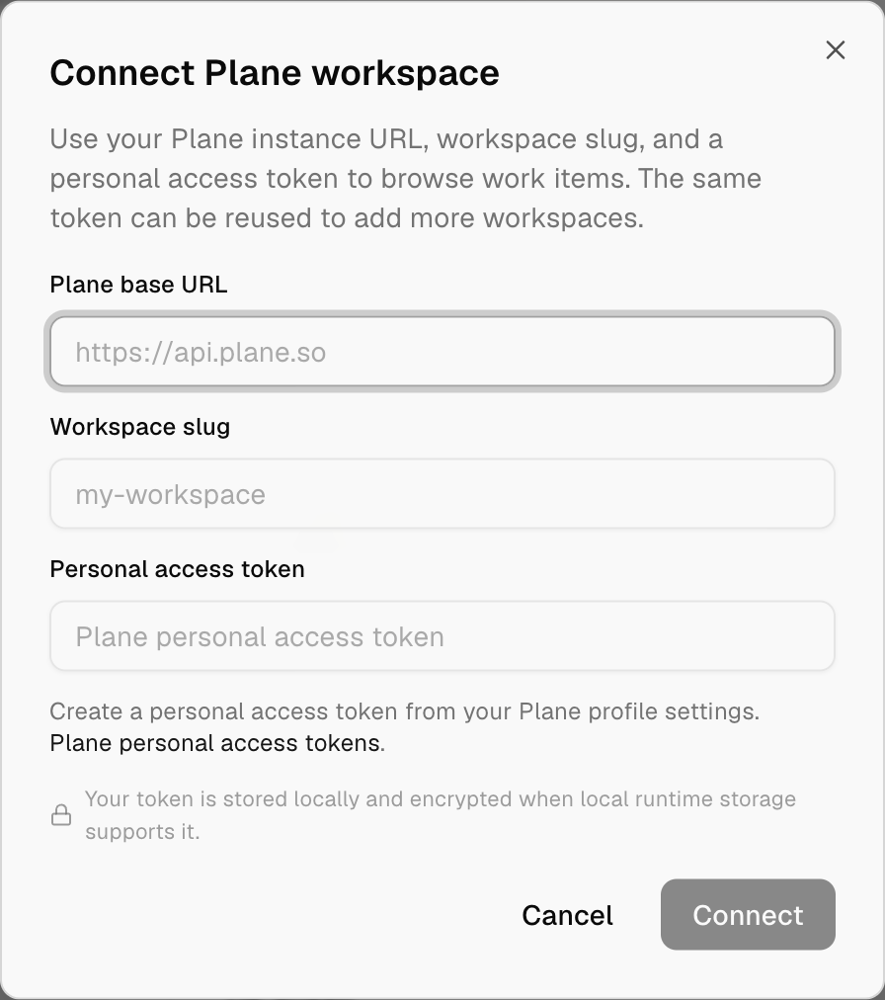

# Trackers y tareas

Orca Lab lee tus tickets de GitHub, GitLab, Linear, Jira y Plane. La página **Tasks** los lista, un
clic arranca un espacio de trabajo para uno, y los mismos trackers llenan el To Do que un lead
reparte entre sus miembros.

<figure class="orca-diagram" aria-label="De un tracker a un agente trabajando en un ticket">
<ol class="orca-chain">
<li><strong>Conecta</strong><span>cada tracker una vez, en Settings</span></li>
<li><strong>Tasks</strong><span>todas las fuentes en una página</span></li>
<li><strong>Start workspace</strong><span>el ticket vinculado a un worktree nuevo</span></li>
<li><strong>To Do</strong><span>lo que un lead reparte a sus miembros</span></li>
</ol>
</figure>

## Conecta un tracker

Abre **Settings > Integrations**. **Review providers** reúne GitHub y GitLab, que usan las
herramientas de línea de comandos `gh` y `glab`: ejecuta `gh auth login` o `glab auth login` en
una terminal y luego **Re-check**. **Task providers** reúne los demás:

| Tracker | Botón                 | Qué pide                                                                                                  |
| ------- | --------------------- | --------------------------------------------------------------------------------------------------------- |
| Linear  | **Add Linear access** | Una **Personal API key**, desde Account > Security & Access en Linear.                                    |
| Jira    | **Connect Jira**      | **Atlassian Cloud**: URL del sitio, **Atlassian email** y **API token**. **Self-hosted**: URL del sitio y un token de acceso personal, o usuario y contraseña. |
| Plane   | **Connect Plane**     | **Plane base URL**, **Workspace slug** y un **Personal access token** de tu perfil de Plane.              |

Los tokens se quedan en tu equipo, cifrados donde el sistema lo permite. **Test** comprueba una
conexión, y **Add workspace** o **Add Jira site** agrega otra.



## La página Tasks

Elige **Tasks** arriba de la barra lateral. Escoge una fuente en el selector de arriba y luego
acota la lista:

- **GitHub**: **Issues**, **PRs** y **Projects**, con filtros como **Assigned to me** y
  **Needs review**.
- **GitLab**: **Issues**, **MRs** y **My Todos**.
- **Linear**: **Issues**, **Projects**, **Views** y **Has Workspace**.
- **Jira**: **Assigned**, **Reported**, **All Open** y **Done**, o cualquier consulta JQL en el
  campo de búsqueda.
- **Plane**: **All**, **Assigned**, **Created**, **All Open** y **Done**, como **List** o como
  **Board**.

La entrada **Tasks** de la barra lateral también tiene un atajo a cada fuente. Para quitar un
tracker que no usas, abre **Settings > Task Sources**, elige su tarjeta y elige **Hide** en
**Show in Tasks**.

## Arranca un espacio de trabajo desde un ticket

Elige **Start workspace** en un ticket (**Start** para un issue o un pull request de GitHub,
**Resume** si ya tiene uno). Orca Lab abre el diálogo de espacio de trabajo nuevo con el ticket
vinculado, y la fila del worktree nuevo lleva el ticket desde entonces.

También puedes pegar la URL de un ticket directamente en el campo de nombre del diálogo de espacio
de trabajo nuevo: un issue de GitHub o GitLab, un issue de Linear o uno de Jira.

El agente arranca con el enlace del ticket en su entrada, como borrador para que lo completes y lo
envíes. Para Linear y Plane, **Settings > Task Sources > Launch prompt template** define ese texto
con `{{identifier}}` y `{{url}}`. El texto del ticket nunca se copia; el agente lo lee desde su
enlace.

## El To Do de un equipo

Cuando un lead dirige el proyecto, **+ > Add member…** lista el To Do: los tickets abiertos de los
trackers del proyecto que ningún miembro tiene todavía. Junta el tracker indicado en el
`orca.yaml` del proyecto, el proyecto de Plane vinculado, el ticket de Jira o Linear del propio
espacio de trabajo y los issues de GitHub o GitLab del repositorio, hasta 30 tickets.

```yaml
orchestratorGame:
  todo:
    provider: jira # plane, jira, linear, github or gitlab
    project: LUM
```

`todo: off` desactiva el To Do. [Agent Teams](../agents/agent-teams.md) cubre el resto de
`orca.yaml`.

## Vincula un ticket a mano

Haz clic derecho sobre un worktree en la barra lateral y elige **Update**. En
**Edit Worktree Details**, escribe un número de issue o una URL de GitHub o Linear en **Issue**, o
un pull request en su propio campo. Deja un campo vacío para quitar el vínculo.
