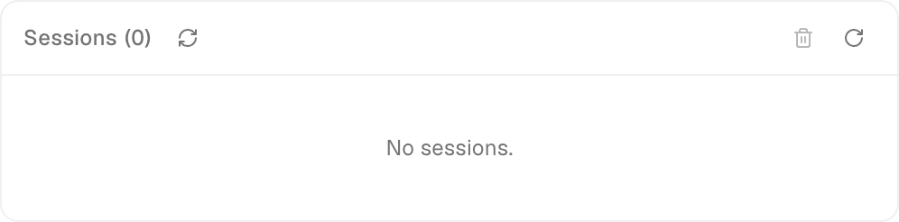

# Ajustes y solución de problemas

Orca Lab guarda los ajustes en tres lugares, y la mayoría de los problemas muestran un mensaje que
dice qué hacer. Esta página ordena ambas cosas: dónde vive un ajuste, y qué hacer cuando un login,
el límite de una cuenta, un miembro o un check se interponen.

## Tres capas de ajustes

<figure class="orca-diagram" aria-label="Dónde viven los ajustes, de todos los proyectos al archivo de un proyecto en el repo">
<ol class="orca-chain">
<li><strong>Settings global</strong>este equipo, todos los proyectos</li>
<li><strong>Project Settings</strong>este equipo, un proyecto</li>
<li><strong>orca.yaml</strong>en el repo, compartido con todos</li>
</ol>
</figure>

- **Settings global**: la página Settings, agrupada en **AI Capabilities**, **Set Up**,
  **Workflows**, **Interface**, **Remote Hosts**, **Privacy & Security**, **Advanced** y
  **Experimental**. **Search settings**, arriba, encuentra cualquiera.
- **Project Settings**: abre el menú del proyecto en la barra lateral (**Project actions**) y elige
  **Project Settings**, o el engranaje de su panel Team. Contiene el nombre y el icono del
  proyecto, **Agent Teams game**, **Available Hosts**, **Worktree Hooks** (**Setup Script**,
  **Archive Script**, **When to Run Setup**), **Source Control AI**, **Worktree Shared Paths**,
  **Sparse Checkout Presets** y **MCP Configs**.
- **`orca.yaml`** en la raíz del repo: `scripts` (`setup`, `archive`), `issueCommand`,
  `defaultTabs`, `environmentRecipes`, `worktree.sharedDirectories` y `orchestratorGame`.

Cuando dos capas definen lo mismo:

- **Scripts de setup y archive**: decide **Worktree Hooks > Advanced > Command Source**:
  **orca.yaml only**, **Local only** o **Run both** (primero orca.yaml, luego los tuyos).
- **El panel del juego**: Settings global, luego `orca.yaml`, luego los ajustes del proyecto en
  este equipo; gana la posterior. [Escenas, estilos y ajustes](agents/scenes-and-settings.md#qué-ajuste-gana)
  tiene el detalle.
- **Los scripts del repo preguntan antes.** La primera vez que un script de `orca.yaml` va a
  correr, o después de que cambia, Orca Lab pregunta **Run hooks** o **Don't run**;
  **Always trust `orca.yaml`** evita la pregunta para ese repo.

## Venció el login de un agente

**Settings > AI Provider Accounts** marca la cuenta con **Sign-in expired — re-authenticate this
account**. Elige **Re-authenticate**, o **Check sign-in** para probarla antes. Una cuenta de token
rechazada dice que vuelvas a ejecutar `claude setup-token`. Un miembro sin sesión dice
**Logged out** en su tarjeta: vuelve a iniciar sesión con `/login` en su terminal, o pídele al líder
que pase su ticket a otra cuenta.

## Una cuenta llegó a su límite

La barra de estado muestra **Limited**, el selector de cuentas **Limit reached** y la tarjeta de un
miembro **Usage limit reached**. Con **Auto-switch Limited Agents** activo (en
**AI Provider Accounts**), una sesión de Claude o Codex en marcha pasa a otra cuenta y sigue ahí. A
mano:

- `orca account switch --to <account>` cambia la cuenta de una terminal.
- `orca game move <ticket> --account auto` pasa un miembro a una cuenta con margen.

Cuando todas las cuentas están cerca de su límite, un lanzamiento dice cuándo vuelve a estar
disponible la primera.

## Un miembro no arranca

| Qué dice | Qué hacer |
| --- | --- |
| `N of M members are running, the lead's cap` | Espera a que termine uno, o cierra uno. |
| `<host> at cap … launch <ticket> with --on <other>` | Lánzalo en el host con margen, como sugiere. |
| `<ticket> already has a live agent in …` | Detén ese agente primero, o sigue trabajando con él. |
| `<ticket> is paused …` | `orca game resume-members <ticket>` lo reanuda; `--discard` lo libera. |
| **Queued** en su tarjeta | Su worktree espera otro setup; arranca solo. |
| **Failed to start**, `Setup failed; skipping agent startup.` | Corrige el **Setup Script** del proyecto y vuelve a lanzarlo. |
| `Not the lead: …` | Ejecuta `/orca-game:lead` en una pestaña **Claude Agent Teams** del proyecto. |

`orca game fleet`, desde la terminal del líder, lista cada miembro con lo que espera y el comando que
lo resuelve. Un Claude anterior a 2.1.287 arranca sin el juego; actualiza Claude Code.

## Leer el CI

- **La barra lateral** colorea el icono de un pull request: pasando, pendiente, fallando.
- **Checks** lista cada check (**Successful**, **Failed**, **In progress**, **Queued**…) y el botón
  de merge nombra lo que lo bloquea (consulta [Un agente hasta un PR mergeado](one-agent.md#mergéalo)).
- **La pestaña PRs del panel Team** muestra **Check failed** o **CI unknown**, y su merge queue
  **In checks**, **In queue** o **Failed**.
- **`orca game state --json`** da a un miembro `review.ci` (`pending`, `success`, `failure`,
  `neutral` o `none`) y `review.mergeState`. Solo `clean` se puede mergear: `behind` necesita
  actualizar la rama, `dirty` tiene conflictos, `blocked` espera una regla como una revisión, y
  `unstable` tiene un check que falla o espera aprobación.

## Otros habituales

- **GitHub CLI is not authenticated**: ejecuta `gh auth login` en una terminal (`glab auth login`
  para GitLab) y luego **Re-check** en **Settings > Integrations**.
- **Una terminal se trabó**: **Settings > Terminal > Manage Sessions** tiene **Restart daemon** y
  **Kill all sessions**; el menú de recursos de la barra de estado también los tiene. Matar las
  sesiones termina los procesos en marcha.
- **Un host SSH no tiene Node.js**: instala Node.js 18 o más reciente con npm en el host y vuelve a
  conectar.
- **Un host dice Update required**: actualiza Orca Lab en el lado más antiguo; consulta
  [Hosts emparejados y SSH](ssh.md).

## Diagnóstico

**Settings > Privacy & Telemetry**, en **Send app diagnostics to support**, tiene
**Create diagnostic file**: revísalo con **Open review file** y luego **Send to support** o
**Discard**. Después de un cierre inesperado, **Help > Report Crash...** abre un informe que puedes
copiar o publicar en GitHub. Los logs están en una carpeta `logs` dentro de la carpeta de datos de
Orca Lab.
