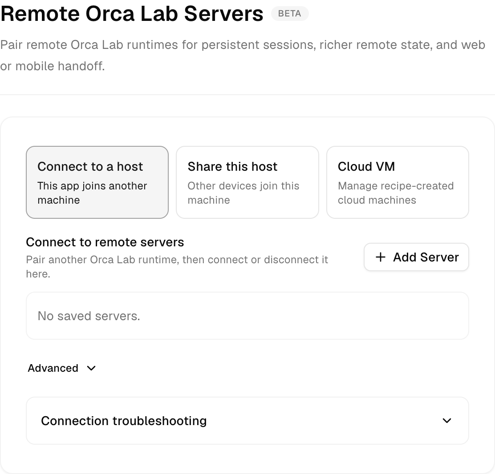

# Hosts emparejados y SSH

Orca Lab puede ejecutar tu trabajo en otra máquina, para que los agentes corran junto al código o
en un equipo más potente, mientras esta ventana sigue siendo donde trabajas. Hay dos tipos de host:
otra máquina con Orca Lab, que **emparejas**, y cualquier máquina a la que llegas por **SSH**.

<figure class="orca-diagram" aria-label="De agregar un host a correr miembros en él">
<ol class="orca-chain">
<li><strong>Agrega un host</strong><span>empareja una máquina con Orca Lab, o agrega un host SSH</span></li>
<li><strong>Agrega el proyecto</strong><span>en ese host, desde el selector Host</span></li>
<li><strong>Trabaja ahí</strong><span>espacios de trabajo, terminales y agentes</span></li>
<li><strong>Miembros ahí</strong><span>un líder puede lanzarlos en un host emparejado</span></li>
</ol>
</figure>

## ¿Host emparejado o host SSH?

| | Host emparejado con Orca Lab | Host SSH |
| --- | --- | --- |
| Qué es | Otro equipo con Orca Lab, u `orca serve` en un servidor | Cualquier máquina a la que puedes entrar con `ssh` |
| Qué ejecuta | Proyectos, archivos, terminales, comprobaciones del proveedor y sus propias cuentas de agente | Terminales, Git y archivos, mediante un pequeño relay que sube Orca Lab |
| Miembros de un equipo | Sí, con `orca game launch --on` | No |
| Necesita | Orca Lab en esa máquina | Node.js 18 o más reciente y npm |

## Empareja otra máquina

En la máquina que quieres usar como host:

- **Con ventana**: abre **Settings > Remote Orca Lab Servers**, elige **Share this host**, luego
  **Advertise this app as a server** y **New Link**. En **Where will this link be opened?** elige
  **Another device** y luego **Generate Access Link**.
- **Sin ventana**: ejecuta `orca serve --pairing-address <reachable-host>`. Imprime
  `Orca Lab server ready` y una `Pairing URL: orca://pair?code=…`. La
  [guía del servidor Linux sin interfaz](../../reference/es/headless-linux-server.md) explica cómo
  ejecutarlo como servicio.

En esta máquina, abre **Settings > Remote Orca Lab Servers**, elige **Connect to a host** y
**Add Server**, dale un **Name in Orca Lab**, pega el **Access link** y elige **Add host**. El host
aparece como **Connected**; **Update client** o **Update server** significa que uno de los dos lados
necesita un Orca Lab más reciente.



## Agrega un host SSH

Abre **Settings > SSH Hosts** y elige **Add Target**: un **Label**, el **Host or alias**, un
**Username**, un **Port** y un **Identity File** (vacío usa ssh-agent). **Advanced** tiene un
**Proxy Command**, un **Jump Host** (ProxyJump) y cuánto viven las terminales después de una
desconexión. **Import** agrega de una vez todos los hosts de `~/.ssh/config`.

Orca Lab pide una frase de contraseña o una contraseña cuando el host la necesita, y la guarda solo
en memoria durante la sesión. La primera conexión sube un pequeño relay a `~/.orca-remote` en el
host y lo inicia por SSH; ahí necesita Node.js 18 o más reciente y npm, y herramientas de
compilación (make, un compilador de C++ y python3) cuando tiene que compilar su módulo de terminal.
Funcionan hosts Linux, macOS y Windows, en x64 y arm64.

Las terminales en un host SSH siguen corriendo después de una desconexión: por defecto hasta que las
reinicias, o durante un tiempo que defines en **Advanced** con **Keep terminals alive until reset**
desactivado (de 60 segundos a 7 días).

## Trabaja en un host

- **Agrega el proyecto ahí**: en **Add a project**, elige el host en el selector **Host**. Para un
  host SSH, elige **Open project on SSH host** e introduce el **Host path**. **Add remote host** en
  el selector agrega un host sin pasar por Settings.
- **Espacios de trabajo**: con más de un host, el diálogo de espacio de trabajo nuevo tiene
  **Run on**. Lista cada host, marca los que todavía no tienen el proyecto configurado y termina con
  **Add host**.
- **La barra lateral** agrupa las filas por host cuando dos hosts tienen trabajo, con
  **This computer** para el tuyo. El menú de un host tiene **Check connection**, **Disconnect** y
  **Remove host…**.

## Miembros en un host emparejado

Un líder puede iniciar un miembro en un host emparejado:

```bash
orca game launch LUM-21 --on studio --repo name:lumen-app
```

`--on` toma el nombre del host emparejado y necesita `--repo` para indicar el proyecto. El miembro
corre en ese host con las cuentas de agente de ese host, mientras el líder sigue en esta máquina. Su
tarjeta en el panel Team nombra el host, y **Machines** muestra cuántos agentes corre cada host.
Cada host acepta tantos miembros como le permiten su memoria y sus núcleos; cuando uno está lleno,
al líder se le indica lanzar en otro.

Los agentes en un host inician sesión con los logins de ese host: inicia sesión ahí, o agrega
cuentas en él con `orca account add`.

## Qué se guarda en tu equipo

La configuración de los hosts se guarda en el archivo de datos de Orca Lab en tu equipo. Las
contraseñas y las frases de contraseña no se guardan.
