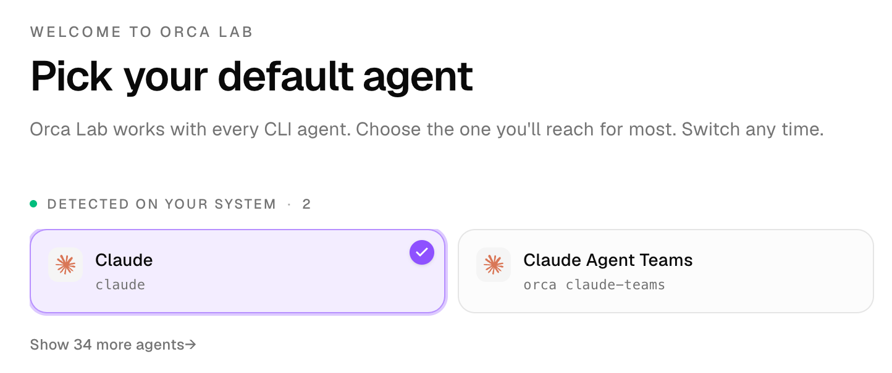
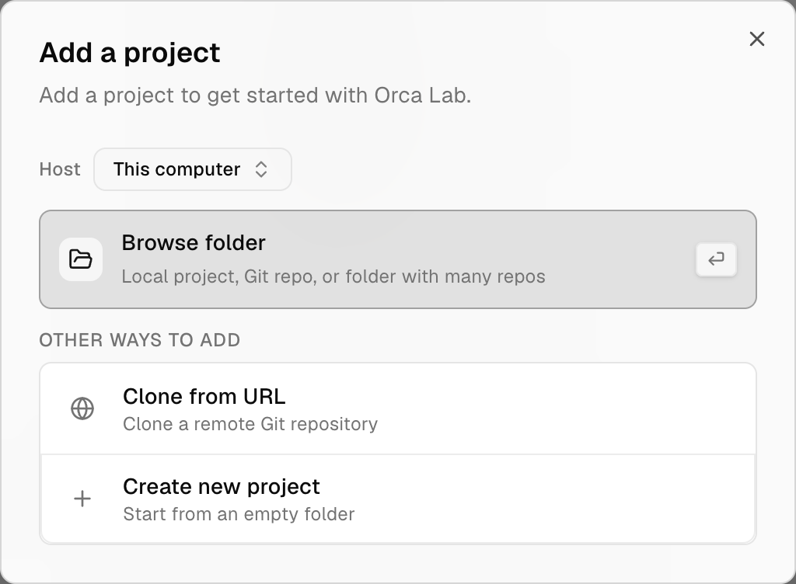
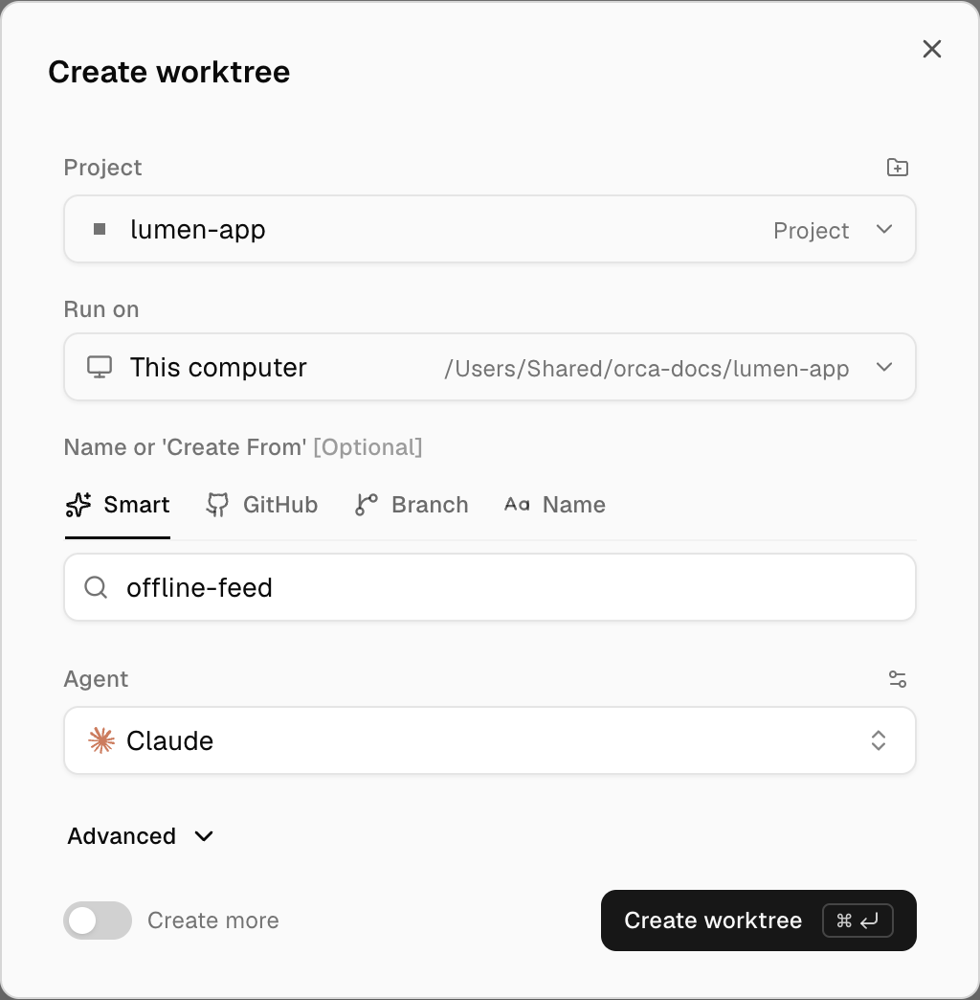
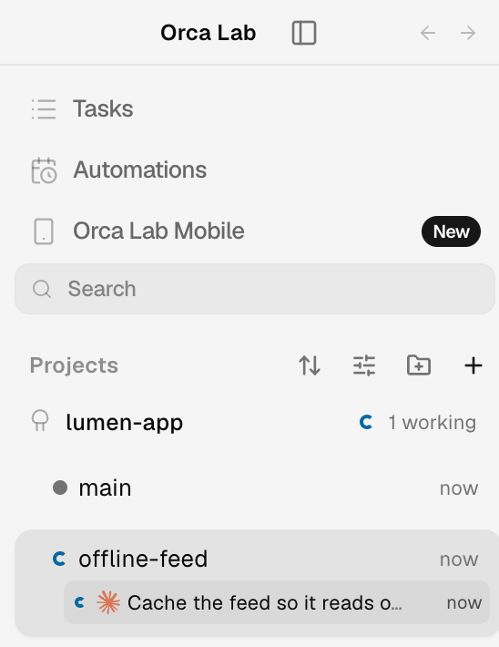
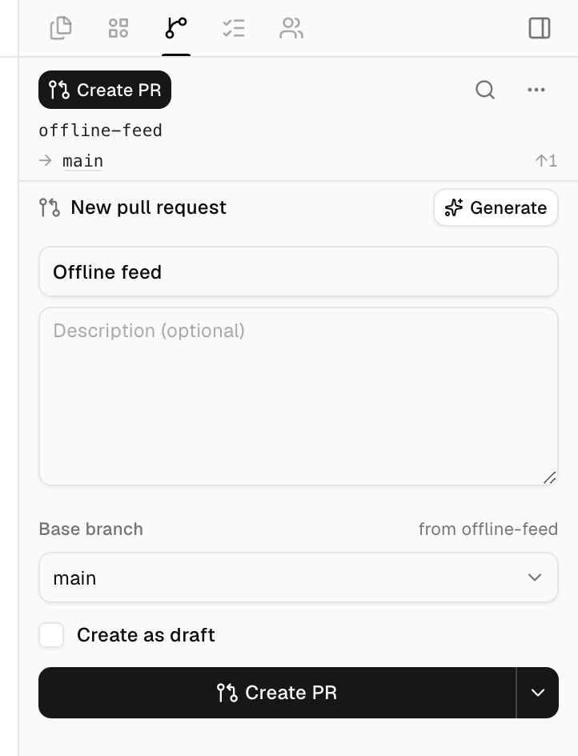

# Get started

Six steps take you from the download to a merged pull request opened by an agent. Each step links
to the full page when you want more.

## 1. Install Orca Lab

Download the build for your platform from the
[latest release](https://github.com/ab2webco/orca-oss/releases/latest) and open it.
[Install](install.md) lists the file for each platform.

The first launch walks you through a few screens: **Pick your default agent**, from the ones it
finds on your system; **Make it feel like home**, the theme; **Set up GitHub tasks**, when the
GitHub CLI is missing; and **Set up notifications**. On the agent screen,
**Yolo / Dangerously skip permissions** is on, so Orca Lab starts the agent with its
skip-permissions flag (for Claude, `--dangerously-skip-permissions`) and the agent runs commands
without asking you first. Untick it if you want to approve each one.

## 2. Sign in to your agent

An agent that is already signed in on this machine works as it is. To keep several accounts and
see how much of each one's limit is left, open **Settings > AI Provider Accounts** and choose
**Add Account**. [Usage tracking and accounts](agents/usage-tracking.md) covers switching and
long-lived tokens.

## 3. Open a repository

In **Add a project**, choose **Browse folder** and pick a Git repository on your machine, or
choose **Clone from URL**. The project appears under **Projects** in the left sidebar.

## 4. Create a worktree with an agent

Click **+** at the top of the sidebar (**New workspace**), or press `Mod+N` (Cmd on macOS, Ctrl on
Windows and Linux). Check the **Project**, type a name for the task, pick an **Agent** and choose
**Create worktree**. Orca Lab checks out a new branch in its own worktree and starts the agent in
a terminal tab there, so your main checkout stays as it was.

Type the task into the agent's terminal tab. The worktree's row in the sidebar shows what the agent
is on, with a spinner while it works and a check when it is done.

## 5. Open the pull request

When the agent has committed its work, open **Source Control** in the right sidebar
(`Mod+Shift+G`). Under **New pull request**, check the title and the **Base branch**, then choose
**Create PR**. On GitLab the same form opens a merge request.

## 6. Merge it

The same panel then shows the pull request's checks and review state. When they are green, choose
**Merge**, or **Enable auto-merge** to let GitHub merge it once they are.

## Next: run a team with Orca Game

One agent in one worktree is the basic unit. Orca Game puts a lead agent on top: you give it
tickets, it starts one member per ticket in its own worktree, and it brings you only what you have
to decide.

<figure class="orca-diagram" aria-label="A lead and its members, from tickets to merged pull requests">
<ol class="orca-chain">
<li><strong>Lead</strong>takes your tickets and launches members</li>
<li><strong>Members</strong>one per ticket, each in its own worktree</li>
<li><strong>Inbox</strong>their questions and pull requests, for you</li>
<li><strong>Merge</strong>queued by the lead once CI is green</li>
</ol>
</figure>

[Agent Teams](agents/agent-teams.md) walks through starting a lead, adding members and reading the
Team panel; [Orca Game](../reference/orchestrator-game.md) is the full reference.
