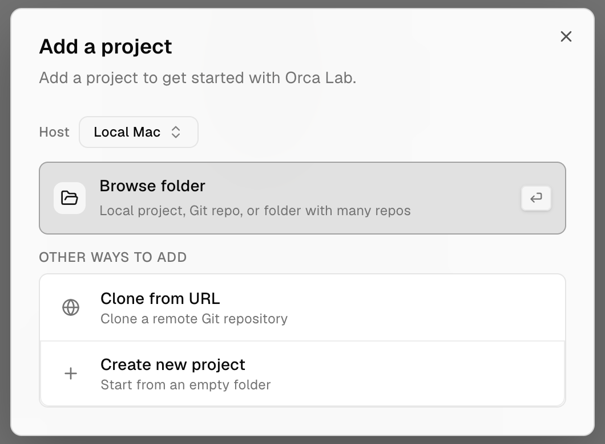
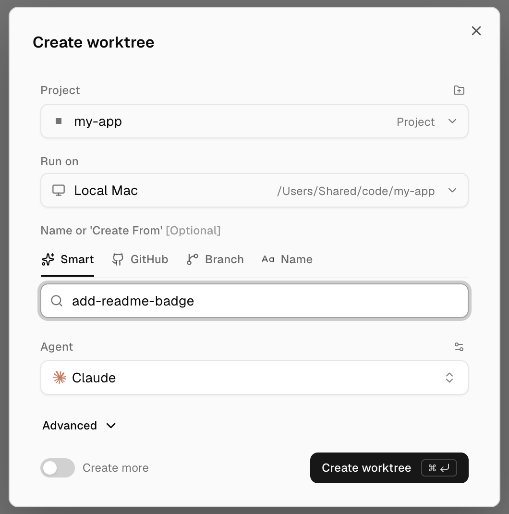
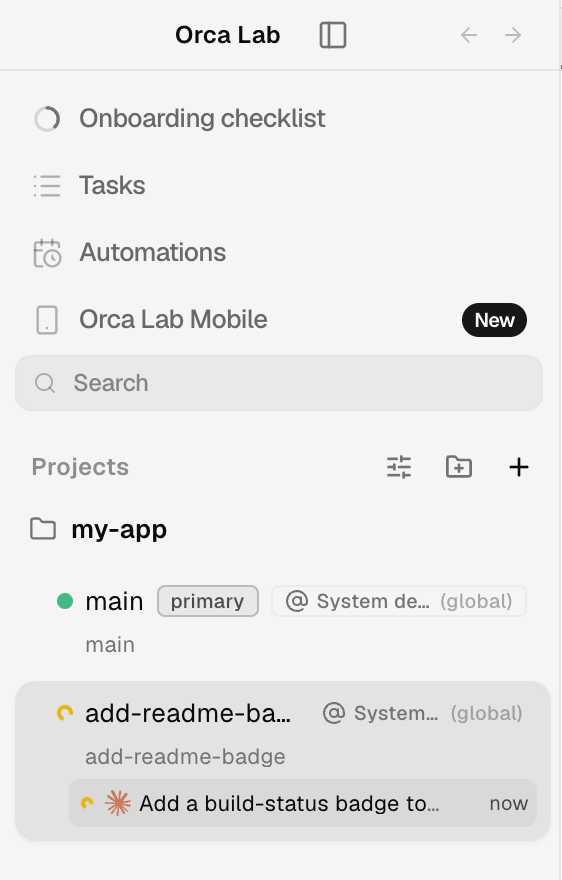
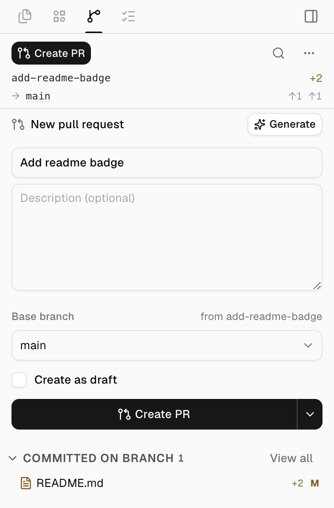

# Get started

Five steps take you from the download to a pull request opened by an agent. Each step links to
the full page when you want more.

## 1. Install Orca Lab

Download the build for your platform from the
[latest release](https://github.com/ab2webco/orca-oss/releases/latest) and open it.
[Install](install.md) lists the file for each platform.

The first launch asks for three things: your default agent, chosen from the ones it detects on your
system; a theme; and notifications. **Yolo / Dangerously skip permissions** is on by default, so
Orca Lab starts the agent with its skip-permissions flag (for Claude,
`--dangerously-skip-permissions`) and the agent runs commands without asking you first. Untick it
if you want to approve each one. Finish with **Add your first project**.

## 2. Open a repository

In **Add a project**, choose **Browse folder** and pick a Git repository on your machine, or
choose **Clone from URL**. The project appears under **Projects** in the left sidebar. The folder
icon next to **Projects** (**Add Project**) adds another one later.

## 3. Create a worktree with an agent

Press `Mod+N` (Cmd on macOS, Ctrl on Windows and Linux), or click **+** next to **Projects**.
In **Create worktree**, check the project, type a name for the task, pick an **Agent** and choose
**Create worktree**. Orca Lab checks out a new branch in its own worktree and starts the agent in
a terminal tab there, so your main checkout stays as it was. [Worktrees](model/worktrees.md)
covers the other options.

## 4. Give the agent its task

Type the task into the agent's terminal tab, as you would in any terminal. The worktree's card in
the sidebar shows what the agent is on, with a spinner while it works and a green check when it
is done, so you can switch to another worktree and come back.
[Supported agents](agents/supported.md) explains how Orca Lab tracks each agent.

## 5. Open the pull request

When the agent has committed its work, open **Source Control** in the right sidebar
(`Mod+Shift+G`). Under **New pull request**, check the title and the **Base branch**, then choose
**Create PR**. On GitLab the same form opens a merge request.

## Next: run a team with Orca Game

One agent in one worktree is the basic unit. [Orca Game](../reference/orchestrator-game.md) puts
a lead agent on top: it takes your tickets, starts one member per ticket in its own worktree, and
asks you only what you have to decide.
