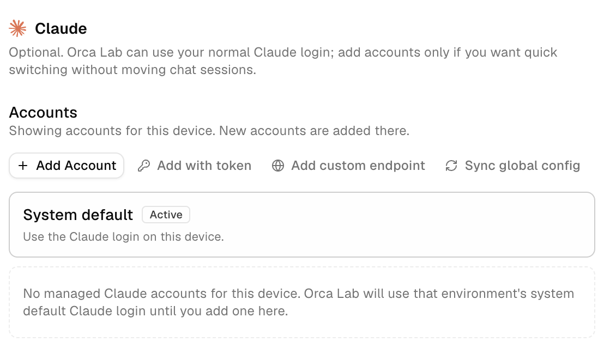

# Install

Orca Lab ships from the [GitHub releases page](https://github.com/ab2webco/orca-oss/releases/latest)
with a build for each desktop platform. Download it, open it, and the first launch walks you to
your first project.

<figure class="orca-diagram" aria-label="From the download to your first project">
<ol class="orca-chain">
<li><strong>Download</strong><span>the build for your platform</span></li>
<li><strong>Open</strong><span>past the system's first-run check</span></li>
<li><strong>First launch</strong><span>agent, theme, notifications</span></li>
<li><strong>Sign in</strong><span>your agent's own login, or several accounts</span></li>
</ol>
</figure>

## Download

| Platform              | File                                                                                                         |
| --------------------- | ------------------------------------------------------------------------------------------------------------ |
| macOS (Apple Silicon) | [`orca-macos-arm64.dmg`](https://github.com/ab2webco/orca-oss/releases/latest/download/orca-macos-arm64.dmg) |
| macOS (Intel)         | [`orca-macos-x64.dmg`](https://github.com/ab2webco/orca-oss/releases/latest/download/orca-macos-x64.dmg)     |
| Windows               | [`orca-windows-setup.exe`](https://github.com/ab2webco/orca-oss/releases/latest/download/orca-windows-setup.exe) |
| Linux x64             | [`orca-linux.AppImage`](https://github.com/ab2webco/orca-oss/releases/latest/download/orca-linux.AppImage), or the `orca-ide_<version>_amd64.deb` on the release page |

## macOS

Open the `.dmg` and drag **Orca Lab** to **Applications**. The build is signed and notarized, so
it opens like any other app, and it updates itself when a new release comes out.

## Windows

Run `orca-windows-setup.exe`. The Windows build is not signed yet, so SmartScreen shows
**Windows protected your PC**: choose **More info**, then **Run anyway**. For the same reason the
app cannot update itself on Windows; to update, download and run the newest installer.

Worktrees can live inside WSL, and the CLI has its own WSL shell command.

## Linux

For the AppImage, make it executable and run it:

```bash
chmod +x orca-linux.AppImage
./orca-linux.AppImage
```

For the `.deb`, install it with `apt`, which pulls in its dependencies:

```bash
sudo apt install ./orca-ide_*_amd64.deb
```

The Linux build targets stock Ubuntu 20.04 and newer (glibc 2.31).

## Sign in to your agent

Orca Lab runs the agents' own command-line tools, so an agent that is already signed in on this
machine works as it is. If it is not, sign in the way that agent always does, for example by
running `claude` or `codex` once in any terminal.

To keep several Claude or Codex accounts and switch between them, open
**Settings > AI Provider Accounts** and choose **Add Account** under **Claude** or **Codex**. Orca
Lab runs that agent's own sign-in and opens it in your browser; there is no email to type. On a
remote server, a **Sign in on** dialog gives you the link and a code to enter instead. **Add with
token** adds a Claude account from a long-lived token.



The first row in each list, **System default**, is the login the agent already had. Click a row
to make it the default for new terminals. A worktree can use its own account: right-click it in the
sidebar and choose **Assign Account**.

Only Claude and Codex have managed accounts. Gemini, OpenCode Go, MiniMax and Grok appear in the
same pane for usage tracking only; every other agent uses its own login.

## Quotas

The status bar shows how much of each account's limit is used and when it resets. Open it for the
**Usage** popover, where **Refresh rate limits** checks now and **Manage Accounts…** goes back to
the accounts pane. With **Auto-switch Limited Agents** on, a session that hits its limit moves to
another account. [Usage tracking and accounts](agents/usage-tracking.md) covers the details,
switching from the CLI and long-lived tokens.

## The `orca` command

Open **Settings > General > Orca Lab CLI** and choose **Register** under **Shell command**. Agents
and scripts then drive Orca Lab from any terminal. See the [CLI guide](cli/overview.md).

## Without a window

To run Orca Lab on a server and pair it as a host for remote members, run `orca serve` on a
headless Linux machine. The [headless Linux server guide](../reference/headless-linux-server.md)
covers the service unit, pairing and upgrades.

## Phone

The companion app pairs with the desktop from **Settings > Mobile**. See [Mobile](mobile.md).
