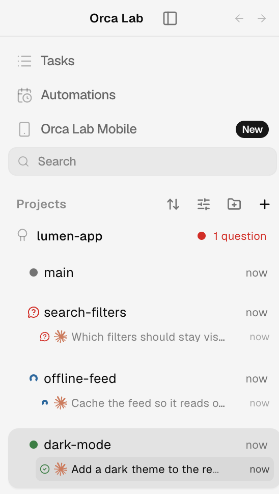
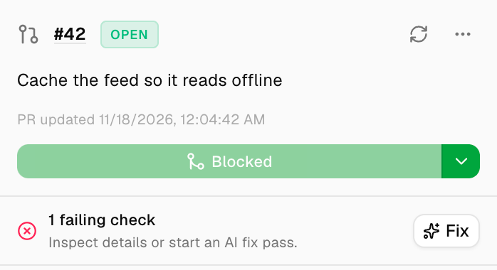
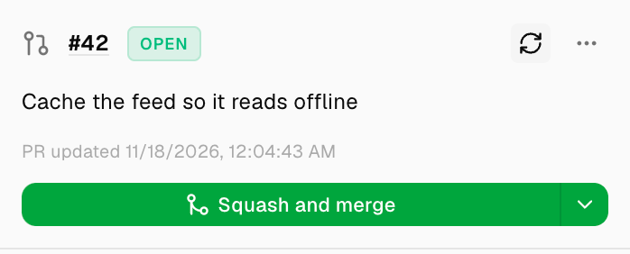

# One agent to a merged PR

One agent in one workspace is the unit everything else in Orca Lab builds on. This page follows
it from the task you type to the merge, on GitHub or GitLab, without leaving the app.

<figure class="orca-diagram" aria-label="From an agent's work to a merged pull request">
<ol class="orca-chain">
<li><strong>Agent</strong>works in its own worktree and tells you when it needs you</li>
<li><strong>Pull request</strong>opened from Source Control</li>
<li><strong>Review</strong>checks and comments, sent back to an agent to fix</li>
<li><strong>Merge</strong>now, or automatically once checks pass</li>
</ol>
</figure>

## Connect GitHub or GitLab

Orca Lab reads pull requests, checks and comments through the provider's own command-line tool:
`gh` for GitHub and `glab` for GitLab. It picks the provider from the repository's remote, so there
is nothing to switch. **Settings > Integrations** shows each one as **Connected**,
**Not installed** or **Not authenticated**; for the last, run `gh auth login` or `glab auth login`
in a terminal and choose **Re-check**.

On GitLab, everything below says **MR** and **merge request** where GitHub says **PR** and
**pull request**.

## Read the agent's state

Start the agent as in [Projects and workspaces](projects.md), then type the task into its terminal
tab. Its row in the sidebar, and its terminal tab, show what it is doing:

| Mark          | State                 | What it means                                            |
| ------------- | --------------------- | -------------------------------------------------------- |
| Spinner       | **Working**           | The agent is running; nothing to do.                     |
| Question mark | **Waiting for input** | It asked you something or wants a permission. Answer it. |
| Check         | **Done**              | It finished its turn. Read what it did.                  |
| Grey dot      | **Idle**              | No agent is working there.                               |

To answer, click the row and reply in its terminal. With **Group by > Status** in the sidebar's
**Workspace options**, rows that wait for you gather under **Needs you** at the top.

## Open the pull request

Open **Source Control** in the right sidebar (`Mod+Shift+G`). Its main button follows the branch:
**Commit** with a message, **Publish Branch** for a branch the remote has not seen, **Push** for new
commits, then **Create PR**.

Under **New pull request**, write the **Title** and an optional **Description**, or choose
**Generate** to draft both with AI from the changes. Check the **Base branch**, tick
**Create as draft** if it is not ready, and choose **Create PR**. When the branch still has local
commits, the button reads **Push & Create PR** and does both.

[Get started](get-started.md#5-open-the-pull-request) shows the form.

## Review it in Orca Lab

Once the pull request exists, the worktree's row carries its icon, coloured by its checks: green
when they pass, amber while they run, red when one fails. **Checks** in the right sidebar has the
rest: the pull request's state, how many checks are passing, failing and pending, and its comments.

- **A failing check**: choose **Fix**. **Fix With AI** shows the prompt with the failing checks'
  details; **Start agent** opens a new agent tab on it in the same worktree. **View full logs**
  opens a check's log.
- **Review comments**: **Reply** and **Resolve** work as on the website. **Queue for agent** collects
  comments; **Send unresolved PR comments** hands them to an agent. Once the prompt is delivered,
  Orca Lab resolves those threads on GitHub and replies to the comments it cannot resolve.
- **Conflicts with the base branch**: **Resolve** starts an agent on them.

## Merge it

The merge button sits under the pull request's title in **Checks** and follows what GitHub reports.
When the pull request can merge, it reads **Squash and merge**, or the repository's own default;
its menu offers **Create merge commit**, **Rebase and merge** and **Close PR**.

- **When it cannot merge yet**, the button names the reason: **Approval required**,
  **Changes requested**, **Conflicts**, **Behind** or **Blocked**. Hover it for GitHub's
  explanation. If the repository allows auto-merge, it reads **Enable auto-merge** instead, which
  merges the pull request as soon as its requirements are met.
- **When the base branch uses a merge queue**, it reads **Merge when ready** and adds the pull
  request to the queue.
- **On GitLab**, it names **Unresolved threads**, or **Checks must pass** when the project requires
  a green pipeline.

After the merge, **Delete Workspace** removes the worktree.

## Next

One agent at a time is enough for small work. [Agent Teams](agents/agent-teams.md) runs several: a
lead hands out tickets, and members bring their pull requests to you.
