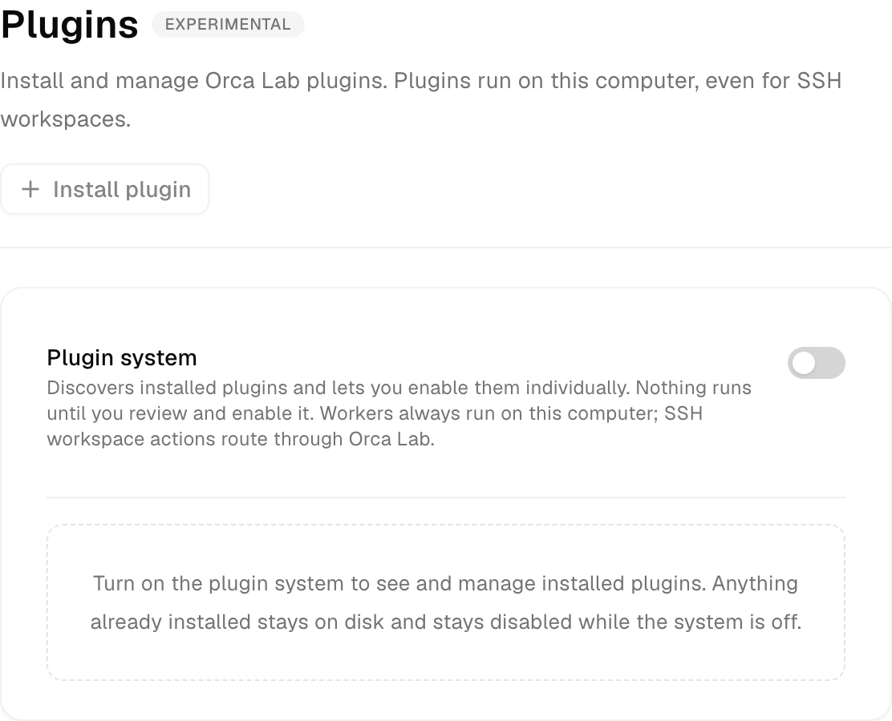

# Plugins, the advisor and skills

Plugins add panels, commands, scenes and agent skills to Orca Lab. The Jev advisor is one of them,
and skills teach your agents how to use Orca Lab and your trackers. This page is for using them;
[Plugins](../reference/plugin-development.md) covers writing one.

<figure class="orca-diagram" aria-label="From turning plugins on to a plugin running">
<ol class="orca-chain">
<li><strong>Turn on</strong><span>the plugin system, in Settings</span></li>
<li><strong>Install</strong><span>from a marketplace, a folder or a Git URL</span></li>
<li><strong>Review</strong><span>what it can do, before anything runs</span></li>
<li><strong>Enable</strong><span>and configure it</span></li>
</ol>
</figure>

## Turn plugins on

Plugins are experimental and off by default. Open **Settings > Plugins** and turn on **Plugin
system**. Nothing runs yet: each plugin still waits for you to review and enable it. Plugins run on
this computer, even for SSH workspaces.



## Install a plugin

- **From a marketplace**: the **All** tab lists the plugins of every marketplace you have, the
  official one first. **Manage sources** adds another Git marketplace. Choose **Install** on a
  plugin, check **Includes** and **Requested access**, then **Install plugin**.
- **From a folder or Git**: **Install plugin** opens a dialog with **Local folder** (the folder that
  holds `orca-plugin.json`) or **Git URL** (a repository URL ending in `#` and a tag or commit, so
  the install is pinned).

Installing copies the plugin and shows its permissions; no plugin code runs until you enable it.

## Review and enable

A new plugin says **Needs review**. **Review & enable** opens its permissions: who published it,
where it came from, and a **This plugin can** list, plus any keyboard shortcuts, scheduled
automations or VM recipe commands it adds. Choose **Enable plugin**, or **Keep Disabled**.

A plugin that adds shortcuts, automations, skills, VM recipes or agent profiles asks again after
every update, since what it does may have changed. Others ask again only when their permissions
change.

Each plugin's card has a switch to turn it off, **Configure** for its own settings (**Finish
setup** when a required value is missing), and a menu with **View logs**, **Roll back** and
**Remove**. A plugin's panel appears as an icon in the right sidebar of each workspace.

## The Jev advisor

Jev is a plugin that watches each agent step and picks the model and effort for it, saying why. With
it installed and plugins on, the Team panel shows its latest advice in a row under the lead, and
the scene acts that advice out.

The row is labelled **Advisor**, shown as **Wizard** in the **Game** look.

The row is on by default. To hide it for one project, set **Advisor** to **Off** on the project's
page in **Settings**, section **Agent Teams game**; `orchestratorGame.panel.advisor` in `orca.yaml`
does the same for everyone on the repo. The row only appears while the plugin is installed.

## Skills

A skill is a set of instructions an agent loads when it needs it. Three kinds reach your agents:

- **Orca Lab's skills** teach an agent to drive Orca Lab and your trackers: `orca-cli`,
  `orchestration`, `orca-plane`, `orca-linear`, `switch-account` and more. Install them from the
  skill pages in Settings (**CLI skill** under **Orca Lab CLI**, **Plane skill**, **Linear skill**),
  which run the install command for you, or from a terminal:

  ```bash
  orca skills install --all
  ```

  `orca skills list` shows what is available and `orca skills update` refreshes them.
- **The orca-game skills** come with Claude Agent Teams panes: `/orca-game:lead`,
  `/orca-game:setup`, `/orca-game:state`, `/orca-game:view` and the rest. They need no install.
- **Plugin skills** come with a plugin that asks to teach your agents. They reach every agent while
  the plugin is enabled and you approved that permission.
