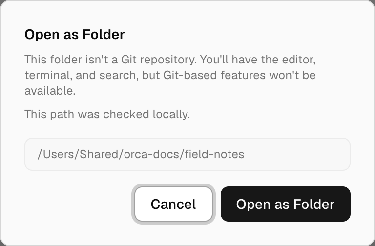
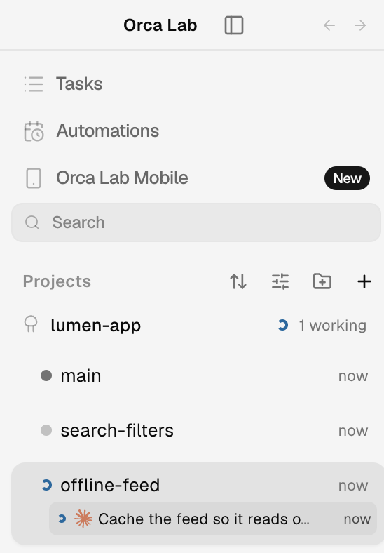
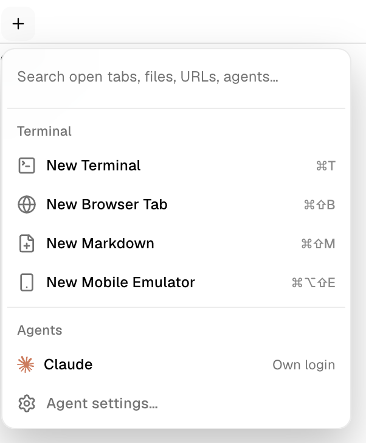

# Projects and workspaces

A project is a repository or a folder you add once. Each task then gets its own workspace in it,
and each workspace has its own tabs: terminals, agents, files and a browser.

<figure class="orca-diagram" aria-label="From a project to the tabs you work in">
<ol class="orca-chain">
<li><strong>Project</strong>a Git repository, a folder, or a group of repos</li>
<li><strong>Workspace</strong>one per task, on its own branch</li>
<li><strong>Tabs</strong>terminals and agents, split into panes</li>
<li><strong>Browser</strong>the page your agent is building</li>
</ol>
</figure>

## Add a project

Click **Add Project**, the folder with a plus beside **Projects** in the sidebar. **Browse folder**
takes a Git repository, a plain folder or a folder that holds several repositories. **Other ways to add**
offers **Clone from URL** and **Create new project**. The **Host** picker at the top chooses where the
project lives: this computer, a paired machine or an [SSH host](ssh.md).

What Orca Lab does depends on the folder you pick:

- **A Git repository** becomes a project with worktrees, Source Control and pull requests.
- **A folder that is not a repository** asks first, because Git features will be missing. Choose
  **Open as Folder** to work in it with the editor, terminals and search.
- **A folder of repositories** opens **Import repositories from folder**. **Yes, import as group**
  keeps them together under one **Group name**, like a monorepo, and lets you work from the parent
  folder; **No, import separately** adds each one as its own project.

## One workspace per task

Press `Mod+N` (Cmd on macOS, Ctrl on Windows and Linux), or click the **+** beside **Projects**, to
create a workspace.

- In a repository, **Create worktree** checks out a new branch in its own folder, under
  `~/orca/workspaces` unless **Settings > General > Workspace Directory** says otherwise. Your
  main checkout stays as it was, so several agents can work side by side.
- In a folder or a group, **Create workspace** opens the folder itself. In a group, worktrees made
  from that workspace show up in its **Attached worktrees** panel, and **PR Checks** shows their
  checks together.

[Worktrees](model/worktrees.md) covers switching between them and the right-click menu.

## The sidebar

The left sidebar lists your projects under **Projects**, one row per workspace, with its agent's
current task under it. A row shows what the agent is doing and its pull request with its checks,
so you can tell which task needs you without opening it. Once you pair a machine or add an SSH
host, each host gets its own group.

`Mod+1` to `Mod+9` jump to a row by position. `Cmd+J` on macOS, or `Ctrl+Shift+J` on Windows and
Linux, searches every workspace by name.
[Sidebar and new tabs](model/sidebar.md) covers grouping, filters and what each row can show.

## Tabs and terminals

The **+** at the end of the tab bar (**New tab**) opens a **New Terminal**, a
**New Browser Tab**, a Markdown file, or any agent Orca Lab found on your system. `Mod+T` opens a
terminal straight away.

Split a tab to keep an agent and a shell side by side: `Cmd+D` splits right and `Cmd+Shift+D`
splits down on macOS; on Windows and Linux use `Ctrl+Shift+D` and `Alt+Shift+D`. Terminals run in
a background process, and Orca Lab reconnects to the ones still running when you reopen it.
[Terminal](terminal.md) has every shortcut, Windows shells and WSL.

## The right sidebar

The right sidebar holds the panels for the active workspace: **Explorer** for files, **Agents**
for past sessions, **Source Control** and **Checks** in a repository, **Ports** on an SSH host, and
**Your work**, which becomes **Team** once a lead runs the project.

## The browser

`Mod+Shift+B` opens a browser tab inside the workspace. Point it at the dev server your agent
started, such as `localhost:5173`, and you can grab an element on the page and send it back to the
agent as feedback. [Browser and Design Mode](browser/design-mode.md) shows how.

## Next

With a workspace and its agent running, steps 5 and 6 of [Get started](get-started.md) take the
work to a pull request and merge it.
