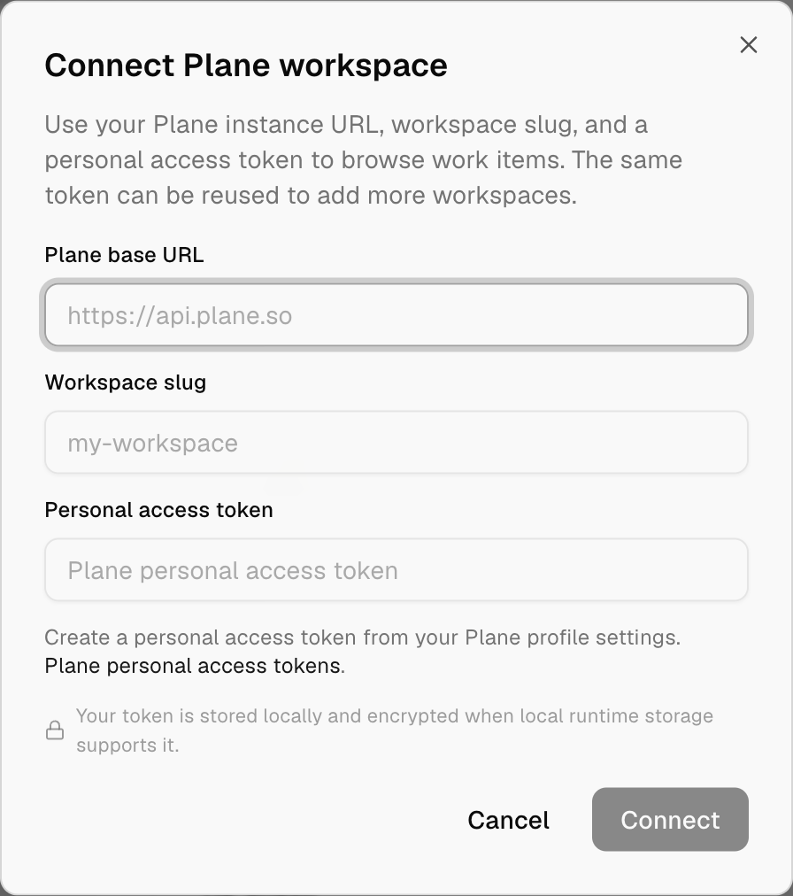

# Trackers and tasks

Orca Lab reads your tickets from GitHub, GitLab, Linear, Jira and Plane. The **Tasks** page lists
them, a click starts a workspace for one, and the same trackers fill the To Do that a lead hands
out to its members.

<figure class="orca-diagram" aria-label="From a tracker to an agent working on a ticket">
<ol class="orca-chain">
<li><strong>Connect</strong><span>each tracker once, in Settings</span></li>
<li><strong>Tasks</strong><span>every source in one page</span></li>
<li><strong>Start workspace</strong><span>the ticket linked to a new worktree</span></li>
<li><strong>To Do</strong><span>what a lead hands to its members</span></li>
</ol>
</figure>

## Connect a tracker

Open **Settings > Integrations**. **Review providers** holds GitHub and GitLab, which use the
`gh` and `glab` command-line tools: run `gh auth login` or `glab auth login` in a terminal, then
**Re-check**. **Task providers** holds the others:

| Tracker | Button                | What it asks for                                                                                         |
| ------- | --------------------- | -------------------------------------------------------------------------------------------------------- |
| Linear  | **Add Linear access** | A **Personal API key**, from Account > Security & Access in Linear.                                      |
| Jira    | **Connect Jira**      | **Atlassian Cloud**: site URL, **Atlassian email** and **API token**. **Self-hosted**: site URL and a personal access token, or username and password. |
| Plane   | **Connect Plane**     | **Plane base URL**, **Workspace slug** and a **Personal access token** from your Plane profile.          |

Tokens stay on your machine, encrypted where the system supports it. **Test** checks a connection,
and **Add workspace** or **Add Jira site** adds another.



## The Tasks page

Choose **Tasks** at the top of the sidebar. Pick a source in the picker at the top, then narrow the
list:

- **GitHub**: **Issues**, **PRs** and **Projects**, with presets such as **Assigned to me** and
  **Needs review**.
- **GitLab**: **Issues**, **MRs** and **My Todos**.
- **Linear**: **Issues**, **Projects**, **Views** and **Has Workspace**.
- **Jira**: **Assigned**, **Reported**, **All Open** and **Done**, or any JQL query in the search
  field.
- **Plane**: **All**, **Assigned**, **Created**, **All Open** and **Done**, as a **List** or a
  **Board**.

The sidebar's **Tasks** entry also has a shortcut to each source. To drop a tracker you don't
use, open **Settings > Task Sources**, choose its card and **Hide** it under **Show in Tasks**.

## Start a workspace from a ticket

Choose **Start workspace** on a ticket (**Start** for a GitHub issue or pull request, **Resume** if
it already has one). Orca Lab opens the new workspace dialog with the ticket linked, and the new
worktree's row carries the ticket from then on.

You can also paste a ticket's URL straight into the name field of the new workspace dialog: a
GitHub or GitLab issue, a Linear issue or a Jira issue.

The agent starts with the ticket's link in its input, as a draft for you to finish and send. For
Linear and Plane, **Settings > Task Sources > Launch prompt template** sets that text with
`{{identifier}}` and `{{url}}`. The ticket's own text is never copied in; the agent reads it
through its link.

## The To Do for a team

When a lead runs the project, **+ > Add member…** lists the To Do: open tickets from the
project's trackers that no member holds yet. It merges the tracker named in the project's
`orca.yaml`, the linked Plane project, the workspace's own Jira or Linear ticket and the
repository's GitHub or GitLab issues, up to 30 tickets.

```yaml
orchestratorGame:
  todo:
    provider: jira # plane, jira, linear, github or gitlab
    project: LUM
```

`todo: off` turns the To Do off. [Agent Teams](../agents/agent-teams.md) covers the rest of
`orca.yaml`.

## Link a ticket by hand

Right-click a worktree in the sidebar and choose **Update**. In **Edit Worktree Details**, enter an
issue number or a GitHub or Linear URL under **Issue**, or a pull request under its own field.
Leave a field blank to remove the link.
