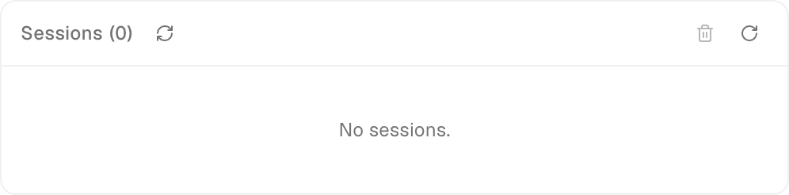

# Settings and troubleshooting

Orca Lab keeps settings in three places, and most problems show a message that says what to do.
This page maps both: where a setting lives, and what to do when a login, an account limit, a member
or a check gets in the way.

## Three layers of settings

<figure class="orca-diagram" aria-label="Where settings live, from every project to one project's committed file">
<ol class="orca-chain">
<li><strong>Global Settings</strong>this machine, every project</li>
<li><strong>Project Settings</strong>this machine, one project</li>
<li><strong>orca.yaml</strong>committed in the repo, shared with everyone</li>
</ol>
</figure>

- **Global Settings**: the Settings page, grouped as **AI Capabilities**, **Set Up**, **Workflows**,
  **Interface**, **Remote Hosts**, **Privacy & Security**, **Advanced** and **Experimental**.
  **Search settings** at the top finds any of them.
- **Project Settings**: open the project's menu in the sidebar (**Project actions**) and choose
  **Project Settings**, or the gear in its Team panel. It holds the project's name and icon,
  **Agent Teams game**, **Available Hosts**, **Worktree Hooks** (**Setup Script**, **Archive
  Script**, **When to Run Setup**), **Source Control AI**, **Worktree Shared Paths**, **Sparse
  Checkout Presets** and **MCP Configs**.
- **`orca.yaml`** at the repo's root: `scripts` (`setup`, `archive`), `issueCommand`, `defaultTabs`,
  `environmentRecipes`, `worktree.sharedDirectories` and `orchestratorGame`.

When two layers set the same thing:

- **Setup and archive scripts**: **Worktree Hooks > Advanced > Command Source** decides:
  **orca.yaml only**, **Local only** or **Run both** (orca.yaml first, then yours).
- **The game panel**: global Settings, then `orca.yaml`, then the project's Settings on this
  machine; the later one wins. [Scenes, styles and settings](agents/scenes-and-settings.md#which-setting-wins)
  has the detail.
- **Committed scripts ask first.** The first time a script from `orca.yaml` would run, or after it
  changes, Orca Lab asks **Run hooks** or **Don't run**; **Always trust `orca.yaml`** skips the
  question for that repo.

## An agent's login expired

**Settings > AI Provider Accounts** marks the account **Sign-in expired — re-authenticate this
account**. Choose **Re-authenticate**, or **Check sign-in** to test it first. A token account that
was rejected says to run `claude setup-token` again. A member signed out reads **Logged out** on its
card: sign in again with `/login` in its terminal, or ask the lead to move its ticket to another
account.

## An account hit its limit

The status bar shows **Limited**, the account picker **Limit reached**, and a member card **Usage
limit reached**. With **Auto-switch Limited Agents** on (in **AI Provider Accounts**), a live Claude
or Codex session moves to another account and resumes there. By hand:

- `orca account switch --to <account>` switches a terminal's account.
- `orca game move <ticket> --account auto` moves a member to an account with room.

When every account is near its limit, a launch says when the first one is usable again.

## A member does not start

| What it says | What to do |
| --- | --- |
| `N of M members are running, the lead's cap` | Wait for one to finish, or close one. |
| `<host> at cap … launch <ticket> with --on <other>` | Launch it on the host with room, as it suggests. |
| `<ticket> already has a live agent in …` | Stop that agent first, or keep working with it. |
| `<ticket> is paused …` | `orca game resume-members <ticket>` resumes it; `--discard` frees it. |
| **Queued** on its card | Its worktree waits for another setup; it starts by itself. |
| **Failed to start**, `Setup failed; skipping agent startup.` | Fix the project's **Setup Script**, then launch again. |
| `Not the lead: …` | Run `/orca-game:lead` in a **Claude Agent Teams** tab of the project. |

`orca game fleet`, from the lead's terminal, lists every member with what it waits for and the
command that fixes it. A Claude older than 2.1.287 starts without the game; update Claude Code.

## Reading CI

- **The sidebar** colours a pull request's icon: passing, pending, failing.
- **Checks** lists each check (**Successful**, **Failed**, **In progress**, **Queued**…) and the
  merge button names what blocks it (see [One agent to a merged PR](one-agent.md#merge-it)).
- **The Team panel's PRs** tab shows **Check failed** or **CI unknown**, and its merge queue **In
  checks**, **In queue** or **Failed**.
- **`orca game state --json`** gives a member `review.ci` (`pending`, `success`, `failure`,
  `neutral` or `none`) and `review.mergeState`. Only `clean` can merge: `behind` needs the branch
  updated, `dirty` has conflicts, `blocked` waits on a rule such as a review, and `unstable` has a
  check that is failing or waiting for approval.

## Other common ones

- **GitHub CLI is not authenticated**: run `gh auth login` in a terminal (`glab auth login` for
  GitLab), then **Re-check** in **Settings > Integrations**.
- **A terminal is stuck**: **Settings > Terminal > Manage Sessions** has **Restart daemon** and
  **Kill all sessions**; the status bar's resource menu has them too. Killing sessions ends the
  running processes.
- **An SSH host has no Node.js**: install Node.js 18 or newer with npm on the host, then reconnect.
- **A host says Update required**: update Orca Lab on the side that is older; see
  [Paired hosts and SSH](ssh.md).

## Diagnostics

**Settings > Privacy & Telemetry**, under **Send app diagnostics to support**, has **Create
diagnostic file**: review it with **Open review file**, then **Send to support** or **Discard**.
After a crash, **Help > Report Crash...** opens a report you can copy or file on GitHub. Logs live
in a `logs` folder inside Orca Lab's data folder.
