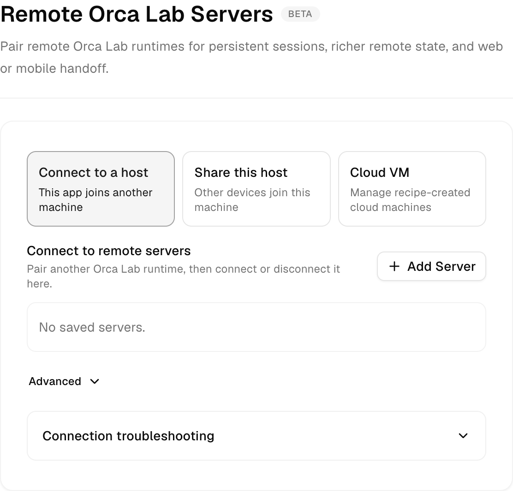

# Paired hosts and SSH

Orca Lab can run your work on another machine, so agents run next to the code or on a bigger box,
while this window stays the place you work from. There are two kinds of host: another machine
running Orca Lab, which you **pair**, and any machine you reach over **SSH**.

<figure class="orca-diagram" aria-label="From adding a host to running members on it">
<ol class="orca-chain">
<li><strong>Add a host</strong><span>pair an Orca Lab machine, or add an SSH host</span></li>
<li><strong>Add the project</strong><span>on that host, from the Host picker</span></li>
<li><strong>Run there</strong><span>workspaces, terminals and agents</span></li>
<li><strong>Members there</strong><span>a lead can launch on a paired host</span></li>
</ol>
</figure>

## Paired host or SSH host?

| | Paired Orca Lab host | SSH host |
| --- | --- | --- |
| What it is | Another computer running Orca Lab, or `orca serve` on a server | Any machine you can `ssh` into |
| What it runs | Projects, files, terminals, provider checks, its own agent accounts | Terminals, Git and files, through a small relay Orca Lab uploads |
| Members of a team | Yes, with `orca game launch --on` | No |
| Needs | Orca Lab on that machine | Node.js 18 or newer and npm |

## Pair another machine

On the machine you want to use as a host:

- **With a window**: open **Settings > Remote Orca Lab Servers**, choose **Share this host**, then
  **Advertise this app as a server** and **New Link**. Under **Where will this link be opened?**
  pick **Another device**, and choose **Generate Access Link**.
- **Without a window**: run `orca serve --pairing-address <reachable-host>`. It prints
  `Orca Lab server ready` and a `Pairing URL: orca://pair?code=…`. The
  [headless Linux server guide](../reference/headless-linux-server.md) covers running it as a
  service.

On this machine, open **Settings > Remote Orca Lab Servers**, choose **Connect to a host** and
**Add Server**, give it a **Name in Orca Lab**, paste the **Access link** and choose **Add host**.
The host shows **Connected**; **Update client** or **Update server** means one side needs a newer
Orca Lab.



## Add an SSH host

Open **Settings > SSH Hosts** and choose **Add Target**: a **Label**, the **Host or alias**, a
**Username**, a **Port** and an **Identity File** (empty uses ssh-agent). **Advanced** has a
**Proxy Command**, a **Jump Host** (ProxyJump) and how long terminals live after a disconnect.
**Import** adds every host in `~/.ssh/config` at once.

Orca Lab asks for a passphrase or password when the host needs one, and keeps it only in memory
for the session. The first connection uploads a small relay to `~/.orca-remote` on the host and
starts it over SSH; it needs Node.js 18 or newer and npm there, and build tools (make, a C++
compiler and python3) when it has to compile its terminal module. Linux, macOS and Windows hosts
work, on x64 and arm64.

Terminals on an SSH host keep running after a disconnect: by default until you reset them, or for
a time you set under **Advanced** with **Keep terminals alive until reset** off (from 60 seconds to
7 days).

## Work on a host

- **Add the project there**: in **Add a project**, pick the host in the **Host** picker. For an SSH
  host, choose **Open project on SSH host** and enter the **Host path**. The picker's
  **Add remote host** adds a host without going to Settings.
- **Workspaces**: with more than one host, the new workspace dialog has **Run on**. It lists each
  host, marks the ones where the project is not set up yet, and ends with **Add host**.
- **The sidebar** groups rows by host once two hosts have work, with **This computer** for yours.
  A host's menu has **Check connection**, **Disconnect** and **Remove host…**.

## Members on a paired host

A lead can start a member on a paired host:

```bash
orca game launch LUM-21 --on studio --repo name:lumen-app
```

`--on` takes the paired host's name and needs `--repo` to say which project. The member runs on
that host with that host's own agent accounts, while the lead stays on this machine. Its card
in the Team panel names the host, and **Machines** shows how many agents each host runs. Each host
takes as many members as its memory and cores allow; when one is full, the lead is told to launch
on another.

Agents on a host sign in with that host's own logins: sign in there, or add accounts on it with
`orca account add`.

## What is stored on your machine

Host settings are saved in Orca Lab's data file on your machine. Passwords and passphrases are not
saved.
